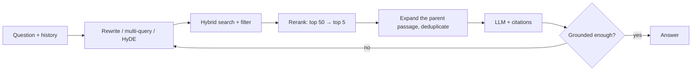

## 1. Core Concept

Basic RAG (chunk → embed → take top-K → hand to the LLM) usually only solves the bulk of easy questions; the rest needs advanced patterns that improve **the query, retrieval, context and evaluation**. The through-line: **RAG quality is mostly retrieval quality**, because the LLM can only use what you put in the context.

**Mental model:** RAG is **a librarian helping you write a report**: if the librarian finds the wrong book (a retrieval miss) or hands over the right book at the wrong page (a ranking miss), even a great writer writes wrongly. Advanced techniques are **training the librarian**: understand the question better, search in several ways, read more carefully before handing over books.

## 2. How It Works

**Query transformation → Understanding the question correctly**
- **Rewrite/condense**: turn a follow-up question ("what about the second one?") into a standalone question using history. **Multi-query**: generate several variants and merge the results with **RRF**. **HyDE**: generate a **hypothetical answer** and embed that to search (closer in meaning to the documents than the question). **Decomposition**: split a complex question into sub-questions.

**Retrieval → Several routes, then rescoring**
- **Hybrid search** (BM25 + vector), **metadata filters**, retrieve many (top 20–50) and then **rerank with a cross-encoder** to keep the top 5; **MMR** for diversity, avoiding passages with duplicate meaning.

**Advanced chunking → Balancing precision and context**
- **By structure** (headings, sections); **parent-document / small-to-big**: **search with small passages** (precise) and then **give the larger parent passage** (full context) to the LLM; **contextual chunks**: add a sentence describing the chunk's position/topic within the document before embedding so the chunk does not lose context.

**Graph RAG → Multi-entity/global questions**
- Extract **entities and relationships** into a graph (with per-cluster summaries) to answer questions needing **links across many documents** or **an overview of the whole store**; in exchange for **high indexing cost**.

**Agentic RAG → An agent controls retrieval**
- The agent **decides whether to retrieve, from which source, grades the results and rewrites the query and loops** (a `retrieve → grade → rewrite → retrieve` loop). More flexible but slower, token-hungry and harder to predict.

**Assembling context and answering**
- **Deduplicate, order, keep the token budget**, number sources for **citation**; an **"insufficient information"** policy when retrieval is empty; **filter access permissions at the retrieval step**.

**Evaluation → Two separate layers**
- **Retrieval**: **context recall/precision**, recall@K, MRR/nDCG on a **gold question set**. **Generation**: **faithfulness/groundedness**, answer relevance. Classify failures: **retrieval miss**, **ranking miss**, **context overload**, **the LLM ignoring the context**.

## 3. Visual Diagram

## 4. Rules of Thumb & Trade-offs

| Situation / Need | What to choose |
| --- | --- |
| Follow-up questions in a conversation | Query rewrite/condense |
| Exact keywords + semantics | Hybrid search |
| The top-K is not accurate enough | A reranker |
| Retrieved passages lack context | Parent-document / contextual chunks |
| Questions linking many entities, an overview | Graph RAG |
| Complex, multi-step questions | Agentic RAG |

- **What you gain:** higher accuracy and coverage. **What you lose:** each layer adds **latency, cost and complexity**; add one only when **you have measured** errors there.

## 5. Must Remember / Production Pitfalls

- **Adding many layers before measuring → complexity without improvement → measure recall/precision, fix the observed weak point**.
- **A chunk loses context (pronouns, tables, headings) → wrong retrieval → chunk by structure, contextual chunks, parent-document**.
- **The LLM fabricates when retrieval is empty → no refusal policy → answer "insufficient information" with citations and check faithfulness**.
- **Documents the user has no permission for are exposed → permissions were filtered at the answer step → filter at retrieval**.
- **Stale data → no reindexing/deleting old vectors → an update process keyed by source id**.
- Interview trap: "RAG is wrong, change the LLM?" → **check retrieval first**; "what does a parent-document retriever do?" → **search small, give large**; "when Graph/Agentic RAG?" → **multi-entity/multi-step questions, after measuring shows plain RAG is usually not enough**.

## 6. Search Hooks

- `HyDE hypothetical document embeddings` — generating a hypothetical document to search better.
- `parent document retriever small to big` — search small passages, give large ones.
- `Graph RAG` — retrieval based on a knowledge graph.
- `agentic RAG` — an agent controlling retrieval.
- `RAG evaluation faithfulness context recall` — RAG evaluation metrics.
