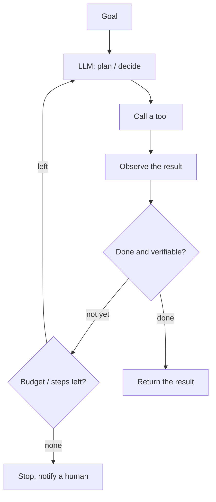

## 1. Core Concept

A **workflow** is a chain of steps decided by **code**, with LLM calls in a few places; an **agent** is a system where **the LLM itself decides the next step and which tool to use** in a loop until done. **Agentic AI** is a broad term for systems with that kind of autonomy. The key design question is not "can we use an agent" but **"do we truly need the LLM to decide the control flow"**.

**Mental model:** a workflow is **an assembly line with a fixed recipe**; an agent is **a problem-solving employee given a goal and a toolset** who decides what to do first. The employee is more flexible but harder to predict, costlier, and needs you to supervise and set limits.

## 2. How It Works

**The agent loop → Observe, decide, act**
- The **ReAct** pattern: the model **thinks** → **calls a tool** → **observes the result** → repeats, until it considers itself done or hits a limit. Each loop **resends the whole context**, so cost grows with the number of steps.

**Components of an agent**
- The **model**, **instructions (system prompt)**, **tools**, **memory/context**, **guardrails** and **stop conditions** (maximum steps, time, token budget). Missing stop conditions is the most serious mistake.

**Workflow patterns (simpler than agents)**
- **Prompt chaining** (a chain of steps with checks between), **routing** (classify then branch), **parallelization** (split up or vote in parallel), **orchestrator-workers** (an LLM divides work dynamically), **evaluator-optimizer** (one LLM generates, another scores, and they loop).

**Planning and self-checking**
- Write the **plan/task list** to a file or state and update it gradually; **verify results objectively** (run tests, validators) rather than trusting the model saying "done".

**Humans in the loop**
- **Human-in-the-loop** at risky steps (deleting data, spending money, sending outside): pause for approval. The level of autonomy should rise gradually with measured reliability.

**Observation and measurement**
- **Trace** every step (prompts, tools, tokens, latency, errors) and **eval** by completion rate, step count, cost. Without traces it is nearly impossible to debug.

**Compounding errors**
- The probability the whole chain is right ≈ the product of each step's probability: at **95%** per step, after **10 steps** only about **60%** remains (0.95¹⁰ ≈ 0.6).

```python
for step in range(MAX_STEPS):               # a hard stop condition
    reply = llm(messages, tools=TOOLS)
    if not reply.tool_calls:
        return reply.text
    for call in reply.tool_calls:
        messages.append(run_tool_safely(call))   # validate, sandbox, truncate the result
raise BudgetExceeded("out of steps")
```

## 3. Visual Diagram



## 4. Rules of Thumb & Trade-offs

| Situation / Need | What to choose |
| --- | --- |
| One simple task | A single good LLM call |
| A stable process, known steps | A code-controlled workflow |
| Unpredictable steps that can self-verify (coding, research) | An agent |
| High-risk work | Agent + human-in-the-loop + least privilege |
| A refund process with fixed steps | A workflow, the LLM only at language-understanding steps |

- **What you gain:** flexibility for open-ended, multi-step problems. **What you lose:** lower reliability, higher cost and latency, harder debugging; **start as simple as possible** and only then increase autonomy.

## 5. Must Remember / Production Pitfalls

- **An agent runs forever burning tokens → no stop condition → limit steps, time and budget, alert when exceeded**.
- **An agent gets stuck calling the same tool again → loops are not detected → detect repetition, give clearer error feedback, change strategy or hand to a human**.
- **An agent declares done but is wrong → no verifiable completion criteria → require verification with tests/validators**.
- **An agent with write/delete/spend permissions runs freely → large consequences when wrong → sandbox, least privilege, confirm sensitive actions**.
- **Cannot debug hard-to-reproduce errors → no traces → full per-step tracing and keep the trail**.
- Interview trap: "how does an agent differ from a workflow?" → **who decides the control flow: the LLM or code**; "95% right per step, 10 steps?" → **~60%**; "when to choose a workflow?" → **a stable process that needs reliability and easy debugging**.

## 6. Search Hooks

- `ReAct reasoning and acting agents` — the reasoning-and-acting loop pattern.
- `agentic workflows patterns routing parallelization` — workflow patterns using LLMs.
- `evaluator optimizer pattern` — a generate-and-score loop.
- `LLM agent planning reflection` — planning and self-checking.
- `human in the loop agents` — inserting human approval steps.
