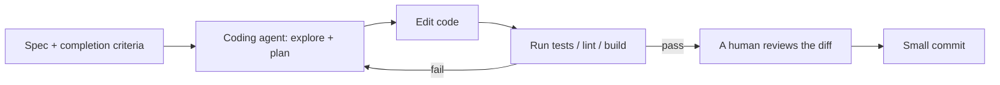

## 1. Core Concept

AI coding assistants come in three forms: **suggestions/chat in the IDE** (Copilot, Cursor), **agents running in the terminal** (Claude Code, Codex CLI, Gemini CLI, Aider) and **background agents in the cloud** that take a task and open a pull request. The value is not "writing code fast" but **the workflow**: you hand over a clear goal, the agent works, you **verify**. The person responsible for the code is still you.

**Mental model:** AI is **an extremely fast junior developer who never tires, is very confident and sometimes makes things up**. You do not "trust", you **set boundaries**: a clear spec, tests as the referee, diff review, limited permissions. The more automatic ways you have to verify, the more you can delegate.

## 2. How It Works

**The coding agent loop**
- **Explore** (read files, grep) → **plan** → **edit** → **run tests/lint/build** → **fix again** until they pass. The crux is the agent **can run verification itself** (tests, type checks, builds); without it, it only guesses.

**Project instructions → A contract with the agent**
- A file such as **`CLAUDE.md`** or **`AGENTS.md`** at the repo root holds **build/test/lint commands, code conventions, directory structure, boundaries** (which directories not to modify, no committing unless asked). Short, specific, containing no secrets.

**Extension mechanisms (Claude Code as an example)**
- **Skills** (a folder of instructions + scripts loaded when needed), **slash commands**, **hooks** (**deterministic** scripts that run on events such as before/after a tool use or on stop, ensuring something always happens, unlike a reminder in the prompt), **subagents** (isolated context), **MCP servers**, **plugins** (bundling the above).

**Permissions and safety**
- Modes that **ask for each command**, **plan mode** (plan and approve before editing), an **allowlist** of safe commands, a **sandbox**. Do not let the agent run arbitrary commands on a machine holding secrets.

**A good working process**
- Write a **short spec with completion criteria** → let the agent work → **it runs the tests itself** → you **review the diff** → **small commits**. For new features: ask it to **write a failing test first** (TDD style) and then implement.
- Use **git** and **worktrees** to isolate and roll back; run **several agents in parallel** on separate worktrees for independent jobs. Keep **sessions short**, use compaction/new sessions when context swells.

**Reviewing AI-generated code**
- Read the diff like a stranger colleague's code: check **logic, edge cases, security, performance**; watch for **nonexistent APIs/libraries** (including invented package names that attackers may register), **fake tests** (everything mocked, asserting nothing), **duplication, needless abstraction**.

```markdown
# AGENTS.md (example)
## Commands
- Build: `npm run build` · Test: `npm test` · Lint: `npm run lint`
## Conventions
- TypeScript strict, no `any`. Every public function has a test.
## Boundaries
- Do not modify `legacy/`. Do not commit unless asked.
```

## 3. Visual Diagram



## 4. Rules of Thumb & Trade-offs

| Situation / Need | What to choose |
| --- | --- |
| Quick suggestions while typing | An IDE assistant |
| Multi-step work, editing many files, running tests | A terminal agent |
| Independent work running in the background, the result is a PR | A cloud agent |
| Many independent jobs in parallel | A separate worktree per agent |
| Ensure something always happens (format, block dangerous commands) | Hooks, not just reminders |
| A major architectural change | You design it, delegate the execution |

- **What you gain:** speed, less repetitive work. **What you lose:** the risk of **technical debt** if you do not review, and a weaker understanding of your own code when you delegate too much; plausible but wrong code.

## 5. Must Remember / Production Pitfalls

- **Code calls a function/package that does not exist → hallucination → run the build/tests, check real libraries, verify before installing**.
- **Tests are "green" but protect nothing → AI-written tests mock everything → review test quality, prefer real behavior tests**.
- **The agent deletes data or leaks secrets → overly broad permissions → a sandbox, a command allowlist, secrets out of the agent's reach**.
- **The agent drifts after a long session → swollen context → short sessions, compaction, external notes, a clear `AGENTS.md`**.
- **Slop accumulates (duplicate, excess code) → only looking at "it runs" → review diffs, ask for refactoring, keep commits small**.
- Interview trap: "how do you trust AI-written code?" → **do not trust its confidence: tests, builds, diff review, small commits**; "the biggest quality lever?" → **give the agent a way to verify itself (tests/builds)**; "ensure something always runs" → **hooks**.

## 6. Search Hooks

- `AGENTS.md CLAUDE.md project instructions` — instruction files for coding agents.
- `Claude Code skills hooks subagents` — agent extension mechanisms.
- `AI pair programming workflow` — the workflow with a coding assistant.
- `git worktree parallel agents` — running many agents in parallel without collisions.
- `reviewing AI generated code` — how to review code written by AI.
