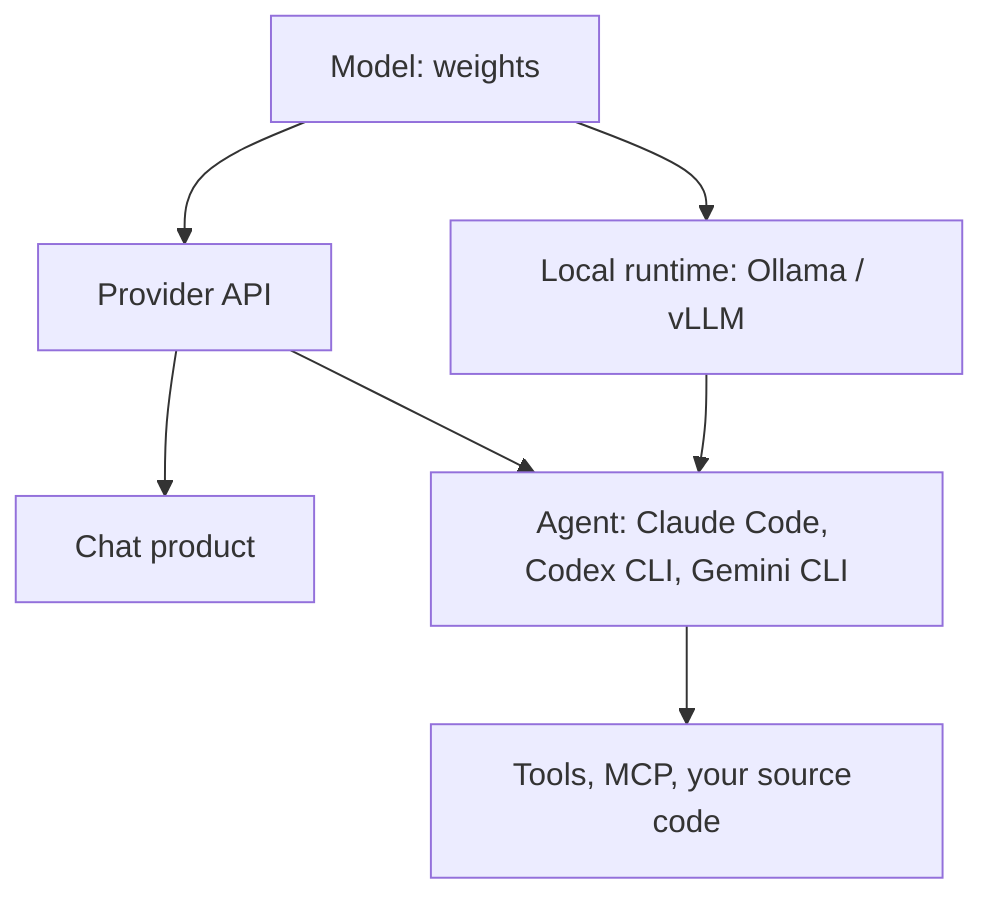

## 1. Core Concept

When people say "AI" in engineering work, they are lumping together **four different layers**: the **model** (a set of weights such as GPT, Claude, Gemini, Llama), the **runtime** (software that loads and runs a model such as Ollama, vLLM), the **agent/tool** (a program that uses a model to do work such as Claude Code, Codex CLI, Gemini CLI) and the **product** (the chat interface wrapped around it). Confusing the layers is the source of most pointless "which model is best" arguments and of wrong architecture decisions.

**Mental model:** the model is **the brain**, the runtime is **the body that supplies power and blood to the brain** (where it runs), the agent is **the hands with tools**, the product is **the face you talk to**. Swapping the brain does not require swapping the hands; running the same brain in the cloud or on a laptop is a matter of the runtime.

## 2. How It Works

**Frontier models (closed-weight, called through an API)**
- The **GPT** (OpenAI), **Claude** (Anthropic) and **Gemini** (Google) families run on the provider's infrastructure; you do not have the weights, you **pay per token** (input and output priced differently, usually per million tokens) and are subject to **rate limits**. They are also reachable through cloud platforms: Amazon Bedrock, Azure OpenAI/Foundry, Google Vertex AI.
- Each vendor usually has several **model sizes**: small-fast-cheap for simple tasks, large-strong-expensive for hard ones.

**Open-weight models (downloadable weights)**
- **Llama** (Meta), **Mistral**, **Qwen**, **DeepSeek**, **Gemma**… let you download and self-run, fine-tune and keep data inside your own infrastructure. **"Open-weight" does not mean "open source"**: licenses differ (some limit purpose or scale of use), so read them carefully before commercial use.

**Classification by model type**
- **Instruct/chat** (trained to follow instructions), **reasoning models** (spend extra "thinking" tokens before answering, stronger on multi-step problems but slower and costlier in tokens), **multimodal** (text + image + audio), **embedding models** (vectors for search/RAG), **image/video generation** (diffusion), **speech** (STT/TTS).

**Classification by usage**
- **Chat** (Q&A), **coding assistants** (IDE/CLI), **agents** (plan on their own and call tools), **automated workflows** (a fixed chain of steps calling an LLM). The same model can serve all four.

**Runtimes for local models**
- **Ollama** packages llama.cpp, downloads a model with one command and serves an **OpenAI-compatible API** on your machine; **vLLM** is for serving many users at high throughput. Ollama **is not a model**, it is just a runtime.

**Choosing a model: measure, do not guess**
- Public benchmarks do not reflect your task. The right way: build an **eval set** of 20–100 cases from real data, run several models and compare **quality, latency and cost**.

```python
# The same code, switching models only by configuration (OpenAI-compatible API)
from openai import OpenAI
client = OpenAI(base_url="http://localhost:11434/v1", api_key="ollama")  # local Ollama
reply = client.chat.completions.create(model="llama3",
    messages=[{"role": "user", "content": "Explain idempotent in 2 sentences"}])
```

## 3. Visual Diagram



## 4. Rules of Thumb & Trade-offs

| Situation / Need | What to choose |
| --- | --- |
| Highest quality, low operations | A frontier model via API |
| Sensitive data, offline, fixed cost | Self-hosted open-weight (Ollama/vLLM) |
| Simple tasks, high volume | A small model |
| Multi-step, hard reasoning | A reasoning model |
| Semantic search, RAG | An embedding model |
| Keep the ability to switch providers | Wrap behind an abstraction layer/gateway |

- **What you gain:** frontier gives quality; open-weight gives control of data and predictable cost. **What you lose:** frontier costs per token and depends on the provider; small local models are often far weaker at coding and long reasoning, and you carry the operations yourself.

## 5. Must Remember / Production Pitfalls

- **Choosing a model by rumor/general benchmarks → poor results on the real task → build your own eval set and compare directly**.
- **Locking tightly to one provider in code → hard to switch when price/quality/availability change → a thin abstraction or gateway, keep prompts/evals vendor-independent**.
- **Sending company data to an API without reading the policy → risk of leakage/training on the data → check retention terms, use an enterprise tier or self-host**.
- **Treating a small local model like a frontier one → unexpectedly low quality → test first with an eval, limit the tasks**.
- **Using a reasoning model for everything → slow and token-hungry → only for hard problems, a small model for easy ones (routing)**.
- Interview trap: "is Ollama a model?" → **no, it is a runtime**; "is open-weight the same as open source?" → **not necessarily, depends on the license**; "which model is best?" → **there is none, measure on your task**.

## 6. Search Hooks

- `open-weight vs closed-weight models` — the difference in weight access.
- `Ollama llama.cpp local LLM` — running a model on a personal machine.
- `reasoning models vs standard LLM` — multi-step reasoning models.
- `multimodal LLM` — models handling multiple kinds of data.
- `LLM model routing` — choosing a model by task difficulty.
