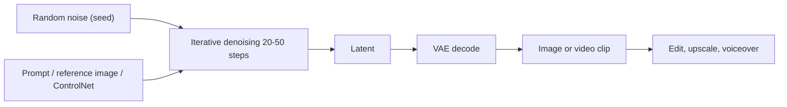

## 1. Core Concept

AI image and video generation mostly relies on **diffusion models**: they learn to **denoise** gradually, from random noise into an image matching a description. Video adds the **time** dimension so it must maintain **consistency between frames** — the hardest part. Unlike an LLM generating token after token, diffusion **iteratively refines the whole sample** over many steps.

**Mental model:** like **a sculptor starting from a block of noisy stone**, each pass chipping away a little noise following instructions (a prompt, reference images) until a form emerges. Video is **sculpting a whole film reel** so frames flow together, without characters "jumping".

## 2. How It Works

**Diffusion → Add noise and learn to reverse it**
- Training: add noise to images over many steps and teach the model to **predict the noise** to remove. Generation: start from **pure noise** and iterate **20–50 denoising steps** conditioned on inputs. The **seed** determines the initial noise (the same seed + parameters → the same result); the **guidance scale (CFG)** balances following the prompt against diversity.
- **Latent diffusion**: works in a **compressed space** (through a **VAE**) rather than pixels, which is much cheaper, then decodes to an image. Modern architectures often use a **Diffusion Transformer (DiT)** instead of a U-Net.

**Conditioning → Controlling the result**
- Text through a **text encoder**; also **reference images** (keeping a character/style), **pose/depth/edges** (**ControlNet**), **LoRA** (learning a particular style/character).

**Video → Adding time**
- Generate sequences of **spatiotemporal latents** (attention over both space and time). Challenges: **temporal consistency**, plausible physical motion, character identity, length (usually **a few seconds to a few tens of seconds** per clip) and **very high GPU cost**.
- Modes: **text-to-image, image-to-video, text-to-video, video-to-video**, inpainting/editing, upscaling, frame interpolation.

**The ecosystem (examples, changing very fast)**
- Services: **Sora, Veo, Runway, Kling, Midjourney**… Open source: **Stable Diffusion/FLUX**, open video models run through **ComfyUI** (a node-based pipeline), needing GPUs with lots of VRAM.

**A practical video workflow**
- **Script → storyboard → key frame images (keeping the character via references/LoRA) → image-to-video for each short scene → edit, upscale → voice/music (TTS, separately) → assemble**. Split into short scenes, each with **one idea** (subject, action, setting, camera movement, lighting, style).

```text
Scene prompt: "Close-up of a young engineer typing in an office at night, blue light,
slow dolly-in camera, cinematic style, 6 seconds." + a character reference image.
```

## 3. Visual Diagram



## 4. Rules of Thumb & Trade-offs

| Situation / Need | What to choose |
| --- | --- |
| Keep a character consistent across scenes | Reference images, seed, LoRA |
| Control layout/motion | ControlNet, image-to-video with first/last frames |
| Quick prototype, no GPU | A cloud service |
| A custom, private workflow | An open model + ComfyUI on your own GPU |
| Commercial content | Check licenses and terms of service |

- **What you gain:** fast, cheap visual content compared with manual production. **What you lose:** less precise control than hand editing, you must **generate many times and pick**, high GPU/subscription cost for long videos.

## 5. Must Remember / Production Pitfalls

- **A character/details change between scenes → each scene generated independently → use reference images, seed, LoRA, keep the descriptive prompt consistent**.
- **Text, hands, physics come out wrong → current model weaknesses → regenerate several times, post-edit, avoid scenes depending on those details**.
- **Legal risks (copyright, training data, real people's images, deepfakes) → misuse → read commercial terms, get permission for real people's images, label AI content/watermark per platform rules**.
- **The GPU bill grows fast → many tries at high resolution → try low resolution/short first, pick and then upscale**.
- **Expecting "one prompt makes the whole film" → it does not work → split into short scenes, one idea each, edit and assemble**.
- Interview trap: "how does diffusion differ from autoregressive?" → **iterative global denoising from noise vs sequential token generation**; "the main challenge of video?" → **temporal consistency**; "keeping a character consistent?" → **reference images/seed/LoRA**.

## 6. Search Hooks

- `latent diffusion models` — diffusion in a compressed space.
- `diffusion transformer DiT video generation` — the foundation architecture of many video models.
- `ControlNet image conditioning` — controlling image generation with pose, depth.
- `ComfyUI workflow` — building node-based image/video pipelines.
- `temporal consistency video generation` — keeping consistency between frames.
