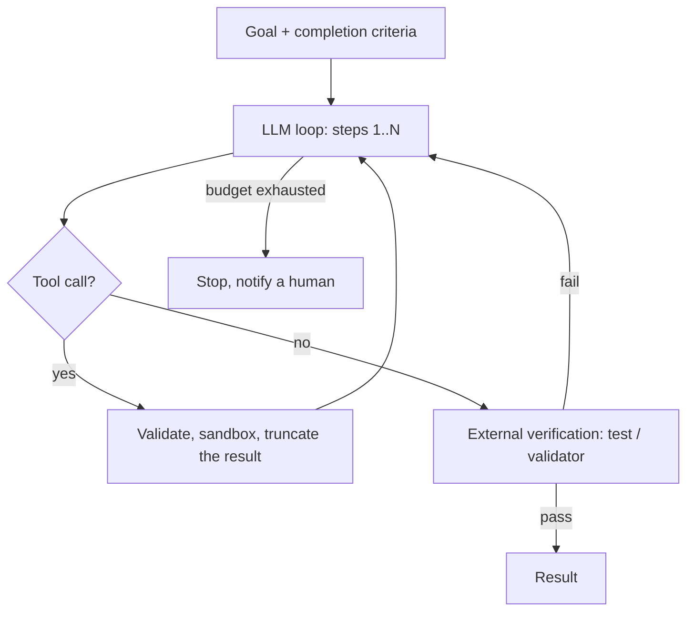

## 1. Core Concept

Building a real agent is mostly **ordinary software engineering** around an LLM loop: **defining tools, a bounded loop, managing context, verifying results, observing and measuring**. The "AI" part is smaller than you think; what decides success is **safety boundaries, stop conditions and evals**.

**Mental model:** an agent is **a `while` loop** that calls the model, executes tools and feeds results back. You are **the designer of the arena**: the toolset, the rules (step/budget/permission limits) and the referee (verification, tests) — not the one writing each move.

## 2. How It Works

**Step 0: Design before coding**
- Define the **goal**, **verifiable completion criteria**, **minimum tools**, the **budget** (steps, tokens, time), **permissions** and the points that **need human approval**. Start with **one agent and few tools**.

**A minimal loop**

```python
def run(goal, max_steps=20):
    msgs = [system(), user(goal)]
    seen = set()
    for step in range(max_steps):                    # a hard stop condition
        reply = llm(msgs, tools=TOOLS)
        if not reply.tool_calls:
            return reply.text                        # finish, with verification outside the loop
        for call in reply.tool_calls:
            key = (call.name, json.dumps(call.args, sort_keys=True))
            if key in seen:                          # detect repetition
                msgs.append(tool_error(call, "You already made this call. Change your approach."))
                continue
            seen.add(key)
            msgs.append(run_tool(call))              # validate → sandbox → truncate the result
    raise BudgetExceeded("out of steps")
```

**Tools → Engineering details**
- A **registry** (name, schema, function). **Validate parameters** against the schema before running; **return errors as clear text** so the model can correct itself; **truncate/paginate large results**; **timeouts** per tool; write operations **idempotent**, with **dry-run** and **confirmation** for dangerous actions; run code in a **sandbox** (a container, no network, resource limits).

**Context and planning**
- Summarize when long, clean old tool results; add tools to **write/read the plan (todo)** so the agent tracks progress; keep **checkpoints** so it can resume after failure.

**Verification and evaluation**
- **Do not trust the model saying "done"**: run tests/validators/compare with expectations. Build a **sample task set** measuring **completion rate, step count, tokens, cost, latency**; rerun when the prompt/model/tools change. Test logic with **recorded (record/replay)** responses for stability.

**Observability**
- **Trace each step** (prompt, tool call, result, tokens, latency, errors) — standardized (for example OpenTelemetry) — for debugging and cost accounting.

**Framework or build it yourself**
- A framework (LangGraph, OpenAI Agents SDK…) helps with tracing, checkpoints, handoffs; writing your own helps you understand and control. Whichever you pick, keep **the tool layer and evals framework-independent**.

## 3. Visual Diagram



## 4. Rules of Thumb & Trade-offs

| Situation / Need | What to choose |
| --- | --- |
| Getting started | One agent, few tools, a small eval |
| Tools with side effects | Dry-run, confirmation, idempotent |
| Running model-generated code | A sandbox, no network, timeout |
| Long sessions | Checkpoint + compaction |
| Need debugging/cost measurement | Per-step tracing |
| Need handoff/multi-agent | A framework or a self-built orchestrator |

- **What you gain:** automating multi-step work, flexibility. **What you lose:** lower reliability than workflows, higher cost/latency; you need to invest in evals and safety.

## 5. Must Remember / Production Pitfalls

- **The loop does not stop → burning money → `max_steps`, token/time budgets, alert when exceeded**.
- **A tool returns huge data and overflows the context → no truncation → paginate/summarize, cap the size**.
- **The agent declares done but is wrong → trusting the model's word → require verification with tests/validators**.
- **Running model-generated commands/code on a real machine → risk of data loss/secret leakage → a sandbox, allowlist, least privilege**.
- **Cannot debug rare errors → no tracing → full tracing, save failed sessions to reproduce**.
- Interview trap: "the agent is stuck repeating the same tool call?" → **detect repetition, give clear error feedback, change strategy or hand to a human**; "the mandatory element?" → **a step/budget limit**; "what should a failing tool return?" → **a text message so the model can correct itself**.

## 6. Search Hooks

- `building effective agents` — guidance for simple, effective agent design.
- `agent observability tracing` — tracing each step of an agent.
- `LLM agent sandbox code execution` — running code safely.
- `agent evals task success rate` — measuring agents with a task set.
- `OpenAI Agents SDK vs LangGraph` — orchestration frameworks.
