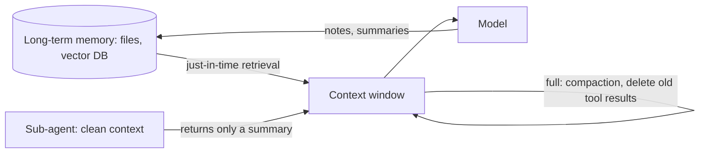

## 1. Core Concept

A model only "remembers" what is inside the **context window** of the current call; everything else is **external memory** you must reload yourself. **Context engineering** is choosing **the right information, at the right time, in the right place** to put into the context at each step, because context is **expensive** (billed per token), **slow** (latency grows with length) and **can lower quality** when it is too long and noisy.

**Mental model:** context is **small, expensive RAM**, long-term memory is **a large, cheap disk**. Your job is like an operating system's: **page** the right data into RAM when needed, push old data out to disk as summaries, and never try to cram the whole disk into RAM.

## 2. How It Works

**The context window → Limits and cost**
- Context consists of the system prompt, tool definitions, conversation history, retrieved documents and tool results. **Cost is proportional to tokens** and a multi-step agent **resends the whole context at each step**. Example: an agent running 100 steps with each tool result at 5,000 tokens → the history can reach **~500K tokens** if not cleaned up.
- Quality may fall when context is long and noisy: information in the middle is easily missed (**lost in the middle**), a phenomenon often called **context rot**.

**Short-term memory → Keeping the conversation lean**
- A **sliding window** (keeping only the last N turns) is cheap but loses the beginning; **summarization/compaction** summarizes old history, **keeping decisions, constraints, open TODOs, paths/file names**; **deleting old tool results** (keeping the conclusions) is the most effective cleanup.

**Long-term memory → Store externally and retrieve**
- Types: **episodic** (events that happened), **semantic** (facts/preferences), **procedural** (how-to, rules). Where to store: **files** (`CLAUDE.md`, `AGENTS.md`, `NOTES.md`), key-value, a **vector DB** (semantic retrieval, see RAG), a knowledge graph. You need a **write** policy (what to store, when), **read** policy (how to retrieve) and **forget** policy (TTL, deletion).

**Just-in-time retrieval → Keep references, load when needed**
- Instead of stuffing the whole repo/documents up front, keep **lightweight identifiers** (paths, ids, queries) and let the agent load content when needed (grep, read a file). It saves tokens and avoids noise.

**Sub-agents → Isolating context**
- Hand noisy tasks (searching, reading many files) to a sub-agent with a clean context; you only receive **a summary of a few hundred to a few thousand tokens** instead of the whole trail.

**Prompt caching → Cheaper and faster for repeated parts**
- The provider caches an **identical beginning (prefix)** of the prompt: later calls read it from the cache at much lower price and latency; the cache has a **short lifetime** if not reused. The optimal order: **tools + system → stable documents → history → the newest question**.

```python
# Structure so the prefix stays stable (cache hits), the changing part goes last
messages = [
  {"role": "system", "content": SYSTEM_PROMPT},        # stable
  {"role": "user", "content": f"<docs>{STABLE_DOCS}</docs>"},  # stable
  *history_compacted,                                   # summarized
  {"role": "user", "content": new_question},            # changes last
]
```

## 3. Visual Diagram



## 4. Rules of Thumb & Trade-offs

| Situation / Need | What to choose |
| --- | --- |
| A long conversation makes the agent drift from its goal | Compaction + pin key instructions + external notes |
| Noisy tasks (searching, reading many files) | A sub-agent returning a summary |
| Large, changing knowledge | RAG / just-in-time retrieval |
| A prompt part repeated many times | Prompt caching (a stable prefix) |
| Priorities and rules that persist across sessions | An instruction file (CLAUDE.md/AGENTS.md) |

- **What you gain:** stable quality, low cost and latency. **What you lose:** summarization **loses detail**; long-term memory adds infrastructure and data risk; long context is costlier than retrieving the right passages.

## 5. Must Remember / Production Pitfalls

- **The agent forgets the original constraints after many steps → summarization dropped the constraints → pin core instructions at the start and reload them after compaction**.
- **Cost/latency creeps up step by step → raw tool results accumulate → trim/summarize tool results, delete old ones**.
- **Prompt caching does not reduce cost → the start of the prompt changes every time (timestamp, id) → move the dynamic part to the end, keep the prefix stable**.
- **Stuffing the whole codebase/documents into context → expensive and less accurate → retrieve exactly the needed part**.
- **Long-term memory is contaminated with wrong/malicious information (memory poisoning) → every later session is affected → control the write source, allow deletion, do not trust stored content absolutely**.
- Interview trap: "does a large context window replace RAG?" → **not completely**: cost, latency and accuracy when finding a needle in a haystack; "why is caching ineffective?" → **the prefix changes**.

## 6. Search Hooks

- `context engineering for agents` — choosing the information to put in context.
- `lost in the middle LLM` — information in the middle of context is easily missed.
- `prompt caching` — caching the start of the prompt to cut cost.
- `LLM agent memory episodic semantic procedural` — the kinds of agent memory.
- `conversation summarization compaction` — compressing history when context fills.
