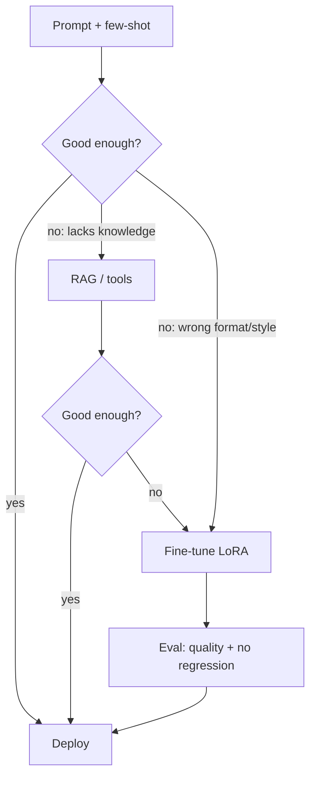

## 1. Core Concept

**Fine-tuning** is further training an existing model on your data to change its **behavior, style, output format or to master a narrow task** — it is **not** a good way to "teach new knowledge" (that belongs to RAG). **LoRA/QLoRA** do this cheaply by learning only a very small share of parameters. **Distillation** distills the capability of a large model into a small one to cut cost.

**Mental model:** prompts and RAG are **handing an employee documents and instructions before each shift** (changeable immediately, cheap, reversible); fine-tuning is **retraining the employee's working habits** (durable, fast at a narrow task, but laborious, hard to fix and unsuited to cramming information or to change).

## 2. How It Works

**Order of attempts → Fine-tuning is the last step**
- **A good prompt → few-shot → RAG → tools → fine-tune**. Fine-tune only after measuring that the problem lies in **behavior/format/stability** that prompting cannot solve, or when you need a **small model** (cheap, fast) doing a narrow job.

**SFT (Supervised Fine-Tuning)**
- Teach with **input → example output** pairs (chat JSONL format). **Quality matters more than quantity**: a few hundred to a few thousand clean, diverse examples are usually enough for a narrow task. Keep a **separate validation set** to detect overfitting; typically 1–3 epochs.

**LoRA → Learning low-rank matrices**
- Freeze the original weights `W` and learn two extra small matrices `A`,`B` so the update is `W + BA` with a **low rank `r`** (usually 8–64). Only about **0.1–1% of parameters** are trained, the **adapter is just tens of MB**, and it can be **swapped** or merged into the model. **QLoRA** adds quantizing the base model to 4-bit to fine-tune large models on small GPUs (for example a 7B model on a 24 GB GPU).

**Preference tuning → Learning what is "better"**
- **RLHF** uses a reward model; **DPO** learns directly from **(better, worse)** pairs, which is simpler. Used to adjust style, safety and instruction following.

**Distillation → Teacher teaches student**
- Use a large model (the teacher) to **generate data** (answers, reasons) for a specific task and then **SFT** a small model (the student). Result: a small model close to the teacher's quality on a narrow task at much lower cost/latency. Check the provider's terms of use when using outputs as training data.

**Evaluation and operations**
- Measure with **the task's eval** before and after; check **general capability/safety does not drop**. **Version the data and adapters**; when the base model is upgraded you must retrain.

```json
{"messages": [
  {"role": "system", "content": "You classify tickets. Return exactly one label."},
  {"role": "user", "content": "The app shows a 500 error at checkout"},
  {"role": "assistant", "content": "BUG_PAYMENT"}]}
```

## 3. Visual Diagram



## 4. Rules of Thumb & Trade-offs

| Situation / Need | What to choose |
| --- | --- |
| Frequently changing knowledge (company documents) | RAG |
| Stable format/tone for a narrow task | Fine-tune (SFT/LoRA) |
| Reduce cost/latency at large volume | Distill into a small model |
| Adjust style/safety by preference | DPO/preference tuning |
| Few GPUs | QLoRA |
| No eval set yet | Do not fine-tune yet |

- **What you gain:** stable quality on a narrow task, a cheap small model at run time. **What you lose:** the cost of preparing data, training, maintenance (retraining when the base model changes), the risk of losing general capability.

## 5. Must Remember / Production Pitfalls

- **Fine-tuning to make the model "remember company documents" → poor results, easy to hallucinate, changing data goes stale → use RAG for knowledge, fine-tuning for behavior**.
- **Losing general ability after training (catastrophic forgetting) → learning too aggressively on narrow data → a small learning rate/epochs, LoRA, mix in general data, measure regressions**.
- **The model learns errors/PII from the data → dirty, duplicated data → clean, deduplicate, mask PII before training**.
- **Not knowing if it improved → no eval or validation set → build the eval before training**.
- **The base model is upgraded and the old adapter is useless → a version coupling → version it and keep a retraining process**.
- Interview trap: "should you fine-tune so the model knows company data?" → **usually no, use RAG**; "what does LoRA train?" → **extra low-rank matrices, with the original weights frozen**; "the risk of over-fine-tuning?" → **catastrophic forgetting**.

## 6. Search Hooks

- `LoRA QLoRA PEFT` — parameter-efficient fine-tuning.
- `supervised fine-tuning SFT` — training with example pairs.
- `DPO direct preference optimization` — learning from preference pairs.
- `knowledge distillation LLM` — distilling a large model into a small one.
- `fine-tuning vs RAG` — when to use which.
