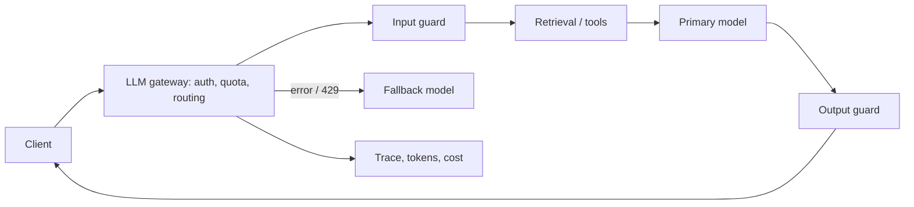

## 1. Core Concept

A production LLM application is not just "calling an API": it needs **an architecture layer around the model** consisting of **a gateway, routing, caching, guardrails, retrieval, observability and cost management**. The right mindset: **the LLM is an expensive, slow, non-deterministic dependency that can be attacked** — wrap it like any untrusted external service (timeouts, controlled retries, circuit breakers, fallbacks).

**Mental model:** the gateway is **a switchboard operator** standing between the application and the providers: checking who may call, how much quota remains, choosing a suitable provider, switching to a backup when one side is busy, and **logging** every call.

## 2. How It Works

**The LLM gateway → A single entry point**
- Every LLM call goes through the gateway: **authentication**, **quota/rate limits per user/team** (counting tokens), **routing** to a model/provider, **fallback** on errors or rate limits, **retry with backoff + jitter**, **timeouts**, **caching**, **logging (with PII masked)** and **cost accounting**. API keys live at the gateway, **never at the client**.

**Prompt management**
- A **prompt registry** with versions, separate from code and tied to **evals**; **canary/A/B** when changing prompts or models; a **quality gate** (evals must pass) before rollout.

**Routing and cost**
- **Routing/cascade**: small models for easy work, large for hard; **caching** (prompt caching, semantic cache); **batching** for non-urgent work.

**Retrieval, tools and guardrails**
- RAG and tools/MCP sit **behind an authorization layer**; an **input guard** (PII, injection) and **output guard** (schema, content) wrap the model; treat output as untrusted.

**Resilience**
- **Timeouts** at every step; capped **retries**; a **circuit breaker** when a provider fails; **degrade** (a simpler answer/cache/notice) instead of crashing; **asynchronous queues** for long tasks; **streaming** for the experience.

**Observability**
- **Per-request traces**: the prompt (with sensitive data masked), completion, tokens, latency, cost, model/prompt version; collect **user feedback** to improve; dashboards per feature/team.

**Multi-tenancy and data**
- Isolate data between customers, a **retention and deletion** policy for logs/data, regulatory compliance.

```python
async def call_llm(req, user):
    gate.check_quota(user, est_tokens(req))               # per-user quota
    for provider in route(req):                           # priority order + fallback
        try:
            return await with_timeout(provider.call(req), 30)
        except (RateLimit, Timeout):
            await backoff_with_jitter()
    return degraded_answer(req)                           # do not fully crash
```

## 3. Visual Diagram



## 4. Rules of Thumb & Trade-offs

| Situation / Need | What to choose |
| --- | --- |
| Many services calling the LLM | A central gateway |
| One user burns the budget | Per-user quota/rate limits |
| A widespread provider failure | Timeout + fallback + degrade |
| Changing the model/prompt safely | Canary + eval gate |
| Debugging and cost | Per-request tracing |
| Long tasks | An asynchronous queue |

- **What you gain:** control, safety, easy model swaps, good observability. **What you lose:** one more component to operate, an extra hop of latency and complexity.

## 5. Must Remember / Production Pitfalls

- **An API key leaks → it was placed in the client or repo → keep it at the gateway/server, rotate, least privilege**.
- **One user exhausts the budget → no quota → quotas/rate limits, spend alerts**.
- **The provider is a single point of failure → no fallback → multiple providers/backup models, a circuit breaker**.
- **Unlimited retries multiply cost → backoff with jitter, a capped number of attempts**.
- **Logs of prompts contain PII/secrets → data leakage → mask sensitive data, a retention policy**.
- Interview trap: "the LLM is slow/failing, what does the application do?" → **timeouts, controlled retries, a fallback model, degrade functionality**; "where does the API key live?" → **the server/gateway**; "why a gateway?" → **centralized control, easy model swaps, observability and cost**.

## 6. Search Hooks

- `LLM gateway` — the layer managing LLM calls.
- `LLM observability tracing cost` — tracking prompts, tokens, cost.
- `LLM fallback routing resilience` — tolerating provider failures.
- `prompt versioning management` — managing prompt versions.
- `semantic cache` — reusing similar answers.
