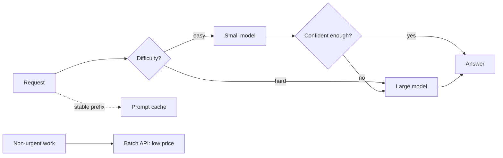

## 1. Core Concept

The cost and latency of an LLM application come mainly from the **token count** (input + output) and the **model size**. Optimizing means **cutting unnecessary tokens**, **picking a model that is just enough**, and **using caching, batching and streaming** — without letting quality drop. The principle: **measure first, optimize later**, and every optimization must come with an eval.

**Mental model:** you **pay per word** in and out, and **wait per word out** (the model "types" one token at a time). To be cheap and fast: **send fewer words, make it write shorter, use a cheaper writer for easy work**, and use **a cache** for repeated parts.

## 2. How It Works

**Price and latency → Two axes**
- **Price**: billed per **million tokens**, **output tokens usually cost several times more than input**. **Latency** = **TTFT** (time-to-first-token, depending on prompt length/prefill) + **output tokens × time per token** (decode, sequential). Long output is the main source of delay.

**Cutting tokens → Trim at the root**
- A lean prompt; **retrieve exactly the right passages** instead of stuffing whole documents (RAG); **summarize history**, clean old tool results; **limit `max_tokens`** and ask for short/structured output; control **reasoning tokens** (use reasoning models/high budgets only for hard problems).

**Model routing → The right model for the right job**
- **Cascade/router**: try a **small cheap model** first and only escalate to a large model when confidence is low or the task is hard. You need an **eval** to know where the small model is good enough.

**Prompt caching → Cheaper and faster for repeated prefixes**
- An identical beginning of the prompt is cached; later calls read it at a much lower price and lower TTFT. Example: a 3,000-token prompt where the first 2,500 tokens are cacheable; if a cache read costs ~10% of the input price (depending on the provider), the input cost drops by about **75%**.

**Batch API → Non-urgent work**
- Submit in bulk **asynchronously** (completing within hours) at a **lower price** (often about half); suited to document processing, labeling, offline evaluation.

**Streaming and parallelism**
- **Streaming** displays early so it **feels faster** even if the total time is the same; run independent calls **in parallel**; handle **rate limits** with retry using backoff + jitter.

**Semantic caching and fine-tuning**
- A **semantic cache** reuses answers for similar queries (you need a carefully chosen similarity threshold to avoid wrong answers); **distillation/fine-tuning** a small model for a narrow, high-volume task.

**Observability**
- Track **tokens, cost and latency per feature/user**; set **budgets and quotas**.

```python
resp = client.messages.create(
    model=SMALL_MODEL, max_tokens=300,           # cut output
    system=[{"type": "text", "text": BIG_STABLE_PROMPT,
             "cache_control": {"type": "ephemeral"}}],  # the stable prefix is cached
    messages=[{"role": "user", "content": question}])
```

## 3. Visual Diagram



## 4. Rules of Thumb & Trade-offs

| Situation / Need | What to choose |
| --- | --- |
| A long prompt repeated across turns | Prompt caching |
| Large volume, not urgent | Batch API |
| Many tasks mixing easy and hard | Model routing/cascade |
| Reduce perceived latency in chat | Streaming |
| Reduce real latency | Reduce output, a smaller model, caching |
| Very large volume, narrow task | Fine-tune/distill a small model |

- **What you gain:** the bill and latency drop significantly. **What you lose:** extra complexity (router, cache, evals), a risk of lower quality if you cut too hard.

## 5. Must Remember / Production Pitfalls

- **Prompt caching does not reduce cost → the start of the prompt changes every time (timestamp, id) → move the dynamic part to the end, keep the prefix stable**.
- **Agent cost multiplies with steps → resending the whole context each loop → set a budget, limit steps, clean old results**.
- **Quality drops after cutting context too aggressively → information was lost → redoing work costs more → measure with evals before cutting**.
- **Unlimited retries on rate limits → multiplied cost → backoff + jitter, a capped number of attempts**.
- **The bill rises unexpectedly → no per-feature limits/monitoring → quotas, alerts, per-request cost tracking**.
- Interview trap: "reducing chat latency?" → **streaming, reducing output, prompt caching, a smaller model**; "processing a million non-urgent documents?" → **Batch API**; "why is caching ineffective?" → **the prefix changes**.

## 6. Search Hooks

- `LLM prompt caching cost` — cutting the cost of repeated prefixes.
- `LLM model cascade routing` — escalating hard tasks to a stronger model.
- `batch API LLM` — cheap asynchronous processing.
- `time to first token TTFT` — latency to the first token.
- `semantic caching LLM` — reusing answers for similar queries.
