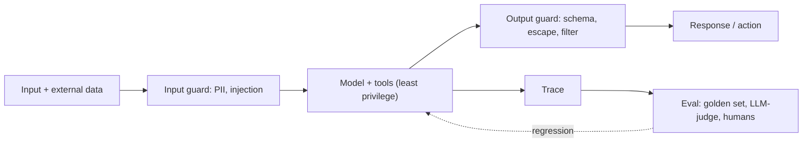

## 1. Core Concept

LLM applications are **non-deterministic** and easy to manipulate, so "trying it a few times and it looks fine" is not enough. You need three things: **evaluation** (measuring quality systematically with a test set), **guardrails** (controlling inputs/outputs) and **security design** against **prompt injection**. Without them you only know the system "seems good" until it breaks in production.

**Mental model:** evals are **unit tests for prompts and models**; guardrails are **validation at the system boundary**; prompt injection is **the SQL injection of the LLM era** — the root cause is the same: **mixing untrusted data with commands**, and there is no absolute block at the prompt layer, so you must limit damage at the architecture layer.

## 2. How It Works

**Evals → A test suite for behavior**
- A **golden set** of 20–200 real cases with inputs and expectations/criteria, taken from production logs and failure cases; add an **adversarial (red-team)** set. Rerun it **every time you change the prompt, model or tools**; because of randomness, run several times and look at the distribution.
- **Scoring**: **code-based** (exact match, regex, **schema validation**, running unit tests for code; cheap and solid), **LLM-as-judge** (scoring against a clear rubric; it has **biases**: favoring long answers, the first position, outputs resembling its own → swap order, use rubrics, **calibrate against human labels**), **human evaluation** on samples.
- **Metrics by application type**: RAG (separate **retrieval**: context precision/recall; **generation**: **faithfulness/groundedness**, answer relevance), agents (completion rate, step count, cost, tool-call correctness), code (**pass@k**), classification (precision/recall). **Online**: traces, user feedback, A/B.

**Prompt injection → The central threat**
- **Direct** (a user trying to override instructions) and **indirect** (malicious instructions inside web pages, emails, documents or tool results the model reads). **The dangerous combination:** private data + untrusted content + the ability to send data out.

**Layered defenses**
- **Separate data from instructions** (delimiter tags, roles), **least privilege** for tools, **human confirmation** for sensitive actions, **egress control** (a domain allowlist), a **sandbox**, and treat **LLM output as untrusted** (validate/escape before putting it into SQL, shell, HTML — avoiding XSS/SQLi/command injection). **The system prompt is not a secret.**
- **Guardrails**: schema validation, content filters, **PII** detection/masking, blocking secret leaks, rate limits and consumption caps (against cost-based DoS).

**Reference**
- **OWASP Top 10 for LLM Applications**: prompt injection, sensitive information disclosure, supply chain, data poisoning, improper output handling, **excessive agency**, system prompt leakage, vector/embedding weaknesses, misinformation, unbounded consumption.

```python
def check(case, output):
    parsed = json.loads(output)                  # code-based: schema
    assert set(parsed) == {"issue", "severity"}  # the right keys
    return grader_llm(rubric, case.input, output)  # the LLM judge scores the subjective part
```

## 3. Visual Diagram



## 4. Rules of Thumb & Trade-offs

| Situation / Need | What to choose |
| --- | --- |
| Scoring output with a clear answer | Code-based (schema, tests, regex) |
| Scoring subjective quality at scale | LLM-as-judge + human calibration |
| Measuring RAG quality | Measure retrieval and generation separately |
| An agent with write/send-data permissions | Least privilege + confirmation + an egress allowlist |
| Changing the model/prompt | Rerun the eval set |
| Harmful content, PII | Input/output filters |

- **What you gain:** seeing regressions early, lower security risk. **What you lose:** effort to build the eval set, added latency and cost for the checking layer; **no measure blocks** prompt injection absolutely.

## 5. Must Remember / Production Pitfalls

- **Trusting the model to refuse malicious instructions → manipulated through external content → assume it can be fooled, limit permissions and confirm sensitive actions**.
- **Feeding LLM output straight into SQL/shell/HTML → classic injection → validate, parameterize, escape**.
- **A biased LLM-as-judge → untrustworthy scores → a clear rubric, swap order, calibrate against humans**.
- **Changing models without running evals → silent regression → make running evals in CI mandatory**.
- **Relying on public benchmarks → they do not reflect your task → your own eval set from real data**.
- Interview trap: "a good design against prompt injection?" → **assume the model can be fooled and limit damage with least privilege**; "measuring RAG quality?" → **separate retrieval and generation**; "the risk of LLM-as-judge?" → **bias toward length/its own output**.

## 6. Search Hooks

- `LLM evals LLM-as-judge` — scoring output with another model.
- `prompt injection indirect` — malicious instructions hidden in external data.
- `OWASP Top 10 for LLM applications` — the list of security risks for LLM applications.
- `RAG evaluation groundedness` — measuring how grounded answers are.
- `LLM guardrails` — controlling the model's inputs and outputs.
