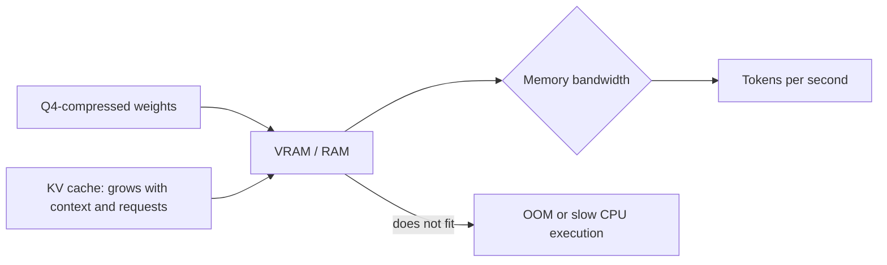

## 1. Core Concept

Self-hosting an LLM with **Ollama, llama.cpp or vLLM** is really a problem of **memory and memory bandwidth**: all the weights must fit in **VRAM/RAM**, and token generation speed is bounded by reading the weights at each step. **Quantization** compresses weights to fewer bits to fit small hardware, at the cost of some quality.

**Mental model:** the model is **a giant dictionary** you must **flip through entirely** for every word generated. Compressing the pages (quantization) makes the book thinner so it fits in a pocket and flips faster; a long context is **a notepad** (the KV cache) that you carry and that swells with the length of the conversation.

## 2. How It Works

**Estimating memory → Weights and the KV cache**
- Weights ≈ **parameter count × bytes per parameter**: 7B at **FP16** (2 bytes) ≈ **14 GB**; **4-bit** ≈ **3.5–4.5 GB**; 70B at 4-bit ≈ **35–42 GB**.
- The **KV cache** (attention keys/values of already processed tokens) grows **linearly with context length and the number of concurrent requests**. Example estimate for a multi-head FP16 7B model: about **0.5 MB per token** → an 8,000-token context ≈ **4 GB per sequence**; **GQA** (grouped-query attention) reduces this several-fold.

**Quantization → Compressing weights**
- **GGUF** (the llama.cpp/Ollama format, runs on CPU+GPU) with levels such as `Q8_0` (almost lossless), **`Q4_K_M`** (a popular balance), `Q2`/`Q3` (clear quality loss). **safetensors/AWQ/GPTQ** are used for vLLM and GPUs. Quantization affects **reasoning and code** more heavily than ordinary conversation.

**Token generation speed → The bandwidth limit**
- Every generated token must read nearly **all the weights**, so the maximum speed ≈ **memory bandwidth ÷ model size**. For example a 400 GB/s GPU with a 4 GB model has a theoretical ceiling of ~100 tokens/s; reality is lower. Quantization is faster not just because it is smaller but because it **reads fewer bytes**.

**Runtimes → Ollama and vLLM**
- **Ollama**: `ollama pull/run`, serves an API on port **11434** (with an OpenAI-compatible endpoint), a **Modelfile** sets the system prompt and parameters (`num_ctx`, `temperature`); the **default context is small**, so raise `num_ctx` deliberately. It automatically **offloads** some layers to the GPU while the rest run on the CPU.
- **vLLM**: a production server with **PagedAttention** (KV cache managed in pages, little waste) and **continuous batching** (continuously merging requests) for high throughput with many users.

```bash
ollama pull llama3
ollama run llama3 "Explain idempotent in 2 sentences"
cat > Modelfile <<'EOF2'
FROM llama3
PARAMETER num_ctx 8192
SYSTEM "You are a technical assistant, answer concisely."
EOF2
ollama create tech-helper -f Modelfile
```

## 3. Visual Diagram



## 4. Rules of Thumb & Trade-offs

| Situation / Need | What to choose |
| --- | --- |
| A personal dev, laptop, experiments | Ollama/llama.cpp, Q4 |
| Serving many users, high throughput | vLLM (continuous batching) |
| Small hardware, must fit in memory | Q4 quantization or lower |
| Need near-original quality | Q8 or FP16 if VRAM allows |
| A very long context | Budget for the KV cache, consider GQA/smaller batches |

- **What you gain:** data stays in your infrastructure, fixed cost. **What you lose:** self-operation, no SLA/safety like a commercial service, quality usually lower than frontier; **size/speed** trade off against **quality** when compressing.

## 5. Must Remember / Production Pitfalls

- **A model runs at a short context but OOMs at a long one → only the weights were counted and the KV cache forgotten → budget the KV cache as context × concurrent requests, reduce `num_ctx`/batch**.
- **A model "fits RAM" but runs extremely slowly → it does not fit VRAM so it runs on CPU/partially offloaded → pick a smaller quantization or a smaller model to fit VRAM**.
- **Code/reasoning quality drops after heavy compression → Q2/Q3 lose accuracy → use Q4–Q8 for hard tasks and measure with evals**.
- **Speed does not rise despite a stronger GPU → memory bandwidth is the limit rather than FLOPS → consider bandwidth, quantization, batching**.
- **Serving many people with Ollama on a laptop → congestion and instability → vLLM/dedicated infrastructure with batching**.
- Interview trap: "why is token generation slow despite a strong GPU?" → limited by **memory bandwidth** (reading all the weights per token); "how much memory does 7B FP16 need?" → **~14 GB for weights, not counting the KV cache**.

## 6. Search Hooks

- `LLM quantization GGUF Q4_K_M` — compressing weights to run on small hardware.
- `KV cache memory` — attention memory that grows with context.
- `vLLM PagedAttention continuous batching` — high-throughput LLM serving.
- `Ollama Modelfile` — configuring a local model.
- `LLM inference memory bandwidth bound` — why decoding is memory-limited.
