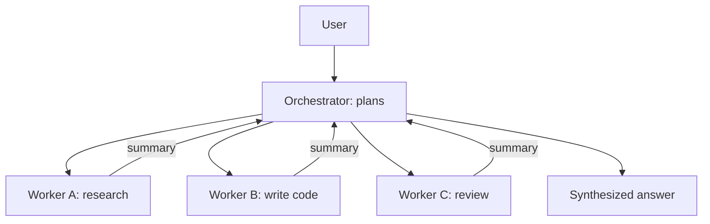

## 1. Core Concept

**Multi-agent** is a system of several specialized agents coordinating through an **orchestrator**. The right reason to use it is **not "more AIs to look impressive"** but two concrete benefits: **splitting context** (each agent has a clean context, its own prompt and tools, not polluted by other agents' work) and **running in parallel** (a broad task is handled all at once). The price is **much higher token cost** and more complex coordination.

**Mental model:** like **a project team**: the lead (the orchestrator) divides the work, gives each member (a worker) a clear brief to work independently in their own room, then **collects summary reports** and synthesizes them. The team is effective when the work **can be split apart**, ineffective when everyone has to keep editing one shared document.

## 2. How It Works

**Orchestration patterns**
- **Orchestrator-worker (supervisor)**: the main agent decomposes the task, assigns **sub-agents** and synthesizes results. The most common, suited to broad work (research across many sources).
- **Handoff/routing**: an agent passes control to another specialized agent (for example the OpenAI Agents SDK).
- **Pipeline** (sequential: research → write → review) and **parallel fan-out/fan-in** (many agents work at once and then merge).
- **Critic/debate**: one agent produces, another critiques or scores (evaluator-optimizer in multi-agent form).

**Communication and context management**
- Pass **structured messages** or **references** (file paths, ids) instead of pasting contents; use **shared state/a blackboard** or files as the common channel. A sub-agent returns only **a concise summary** so the orchestrator keeps its context small.
- The delegation prompt for a worker must state **the goal, output format, allowed tools, boundaries** and expected level of effort, otherwise the worker will duplicate work or drift.

**Frameworks and protocols**
- **LangGraph** (state graphs, checkpoints), **AutoGen**, **CrewAI** (roles/tasks), the **OpenAI Agents SDK** (handoffs, guardrails, tracing), sub-agents in **Claude Code/the Agent SDK**. Protocols: **MCP** (agent ↔ tool) and **A2A** (agent ↔ agent across different systems).

**Model coordination**
- Use **a strong model as the orchestrator** (planning, synthesis) and **small cheap models as workers** for simple, parallel work.

**Cost**
- Each agent has its own context and many calls, so total tokens are **many times** a single agent's (one report on a multi-agent research system cited roughly **15×** the tokens of an ordinary chat); it only pays off when the task value is high enough.

```python
plan = orchestrator.plan(goal)                       # split into independent tasks
results = await asyncio.gather(*[
    run_worker(task) for task in plan.tasks          # in parallel, separate context
])
summary = orchestrator.synthesize(goal, [r.summary for r in results])  # receives only summaries
```

## 3. Visual Diagram



## 4. Rules of Thumb & Trade-offs

| Situation / Need | What to choose |
| --- | --- |
| Broad work that can be split and parallelized | Orchestrator-worker |
| Handing off by expertise within a conversation flow | Handoff |
| Clearly sequential stages | Pipeline |
| Need quality critique | Critic/evaluator |
| Small or tightly coupled work | A single agent |
| Agent ↔ tool | MCP |
| Agent ↔ an agent in another system | A2A |

- **What you gain:** clean context, parallelism, specialization. **What you lose:** many times the token cost, coordination latency, harder debugging, errors propagating between agents.

## 5. Must Remember / Production Pitfalls

- **Two agents edit the same file/resource → overwrites, conflicts → partition resources, one worktree/branch per agent, or serialize**.
- **The token bill exceeds expectations → many agents × many calls → set a budget per agent, limit depth/agent count, use small models for workers**.
- **The synthesized result is wrong because detail was lost → sub-agents summarized too aggressively → require an output format with evidence/sources, let the orchestrator ask back**.
- **Work is handed back and forth endlessly → no depth limit → cap rounds, add stop conditions**.
- **One agent's error spreads through the system → no end-to-end tracing → consistent trace/IDs and end-to-end evaluation**.
- Interview trap: "when should you NOT use multi-agent?" → **a small task, tightly coupled, or when cost/latency matter more than coverage**; "the main reason to use it?" → **clean context split and parallelization**.

## 6. Search Hooks

- `orchestrator-worker pattern LLM` — the main agent delegating to sub-agents.
- `multi-agent systems LangGraph AutoGen CrewAI` — popular frameworks.
- `Agent2Agent A2A protocol` — a protocol for agents to talk to agents.
- `agent handoffs OpenAI Agents SDK` — passing control between agents.
- `subagents context isolation` — using sub-agents to keep context clean.
