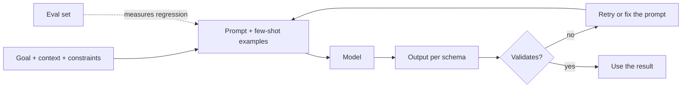

## 1. Core Concept

**Prompt engineering** is designing the input so a model produces results that are **correct, stable and verifiable**. For engineers it is like writing a **specification**: clearly state the goal, context, constraints, examples and output format. Its real value lies in being **measurable** (evals), not in "magic spells".

**Mental model:** the model is **a very capable colleague who knows nothing about your project** and cannot ask back. The prompt is **a briefing**: with missing context it guesses, with contradictions it picks arbitrarily, with an ambiguous format it answers in its own style.

## 2. How It Works

**A good prompt structure → Five parts**
- **Role/goal → context → constraints → examples → output format.** More specific does **not** mean longer: add context and **success criteria**, drop flowery language. State what "not to do" and allow an **"I don't know"** answer to reduce fabrication.
- **Position**: placing long documents **first** and the question/instructions **last** usually gives better results.

**Separate data from instructions**
- Use tags like `<document>…</document>` or XML/Markdown so the model does not confuse data content with commands (also reducing prompt injection at a basic level).

**Few-shot → Examples that steer**
- 2–5 input/output examples showing **the right format and edge cases**. Beware: examples that are too similar make the model **imitate too closely**; diversify them.

**Structured output → Machine-readable output**
- Use the API's **structured output/JSON schema/tool schema** features (forcing the output to a schema), then **validate** and **retry** on failure. Just writing "please return JSON" is not enough for production.

**Reasoning and decomposition**
- **Chain-of-thought**: give the model room to think on multi-step problems (reasoning models do this internally). **Prompt chaining**: split a large task into small calls and check each step.

**System vs user prompt and parameters**
- The **system prompt** sets the role and fixed rules; the **user prompt** is the specific request. A low **`temperature`** for tasks needing stability/reproducibility, high for creativity.

**Measure and iterate**
- Treat prompts like code: **version them** and keep an **eval set** (inputs + expectations) to see regressions when you change the prompt or upgrade the model.

```text
You are a reviewer. Report only real bugs, ignore style.
<diff>…</diff>
Return JSON: [{"file","line","issue","severity"}]. If there are no bugs, return [].
```

## 3. Visual Diagram



## 4. Rules of Thumb & Trade-offs

| Situation / Need | What to choose |
| --- | --- |
| Need machine-readable output | Structured output + validate + retry |
| Need the right format/style | Diverse few-shot examples |
| Multi-step problems | Chain-of-thought or a reasoning model |
| Large, multi-stage tasks | Prompt chaining |
| Need stability, reproducibility | A low temperature |
| Changing model/prompt safely | An eval set |

- **What you gain:** quality and stability rise significantly at low cost. **What you lose:** long prompts cost tokens and latency; examples make the model rigid; a finely tuned prompt breaks easily when the model changes.

## 5. Must Remember / Production Pitfalls

- **JSON output breaks in production → only politely asking "return JSON" → a schema/structured output + validate + retry**.
- **Results change after a model upgrade → the old prompt was tuned for the old model → rerun the eval set, adjust**.
- **The model follows commands inside user data → data and instructions are not separated → use delimiter tags, limit tool permissions, treat data as untrusted**.
- **Contradictory requirements in the prompt → unstable results → review, set clear priorities**.
- **Near-identical few-shot examples → the model repeats the examples → diversify the examples, add edge cases**.
- Interview trap: "how do you make sure the model returns the right format?" → **a schema/structured output + validate + retry**, not just politeness; "changed the model and the prompt behaves differently" → **rerun the eval**; "when does few-shot backfire?" → **examples lacking diversity cause over-imitation**.

## 6. Search Hooks

- `few-shot prompting` — using examples to steer output.
- `structured outputs JSON schema LLM` — forcing output to a schema.
- `chain of thought prompting` — having the model reason step by step.
- `prompt chaining` — splitting a large task into several calls.
- `system prompt design` — designing fixed behavior for the model.
