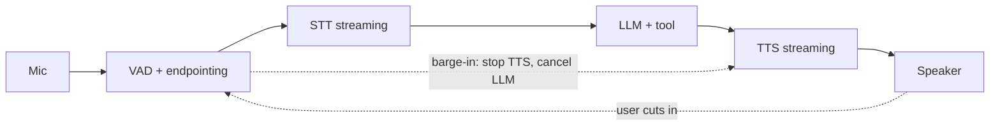

## 1. Core Concept

Voice AI consists of **STT/ASR** (speech → text, such as **Whisper**), **TTS** (text → speech) and **voice agents** (listening, understanding and replying by voice in real time). Unlike text chat, a voice agent's success depends on **latency** and **turn-taking rules** (when the user has finished, when they are interrupted).

**Mental model:** a voice agent is **an interpreter standing in the middle of a conversation**: it must listen just enough to know you are done, think very fast and start speaking **before it has finished thinking the whole sentence** (streaming), and **fall silent the moment you cut in** (barge-in). More than a second of delay feels "robotic".

## 2. How It Works

**The STT → LLM → TTS pipeline**
- **Audio in → VAD → STT → LLM (with tools) → TTS → audio out.** **VAD (voice activity detection)** recognizes when the user speaks/is silent; **endpointing** decides "finished speaking" based on silence (usually 300–700 ms): too short **cuts off** the speaker, too long **adds delay**.

**The latency budget**
- It accumulates: STT (a few hundred ms) + **LLM TTFT** (a few hundred ms) + TTS **first audio** (a few hundred ms) + network. The target total is about **under ~1 second** to feel natural. Ways to reduce: **streaming at every layer** (STT partials → LLM stream → TTS streaming by sentence/phrase), small/fast models, placing servers near users.

**Speech-to-speech (realtime)**
- A model processes **audio directly** (through a realtime API), with low latency and preserving **intonation/emotion**, but **less control over each step** (harder to insert checks/text logging) than a separated pipeline.

**Audio transport**
- **WebRTC** (UDP, browser, jitter buffer, echo cancellation, low latency) or **WebSocket** (TCP, simpler but sensitive to the network). **Telephony (PSTN/SIP)** is usually **8 kHz narrowband**, making STT less accurate.

**Barge-in**
- When the user cuts in: **stop TTS playback, cancel the LLM's generation turn, flush the audio buffer**, and then handle the new utterance. You need **echo cancellation (AEC)** so the agent does not hear its own voice.

**Tools during a call**
- Tool calls take time: insert **filler phrases** ("let me check") to avoid silence.

**Evaluation**
- **WER** = (substitutions + deletions + insertions) / total words; measure **on your own real data** (proper names, numbers, terminology, regional accents, background noise) and add **custom vocabulary**. Also measure **p95 latency**, task completion rate, and interruption handling. For Vietnamese, tones and dialects affect recognition.

```python
async for chunk in llm.stream(history):              # streaming LLM
    for sentence in splitter.feed(chunk):            # group by sentence
        await tts.speak(sentence)                    # play immediately, do not wait for the whole answer
    if vad.user_started_speaking():                  # barge-in
        await tts.stop(); llm.cancel(); break
```

## 3. Visual Diagram



## 4. Rules of Thumb & Trade-offs

| Situation / Need | What to choose |
| --- | --- |
| Need control, logging, checks at each step | An STT → LLM → TTS pipeline |
| Lowest latency, preserving intonation | Speech-to-speech realtime |
| Browser/app, low latency | WebRTC |
| A simple backend | WebSocket |
| Proper names, trade terminology | Custom vocabulary, measure WER on real data |
| Reduce the feeling of silence | Streaming + filler phrases during tool calls |

- **What you gain:** a natural experience, call automation. **What you lose:** accumulated latency is hard to hold, higher cost than text chat, many edge cases (interruptions, noise, echo).

## 5. Must Remember / Production Pitfalls

- **The bot interrupts the speaker or stays silent too long → wrong endpointing → tune VAD thresholds/silence duration, test on real data**.
- **Slow replies → latency accumulating layer by layer → streaming at every layer, faster models, servers near users**.
- **Wrong recognition of names/numbers/regional accents → general benchmarks do not reflect your data → measure real WER, custom vocabulary, reconfirm important information**.
- **The bot hears itself and replies erratically → no echo cancellation → AEC and stop TTS properly**.
- **Legal/ethical risk → recording without consent, voice cloning → notify and obtain consent, anti-abuse policy**.
- Interview trap: "reducing voice bot latency?" → **layer-by-layer streaming, good VAD/endpointing, small models, placed near users**; "what is barge-in?" → **the user interrupts and the system stops speaking/cancels generation**; "how do you measure STT?" → **WER on real data**.

## 6. Search Hooks

- `Whisper speech to text` — open-source STT.
- `WebRTC low latency voice agent` — real-time audio transport.
- `voice activity detection VAD` — detecting when the user speaks.
- `word error rate WER` — the STT accuracy metric.
- `speech-to-speech models` — models processing audio directly.
