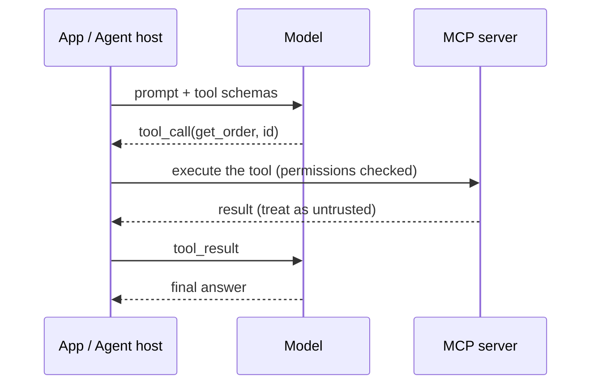

## 1. Core Concept

An LLM only **generates text**; to do real work (query a DB, call an API, run code) it needs **tool use / function calling**: the model **proposes** calling a function with parameters, while **your application is the one that executes** it and returns the result. **MCP (Model Context Protocol)** is an open protocol that standardizes how AI applications **connect to tools and data sources**, often compared to "a USB-C port for AI". The most important thing to remember: the model runs nothing itself, and all data returned from a tool is **untrusted**.

**Mental model:** the model is **someone giving orders over the phone** ("look up order 1001"), the application is **the real assistant who does the work** and reads back the result; MCP is **the standard socket** so every device (tool) works with every outlet (AI application) without custom wiring for each pair.

## 2. How It Works

**Function calling → The tool loop**
- You declare each tool with a **name, a description and a JSON Schema for its parameters**. The model returns a `tool_use`/`tool_call` request with parameters; the application **validates and executes**, then sends a `tool_result` back; the model continues (it may call again, including **several tools in parallel**) until its final answer. Errors should be returned as clear text so the model can correct itself.

```json
{ "name": "get_order", "description": "Get an order by id. Returns the status and the list of items.",
  "input_schema": { "type": "object",
    "properties": { "id": { "type": "string", "description": "Order code, for example o-1001" } },
    "required": ["id"] } }
```

**Designing good tools → A tool is a prompt**
- **A tool's description is the prompt** that makes the model pick the right tool. Rules: **few tools, clear names, narrow scope, simple parameters**; return **concise, high-signal information** (truncate/paginate large results); write operations need to be **idempotent** because the model may call repeatedly. Too many tools waste context and cause wrong choices.

**MCP → A connection standard**
- A **host/client ↔ server** architecture, communicating over **JSON-RPC 2.0**. A server exposes **tools** (actions), **resources** (read-only data), **prompts** (templates); a client may support **sampling, roots, elicitation**. **Transports**: **stdio** (the server runs locally) and **Streamable HTTP** (remote, with **OAuth**). Clients discover tools through `tools/list`.
- **Benefit:** write **one server** usable by **many clients** (avoiding **N×M** integrations, becoming **N+M**). MCP does not replace function calling: underneath, the model still calls tools; MCP standardizes **how tools are provided and discovered**.

**Security → The main front**
- **Indirect prompt injection through tool results**: web/email/document content containing malicious instructions. **Tool poisoning** (a malicious tool description), **rug pull** (a tool definition changed after approval), overly broad permissions. **The dangerous combination:** private data + untrusted content + the ability to send data out.

## 3. Visual Diagram



## 4. Rules of Thumb & Trade-offs

| Situation / Need | What to choose |
| --- | --- |
| One application, a few private tools | Direct function calling |
| Reuse tools across many AI applications | An MCP server |
| Tools running on the user's machine | MCP over stdio |
| Shared/remote tools with authentication | MCP over Streamable HTTP + OAuth |
| Delete/spend money/send data actions | User confirmation, least privilege |
| Data from untrusted sources | Isolate, filter, do not grant broad action rights |

- **What you gain:** reuse, a rich tool ecosystem. **What you lose:** extra attack surface, latency and configuration; every third-party MCP server is a component you must trust.

## 5. Must Remember / Production Pitfalls

- **An agent reads an email/web page with malicious instructions and calls a tool to send data out → indirect prompt injection → least-privilege tools, confirm sensitive actions, separate private data from untrusted content**.
- **The model calls the wrong tool or parameters → too many tools/ambiguous descriptions → fewer tools, clear descriptions, examples, schema validation**.
- **A tool returns huge data and overflows the context → results are not truncated → paginate, summarize, cap the size**.
- **A write operation runs repeatedly → the model/application retries → idempotency keys, duplicate checks**.
- **A third-party MCP server grants overly broad permissions or changes behavior after approval → rug pull/tool poisoning → use only trusted sources, pin versions, review tool definitions**.
- Interview trap: "does function calling run the function itself?" → **no, the model only proposes, the application executes**; "the benefit of MCP" → **write one server for many clients**; "a tool result contains 'ignore previous instructions'" → **indirect prompt injection**.

## 6. Search Hooks

- `Model Context Protocol MCP` — the standard protocol connecting AI with tools and data.
- `LLM function calling tool use` — the model asks to call an external function.
- `MCP server stdio vs streamable HTTP` — MCP's two transports.
- `tool poisoning prompt injection MCP` — security risks when using third-party tools.
- `JSON schema tool definition` — describing tool parameters for the model.
