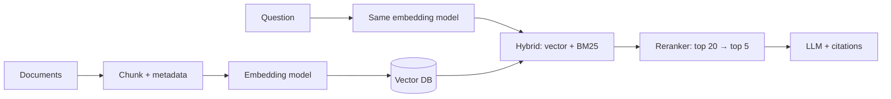

## 1. Core Concept

An **embedding** turns text (or images, audio) into a **numeric vector** so that content with similar meaning lies close together in space; a **vector database** stores and finds the **nearest neighbors** among millions of vectors. This is the foundation of **RAG**, semantic search, recommendations and an agent's long-term memory. The real problem is not "which DB to choose" but **chunking, choosing an embedding, combining keywords and measuring recall**.

**Mental model:** like **finding books by meaning instead of by title**: each passage is placed as **a point on a map of meaning**; the question becomes a point too; you take the nearest points. But the map is **blurry for proper names and codes** — so you need to add keyword search.

## 2. How It Works

**Embeddings → Vectors with meaning**
- An **embedding model** (different from a chat LLM) returns vectors of **384–3,072 dimensions**. You must use **the same model** for documents and queries; **changing the model = re-indexing everything**. Similarity: **cosine**, dot product (equivalent when vectors are normalized), L2.
- **Memory example:** 1 million 1,536-dimension float32 vectors ≈ 1,000,000 × 1,536 × 4 bytes ≈ **6 GB** (not counting the index); quantizing vectors reduces this significantly.

**ANN → Fast approximate search**
- A full scan (brute force) is exact but slow; **ANN** trades a little **recall** for speed: **HNSW** (a multi-layer graph, very fast, RAM-hungry; parameters `M`, `efConstruction`, `efSearch`), **IVF** (clustering, searching the `nprobe` nearest clusters), **PQ** (vector compression).

**Chunking → The single biggest quality decision**
- Cut documents into passages of about **200–800 tokens** with **10–20% overlap**, guided by **structure** (headings, paragraphs, sections). Chunks that are too large cause noise; too small lose context. Attach **metadata** (source, date, tenant, type).

**Hybrid search and reranking → More accurate**
- **Hybrid**: combine **BM25** (keywords, strong on codes/proper names/numbers) and **vector** (semantics), merged with **RRF** (`score = Σ 1/(k + rank)`, typically `k = 60`). A **reranker (cross-encoder)** rescores the top 20–50 and keeps the top 5, raising accuracy at added latency.

**Metadata filtering and multi-tenancy**
- Filter by **tenant/permissions** inside the query (a pre-filter or a filter within the index) to avoid leaking data between customers.

**Storage**
- Dedicated (**Pinecone, Qdrant, Weaviate, Milvus**) or extending an existing DB (**pgvector** in PostgreSQL, OpenSearch/Elasticsearch). Under a few million vectors and already using Postgres, **pgvector** is usually enough.

```sql
-- pgvector: HNSW + filtering by tenant
CREATE INDEX ON docs USING hnsw (embedding vector_cosine_ops);
SELECT id, content FROM docs
WHERE tenant_id = $1
ORDER BY embedding <=> $2   -- cosine distance
LIMIT 20;
```

## 3. Visual Diagram



## 4. Rules of Thumb & Trade-offs

| Situation / Need | What to choose |
| --- | --- |
| Already using Postgres, under a few million vectors | pgvector |
| Large scale, many vector features | A dedicated vector DB |
| Searching by product code, proper names, numbers | Hybrid with BM25 |
| Need more accurate top results | A reranker (cross-encoder) |
| Many customers sharing one index | A metadata filter by tenant |
| Changing the embedding model | Re-index everything |

- **What you gain:** search by meaning, the basis of RAG. **What you lose:** RAM/storage cost, dependence on embedding/chunking quality, recall is never 100% with ANN; a recall ↔ latency trade-off through the `ef`/`nprobe` parameters.

## 5. Must Remember / Production Pitfalls

- **RAG answers wrongly although the right document exists → retrieval does not get the right passage into the top-K → measure recall@K first, fix chunking/hybrid/rerank, then consider the LLM**.
- **The embedding model changes without re-indexing → vectors from two models are incompatible → store the model name/version and re-index everything**.
- **Customer A sees customer B's data → no tenant filter → a mandatory filter at the query layer**.
- **Searching for the product code "ABC-123" returns nothing → vectors are weak at exact matching → hybrid with BM25**.
- **Stale data is still returned → documents were updated without deleting old vectors → an update/delete process keyed by source id**.
- Interview trap: "what do you do when changing the embedding model?" → **re-index everything**; "searching for an exact code?" → **hybrid with BM25**; "RAG is wrong, change the LLM?" → **check retrieval first**.

## 6. Search Hooks

- `HNSW approximate nearest neighbor` — a graph index for fast vector search.
- `hybrid search BM25 vector RRF` — combining keywords and semantics.
- `reranker cross-encoder` — rescoring the top-K for accuracy.
- `chunking strategies RAG` — how to cut documents.
- `pgvector` — vector search in PostgreSQL.
