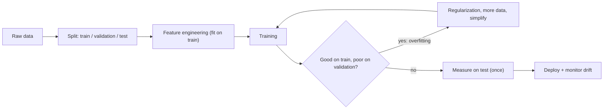

## 1. Core Concept

**Machine learning (ML)** is a way to build systems that **learn patterns from data** instead of hand-writing rules: you provide examples, an algorithm finds patterns, and the model uses them to predict new data. A model's quality is determined far more by **the data, how you split it and how you measure** than by picking a "fancy" algorithm. A firm grasp of these basics is a precondition for judging any AI system correctly, LLMs included.

**Mental model:** like **a student preparing for an exam**: the train set is the textbook, the validation set is practice tests for adjusting how you study, and the test set is **the real exam you may open only once**. Memorizing old tests (overfitting) gives high practice scores and a low real score; and if the exam leaks into the textbook (data leakage) the score looks great but means nothing.

## 2. How It Works

**Three kinds of learning → Labeled data or not**
- **Supervised** (labeled): **classification** (discrete labels: spam/not spam) and **regression** (continuous values: house price). **Unsupervised** (unlabeled): **clustering** (customer segments), dimensionality reduction (PCA), anomaly detection. **Reinforcement learning**: an agent learns through **rewards** from an environment (games, robots, decision optimization). **Self-supervised** learning, which generates labels from the data itself, is the foundation of LLMs.

**Splitting data → Train / Validation / Test**
- **Train** learns the parameters, **validation** selects **hyperparameters** and compares models, an independent **test** set measures **final** quality (never used for tuning). For example a 70/15/15 split. **Cross-validation** (k-fold, for example k = 5) is used when data is scarce. **Time-series data** must be split **by time** (train on the past, test on the future), not shuffled randomly.

**Bias–variance → Overfitting and underfitting**
- **Underfitting** (high bias): poor on both train and validation → the model is too simple or lacks features. **Overfitting** (high variance): excellent on train but **poor on new data** (for example 99% train, 70% validation). To reduce overfitting: **more data**, **regularization** (L1/L2, dropout), **early stopping**, a simpler model, cross-validation.

**Data leakage → Artificially high scores**
- Information from **the test set or from the future** leaks into training (for example **normalizing/computing statistics on the whole dataset before splitting**, using a feature that is only known after the event, duplicate records across train and test). Avoid it by **splitting first, preprocessing after and fitting only on train**, and by checking that each feature is truly available at real prediction time.

**Feature engineering → Turning raw data into signal**
- Handle missing values, **scaling**, **one-hot encoding**, create combined features, **embeddings**. For tabular data, good features often matter more than switching algorithms (decision trees/gradient boosting often win on tabular data).

**After deployment → Drift**
- **Data drift** (the input distribution changes) and **concept drift** (the input–output relationship changes) degrade the model; you need **monitoring and retraining** (see MLOps).

```python
from sklearn.model_selection import train_test_split
from sklearn.preprocessing import StandardScaler
X_tr, X_te, y_tr, y_te = train_test_split(X, y, test_size=0.2, stratify=y, random_state=42)
scaler = StandardScaler().fit(X_tr)          # fit on train only to avoid leakage
X_tr, X_te = scaler.transform(X_tr), scaler.transform(X_te)
```

## 3. Visual Diagram



## 4. Rules of Thumb & Trade-offs

| Situation / Need | What to choose |
| --- | --- |
| Predict a continuous value (house price, revenue) | Regression |
| Predict a discrete label (spam, fraud) | Classification |
| Group unlabeled data | Clustering |
| Decide a sequence of actions from rewards | Reinforcement learning |
| Little data | Cross-validation, a simple model |
| Time-based data | Split by time |

- **What you gain:** solves problems hand-written rules cannot. **What you lose:** needs quality data and drift monitoring; a more complex model overfits more easily and is harder to explain; **use simple rules if they suffice** because they are cheaper and easier to maintain than ML.

## 5. Must Remember / Production Pitfalls

- **A very high test score but poor real-world results → data leakage → split before preprocessing and check each feature is available at real prediction time**.
- **A model great on train but poor on new data → overfitting → regularization, more data, early stopping, reduce complexity**.
- **Tuning the model endlessly against the test score → the test set is no longer independent → tune with validation/cross-validation and use test only for the final measurement**.
- **Randomly shuffling time-series data → the future leaks into train → split by time**.
- **Quality decays after a few months → drift → monitor input distribution and quality, retrain periodically**.
- Exam trap: "predict house prices" → **regression**; "99% train, 70% validation" → **overfitting**; "future information leaked into training" → **data leakage**; "which set selects hyperparameters" → **validation**.

## 6. Search Hooks

- `supervised vs unsupervised vs reinforcement learning` — the three kinds of machine learning.
- `overfitting underfitting bias variance` — generalization and how to handle it.
- `train validation test split` — the role of each dataset.
- `data leakage machine learning` — data leaking during training.
- `feature engineering` — turning raw data into signal for the model.
- `data drift vs concept drift` — model degradation after deployment.
