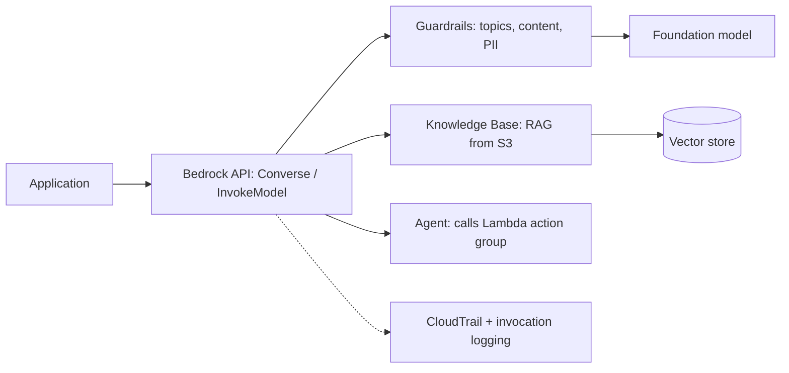

## 1. Core Concept

**Amazon Bedrock** is a **serverless** service for using many **foundation models** from different providers through **one unified API**, with ready-made building blocks for GenAI applications: **Knowledge Bases (RAG)**, **Agents**, **Guardrails**, and model fine-tuning and evaluation. It solves the pain of self-hosting models: no GPUs to manage, and your data is **not used to train the foundation models**.

**Mental model:** Bedrock is **a "model supermarket"** with AWS's security and billing: you pick models from many vendors, call them through one shared counter, and use ready-made utilities (document lookup, agents, safety filters) without building infrastructure. **SageMaker**, by contrast, is **the ML workshop** for training and deploying your own models.

## 2. How It Works

**Accessing models → A unified API**
- Models from many providers (Anthropic, Amazon, Meta, Mistral, Cohere, Stability…) through **`InvokeModel`** or the **Converse API** (a unified conversational interface, supports tool use). You must be **granted model access** in the account/Region. Billing is **per token** (on-demand) or **provisioned throughput** (dedicated capacity, stable latency, a commitment), and there is low-priced **batch inference** for non-urgent work.

**Knowledge Bases for Amazon Bedrock → Managed RAG**
- Point it at a data source (for example **S3**); Bedrock **automatically chunks, creates embeddings, stores them in a vector store** (OpenSearch Serverless, Aurora pgvector…), **retrieves and generates answers with citations** through the retrieve / retrieve-and-generate APIs. This is the **least-operations** option for a chatbot answering from company documents.

**Agents → Tool-calling agents**
- An agent uses a model to **plan**, calling **action groups** (usually **Lambda** + an API schema) and a **knowledge base** to complete multi-step tasks (for example look up an order, then reschedule delivery).

**Guardrails → Safety on input and output**
- **Guardrails for Amazon Bedrock**: **denied topics**, **content filters** (harm, insults, prompt attacks…), **word filters**, **sensitive information/PII filters (block or mask)**, **contextual grounding** checks to reduce hallucination. Applicable to both inputs and outputs.

**Model customization**
- **Fine-tuning**, **continued pre-training** and **distillation** for supported models; **model evaluation** to compare models/prompts.

**Security and operations**
- Data is **not used to train foundation models and not shared with the model provider**; **IAM**, **KMS**, **PrivateLink/VPC endpoints**, **CloudTrail** and **model invocation logging** for auditing. Quotas (tokens/minute) can cause **`ThrottlingException`** → retry with backoff or request a quota increase.

```python
import boto3
br = boto3.client("bedrock-runtime")
resp = br.converse(modelId="MODEL_ID",
    messages=[{"role": "user", "content": [{"text": "Summarize this document"}]}],
    inferenceConfig={"maxTokens": 300, "temperature": 0.2})
print(resp["output"]["message"]["content"][0]["text"])
```

## 3. Visual Diagram



## 4. Rules of Thumb & Trade-offs

| Situation / Need | What to choose |
| --- | --- |
| Call many foundation models through one managed API | Amazon Bedrock |
| A chatbot over company documents, low operations | Knowledge Bases for Amazon Bedrock |
| Block sensitive content, mask PII | Guardrails for Amazon Bedrock |
| Multi-step tasks calling internal APIs | Bedrock Agents |
| High load, stable performance needed | Provisioned throughput |
| Non-urgent bulk processing | Batch inference |
| Train/deploy your own model | SageMaker (not Bedrock) |

- **What you gain:** low operations, many model choices, AWS security. **What you lose:** less control over infrastructure/models than self-hosting, dependence on service quotas and policies, token-based cost can grow large at high traffic.

## 5. Must Remember / Production Pitfalls

- **You get `ThrottlingException` when load grows → token/request quota exceeded → retry with backoff + jitter, request a quota increase or use provisioned throughput**.
- **The chatbot answers outside the documents → no RAG/guardrail → Knowledge Bases + an "insufficient information" policy + Guardrails**.
- **PII leaks in prompts/output → no filter → Guardrails (mask/block PII), control logs**.
- **A model call returns AccessDenied → model access was not granted or IAM is missing → enable model access and grant `bedrock:InvokeModel`**.
- **Confusing Bedrock with SageMaker → picking the wrong tool → Bedrock uses ready-made models, SageMaker trains/deploys your own**.
- Exam trap: "a chatbot over company documents, low operations" → **Knowledge Bases for Bedrock**; "block sensitive content and mask LLM PII" → **Guardrails**; "call many foundation models through one API" → **Bedrock**.

## 6. Search Hooks

- `Amazon Bedrock foundation models API` — using models through a unified API.
- `Knowledge Bases for Amazon Bedrock` — managed RAG on AWS.
- `Guardrails for Amazon Bedrock` — content filtering and PII masking.
- `Amazon Bedrock Agents action groups` — agents calling tools.
- `Bedrock provisioned throughput` — dedicated capacity, stable latency.
- `Bedrock vs SageMaker` — using ready-made models versus training your own.
