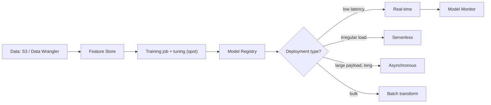

## 1. Core Concept

**Amazon SageMaker AI** is an **end-to-end** ML platform on AWS: data preparation, training, tuning, deployment, monitoring and lifecycle management of **your own models** at scale. Unlike Bedrock (using ready-made models through an API), SageMaker is for when you need to **train yourself, customize deeply or control the inference infrastructure**.

**Mental model:** SageMaker is **an ML factory with every workshop**: receiving raw materials (data, Feature Store), processing (training jobs, tuning), inspection (Clarify, Model Registry), delivery (the endpoint types) and a quality-monitoring camera after shipment (Model Monitor).

## 2. How It Works

**Preparing and managing data/features**
- **Data Wrangler** (data preparation), **Ground Truth** (labeling, optionally with humans), **Feature Store** (stores features **shared by training (offline) and inference (online)**, using one definition to avoid **training-serving skew**).

**Training and optimization**
- A **training job** on managed instances (CPU/GPU, distributed training), **managed spot training** (up to ~90% cost savings, tolerating reclamation thanks to checkpoints), **Automatic Model Tuning** (finds hyperparameters), **JumpStart** (ready-made models and solutions), **Autopilot** (AutoML), **Canvas** (no-code).

**Deploying inference → Choose the right endpoint type**
- **Real-time endpoint**: always running, low latency, billed per instance-hour. **Serverless inference**: irregular load, has cold starts, billed on use. **Asynchronous inference**: large payloads (up to ~1 GB) and long processing, queued, can **scale to 0**. **Batch transform**: bulk prediction over a dataset, **no always-on endpoint needed**. There are also **multi-model endpoints** (several models sharing infrastructure), **production variants** for A/B and **shadow testing**.

**MLOps and governance**
- **SageMaker Pipelines** (CI/CD for ML), **Model Registry** (versions, approval), **Experiments**, **Model Cards**; **Clarify** (bias/explanation), **Model Monitor** (monitors **data quality, model quality, bias drift, feature attribution drift** against a baseline).

**Security**
- Runs inside a **VPC**, **KMS** encryption, **IAM roles** for jobs and endpoints, CloudTrail logging.

```python
from sagemaker.estimator import Estimator
est = Estimator(image_uri=IMG, role=ROLE, instance_count=1, instance_type="ml.g5.xlarge",
                use_spot_instances=True, max_run=3600, max_wait=7200)
est.fit({"train": "s3://bucket/train"})
predictor = est.deploy(initial_instance_count=1, instance_type="ml.m5.large")
```

## 3. Visual Diagram



## 4. Rules of Thumb & Trade-offs

| Situation / Need | What to choose |
| --- | --- |
| Train/deploy a custom model at scale | SageMaker |
| Bulk prediction, no always-on endpoint | Batch transform |
| Irregular load, cold start acceptable | Serverless inference |
| Large payloads, long processing | Asynchronous inference |
| Stable low latency | Real-time endpoint |
| Detect drift after deployment | Model Monitor |
| Features shared by training and inference | Feature Store |
| Reduce training cost | Managed spot training |

- **What you gain:** full control of the ML lifecycle, many cost-optimization options. **What you lose:** many components to learn and operate; real-time endpoints bill even when there are no requests.

## 5. Must Remember / Production Pitfalls

- **High endpoint cost despite few requests → real-time always runs → serverless/asynchronous/batch, or scale to 0/auto scaling**.
- **Model quality degrades over time → drift → Model Monitor against a baseline, retrain with Pipelines**.
- **Good training score but poor real predictions → features are computed differently in train and serve → a shared Feature Store**.
- **Spot training loses progress → no checkpoints → configure checkpoints to S3**.
- **Confusing SageMaker with Bedrock → building needless infrastructure → if you only need a ready-made model use Bedrock**.
- Exam trap: "bulk predictions without an always-on endpoint" → **Batch transform**; "detect drift after deployment" → **Model Monitor**; "features shared by training/inference" → **Feature Store**.

## 6. Search Hooks

- `SageMaker inference options real-time serverless async batch` — the deployment types.
- `SageMaker Model Monitor drift` — monitoring quality after deployment.
- `SageMaker Feature Store online offline` — features shared by train and serve.
- `SageMaker managed spot training` — cheaper training with spot.
- `SageMaker Pipelines MLOps` — CI/CD for ML.
- `SageMaker Clarify` — bias and explainability.
