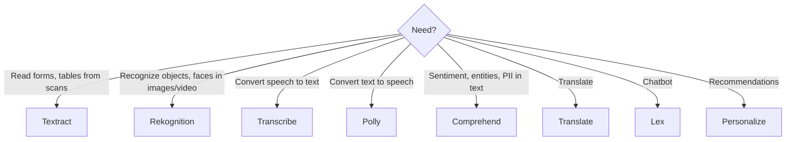

## 1. Core Concept

**AWS AI services** are **pre-trained AI services called through APIs** for common tasks (seeing, hearing, speaking, reading, translating, recommending) **without ML expertise or training infrastructure**. The selection rule: **a ready-made service when the problem is a standard task**, SageMaker when you need a custom model, Bedrock when you need generative AI.

**Mental model:** like **hiring an expert by the hour**: need translation, hire an interpreter (Translate); need invoices read, hire a data-entry clerk (Textract) — fast, pay per use, nobody to train. Only when the business need is very specific do you train your own staff (SageMaker).

## 2. How It Works

**Vision**
- **Amazon Rekognition**: analyzes images/video (object labels, faces, content moderation, text in images), with **Custom Labels** for your own labels.
- **Amazon Textract**: **structured OCR** — extracts **text, forms (key–value pairs), tables** from scanned documents; has APIs for invoices/IDs.

**Language and conversation**
- **Amazon Comprehend**: NLP — **sentiment, entities, key phrases, language, PII**, custom classification. **Amazon Translate**: machine translation. **Amazon Lex**: build chatbots/voice bots (the same technology as Alexa). **Amazon Kendra**: intelligent enterprise search over documents.

**Speech**
- **Amazon Transcribe**: **speech-to-text** (speaker identification, custom vocabulary, PII masking, call analytics). **Amazon Polly**: **text-to-speech** (neural voices, SSML).

**Recommendation and forecasting**
- **Amazon Personalize**: personalized recommendations (like Amazon.com). Some forecasting/fraud-detection services have stopped accepting new customers, so check the current documentation.

**Usage and limits**
- Call APIs with **IAM**; billed **by usage** (images, pages, minutes, characters). Limits: little deep customization; specific data or very high accuracy requirements may need your own model.

**Combining**
- Example pipeline: **Transcribe** (call → text) → **Comprehend** (sentiment, PII) → **Translate** → store in S3; or **Textract → Comprehend → Bedrock** to summarize contracts.

```python
import boto3
tx = boto3.client("textract")
resp = tx.analyze_document(Document={"S3Object": {"Bucket": "b", "Name": "invoice.png"}},
                           FeatureTypes=["FORMS", "TABLES"])   # forms + tables
```

## 3. Visual Diagram



## 4. Rules of Thumb & Trade-offs

| Situation / Need | What to choose |
| --- | --- |
| Extract forms and tables from scanned documents | Textract |
| Recognize objects/faces, moderate images | Rekognition |
| Turn calls into text | Transcribe |
| Read text aloud | Polly |
| Analyze sentiment, PII in text | Comprehend |
| Chatbot/voice bot | Lex |
| Enterprise document search | Kendra |
| Product recommendations | Personalize |
| A specific task needing deep customization | SageMaker |
| Generating content | Bedrock |

- **What you gain:** fast, cheap, no ML needed. **What you lose:** little customization, volume-based cost can be large at high volume, dependence on the service's capabilities.

## 5. Must Remember / Production Pitfalls

- **Training your own OCR for invoices → wasted effort → Textract (or Document Intelligence on Azure)**.
- **Sending sensitive data to a service without control → compliance risk → check storage policy, encryption, PII masking (Comprehend/Transcribe)**.
- **Accuracy is not enough for a specific business need → ready-made services do not customize deeply → custom options (Rekognition Custom Labels, Comprehend custom) or SageMaker**.
- **The bill grows with volume → billed per page/minute/character → estimate cost, process in batches**.
- **Using the wrong service for content generation → ready-made AI services do not generate free text → use Bedrock**.
- Exam trap: "extract data from forms and tables in scanned documents" → **Textract**; "turn calls into text" → **Transcribe**; "when to use a ready-made AI service" → **common tasks, no deep customization needed**.

## 6. Search Hooks

- `Amazon Textract forms tables` — extracting forms/tables from documents.
- `Amazon Rekognition image video analysis` — image/video analysis.
- `Amazon Transcribe speech to text` — speech recognition.
- `Amazon Comprehend sentiment entities PII` — ready-made NLP.
- `Amazon Lex Polly Translate` — chatbot, TTS, translation.
- `Amazon Personalize recommendations` — personalized recommendations.
