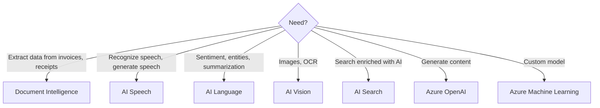

## 1. Core Concept

**Azure AI services** (formerly Cognitive Services) are a set of **ready-made AI services called through APIs** for vision, speech, language, documents and search; **Azure AI Foundry** is the central place to build AI applications/agents; **Azure Machine Learning** is for custom models. The rule: **use a ready-made service for a standard task**, Azure OpenAI when you need content generation, and Azure ML when you need to train your own model.

**Mental model:** like AWS, it is **hiring an expert for each business task**: read invoices → **Document Intelligence**, hear/speak → **Speech**, analyze text → **Language**, search documents with AI → **AI Search**. What differs on Azure is the **"all-in-one bundle"** (multi-service resource) that makes managing keys and bills simpler.

## 2. How It Works

**Main services**
- **Azure AI Vision**: image analysis, **OCR**, object recognition. **Azure AI Speech**: **speech-to-text**, text-to-speech, speech translation, speaker recognition. **Azure AI Language**: sentiment, entity recognition, summarization, conversational understanding (CLU), question answering. **Azure AI Translator**: text/document translation.
- **Azure AI Document Intelligence** (formerly **Form Recognizer**): **extracts structured data** from invoices, receipts, IDs and forms using **prebuilt models** or custom models.
- **Azure AI Search**: **indexes and searches** documents; **knowledge mining** through **skillsets** (OCR, entity extraction, embeddings…) that **enrich** data; supports **hybrid** (keyword + vector) search and a **semantic ranker**; often the RAG store for Azure OpenAI.
- **Azure AI Content Safety**: text/image moderation, **Prompt Shields**, groundedness detection.

**Multi-service vs single-service resource**
- **Multi-service**: **one endpoint and one key** for many services, convenient to manage with a combined bill. **Single-service**: **separate** endpoint, key and cost per service, easier for permissions/detailed tracking and needed when some features exist only in this type.

**Authentication and networking**
- **API keys** or **Microsoft Entra ID/managed identity** (recommended); **Private Endpoint** to avoid the Internet; some services can run in **containers** on-premises/at the edge.

**Azure Machine Learning**
- A custom ML platform: **AutoML**, designer, pipelines, MLflow, **managed endpoints**, monitoring (equivalent to SageMaker).

**Foundry**
- **Azure AI Foundry**: a portal/SDK for managing models (catalog), evaluation, agents and deploying AI applications safely (see the Azure OpenAI & Foundry playbook).

```python
from azure.ai.documentintelligence import DocumentIntelligenceClient
from azure.identity import DefaultAzureCredential
client = DocumentIntelligenceClient(ENDPOINT, DefaultAzureCredential())  # Entra ID, no key
result = client.begin_analyze_document("prebuilt-invoice", body=open("inv.pdf","rb")).result()
```

## 3. Visual Diagram



## 4. Rules of Thumb & Trade-offs

| Situation / Need | What to choose |
| --- | --- |
| Extract data from invoices | Document Intelligence |
| Recognize speech into text | AI Speech |
| Search documents enriched with AI | AI Search |
| Translate text | Translator |
| Moderate content | Content Safety |
| One key for many services | Multi-service resource |
| Separate keys/cost per service | Single-service resource |
| Train your own model | Azure Machine Learning |

- **What you gain:** fast, no ML needed, Entra ID/Private Endpoint integration. **What you lose:** little customization, usage-based cost, dependence on the service's capabilities/limits.

## 5. Must Remember / Production Pitfalls

- **A leaked API key → anyone can call and bill you → use Entra ID/managed identity, rotate keys, Key Vault**.
- **A key shared across many services is leaked → wide impact → consider single-service for sensitive services**.
- **Training your own invoice-reading model → wasted effort → Document Intelligence prebuilt**.
- **Sensitive data goes over the public Internet → no Private Endpoint → Private Endpoint and network control**.
- **Confusing old and new names → learning the wrong thing (Form Recognizer, Cognitive Services) → cross-check the current names**.
- Exam trap: "extract data from invoices on Azure" → **Document Intelligence**; "search documents enriched with AI" → **Azure AI Search**; "recognize speech into text" → **AI Speech**; "multi-service resource" → **one endpoint/key for many services**.

## 6. Search Hooks

- `Azure AI Document Intelligence prebuilt models` — extracting data from documents.
- `Azure AI Search skillset knowledge mining` — enriching and searching documents.
- `Azure AI Speech speech to text` — speech recognition.
- `Azure AI services multi-service resource` — one key for many services.
- `Azure AI Content Safety Prompt Shields` — moderation and prompt-injection defense.
- `Azure Machine Learning vs Azure AI services` — custom versus ready-made.
