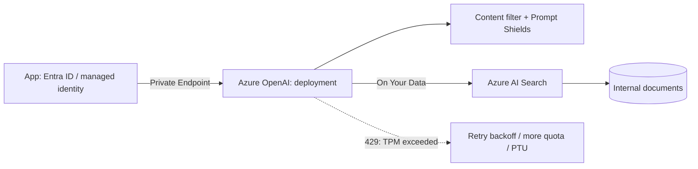

## 1. Core Concept

**Azure OpenAI Service** lets you use OpenAI models (GPT, embeddings, image, audio…) **running in Azure** with enterprise **security, compliance and private networking** commitments; **Azure AI Foundry** is the platform for choosing models (a multi-provider catalog), building applications/agents, and evaluating and deploying them safely. It solves the pain of "wanting a powerful model but the data must not leave the company's control".

**Mental model:** like **hiring a famous expert to work right inside your building**: the same intelligence, but working behind your security gate, with your access badge (Entra ID) and your house rules; the documents they read are **not used to teach anyone else**.

## 2. How It Works

**Resources and deployments → The usage model**
- Create an **Azure OpenAI resource**, then **deploy a model** (name the deployment, choose the type and capacity); applications call the **deployment**, not the model name directly. **Quotas are in TPM/RPM** (tokens/requests per minute) per subscription–Region–model.

**Deployment types → The trade-off between cost and stability**
- **Standard (pay-as-you-go)**: billed per token, **subject to TPM quota**, latency can fluctuate. **Provisioned (PTU — provisioned throughput units)**: **pre-reserved capacity**, **stable, predictable latency** for high load/SLA needs, billed on the committed capacity. **Global/Data zone Standard** (more flexible routing) and **Batch** (cheaper asynchronous processing).

**The 429 error → Exceeding quota**
- **HTTP 429** is usually from **exceeding the deployment's TPM/RPM**: handle it with **retry using exponential backoff + jitter** (honor `Retry-After`), **requesting a quota increase**, **spreading load across several deployments/Regions**, or moving to **PTU**.

**Security and compliance**
- **Prompts and completions are not used to train OpenAI's models**, and data stays within the chosen Azure boundary/geography. Authenticate with **Microsoft Entra ID/managed identity** (the *Cognitive Services OpenAI User* role) instead of keys; use a **Private Endpoint** so traffic does not leave to the public Internet; **content filtering** by default filters hate/sexual/violence/self-harm by severity, plus **Prompt Shields**.

**Internal data → RAG within Azure**
- **Azure OpenAI "On Your Data"** (or a self-built RAG) combined with **Azure AI Search**: retrieve from internal documents and then generate answers with citations, **with data never leaving Azure**; enable **Private Endpoint, managed identity, content filter**.

**Foundry**
- A **model catalog** (OpenAI, Meta, Mistral, DeepSeek…), quality and safety **evaluation**, an **agent service**, and centralized observability and governance.

```python
from openai import AzureOpenAI
from azure.identity import DefaultAzureCredential, get_bearer_token_provider
tp = get_bearer_token_provider(DefaultAzureCredential(), "https://cognitiveservices.azure.com/.default")
client = AzureOpenAI(azure_endpoint=ENDPOINT, azure_ad_token_provider=tp, api_version="2024-10-21")
r = client.chat.completions.create(model="my-gpt-deployment",   # the DEPLOYMENT name
        messages=[{"role": "user", "content": "Summarize the leave policy"}])
```

## 3. Visual Diagram



## 4. Rules of Thumb & Trade-offs

| Situation / Need | What to choose |
| --- | --- |
| Use OpenAI models with Azure security/private networking | Azure OpenAI + Private Endpoint |
| High load, stable latency needed | Provisioned (PTU) |
| Irregular load, flexibility | Standard |
| Non-urgent bulk processing | Batch |
| Use GPT with internal data without leaving Azure | On Your Data + Azure AI Search |
| Authenticate without keys | Managed identity |
| Receiving 429 | Retry backoff, raise quota, split deployments |

- **What you gain:** powerful models with enterprise controls. **What you lose:** quota and availability vary by Region/model, cost by token or PTU commitment, fluctuating latency on Standard.

## 5. Must Remember / Production Pitfalls

- **You get 429 when load grows → the deployment's TPM/RPM is exceeded → retry with backoff, raise quota, spread load across deployments/Regions, or PTU**.
- **Calling by model name instead of deployment name → a not-found error → use the correct deployment name**.
- **An API key in code → leaked → managed identity/Entra ID, Key Vault**.
- **Latency is unstable at peak hours → Standard is shared → PTU for SLA requirements**.
- **Sensitive data travels over the public Internet → no Private Endpoint → Private Endpoint and disable public access**.
- Exam trap: "receiving 429 from Azure OpenAI" → **the deployment's TPM quota exceeded, retry with backoff or raise quota**; "stable performance, predictable latency for high load" → **Provisioned (PTU)**; "use GPT with internal data not leaving Azure" → **Azure OpenAI + AI Search (On Your Data), Private Endpoint, managed identity**.

## 6. Search Hooks

- `Azure OpenAI deployment types standard provisioned PTU` — deployment types and trade-offs.
- `Azure OpenAI quota TPM 429` — quotas and handling 429 errors.
- `Azure OpenAI On Your Data AI Search` — RAG over internal data.
- `Azure AI Foundry model catalog evaluation` — choosing and evaluating models.
- `Azure OpenAI managed identity private endpoint` — authentication and private networking.
- `Azure OpenAI content filtering Prompt Shields` — content filtering and injection defense.
