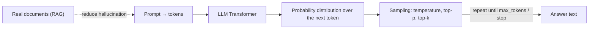

## 1. Core Concept

**Generative AI** produces new content (text, images, code, audio); an **LLM (Large Language Model)** is a model based on the **Transformer** architecture trained on a huge amount of text to **predict the next token**. It is good at understanding and generating language, but is fundamentally **a probabilistic model, not a database of truth** — so you need to understand tokens, context, sampling parameters and hallucination to use it correctly and safely.

**Mental model:** an LLM is like **a person who has read a huge number of books and is great at "continuing" a sentence**: it picks the most plausible next word by probability and does not "look up" facts. So it is fluent, confident, and sometimes **makes things up** when it does not know — unless you put real documents right in front of it (RAG).

## 2. How It Works

**Tokens and the context window → Units and limits**
- Text is split into **tokens** (word fragments; in English about 0.75 words per token, while Vietnamese usually costs **more tokens** for the same content). The **context window** is the total tokens (prompt + answer) the model processes at once; **cost and latency are billed per token**; exceeding the limit means truncation or an error.

**Generation → Controlled sampling**
- At each step the model outputs a **probability distribution** over tokens. A low **temperature** (near 0) → picks high-probability tokens, **stable and less random**; a high one → diverse, **more creative but less stable**. **Top-p** (nucleus) and **top-k** limit the candidate token set. **`max_tokens`** caps the answer length; a **stop sequence** halts on a given string.

**Training → Three stages**
- **Pre-training** (learning language from huge data), **instruction tuning/SFT** (learning to follow instructions) and **alignment** (RLHF/DPO for helpfulness and safety). A model has a **knowledge cutoff** and does not know private/new data.

**Prompt engineering → Steering behavior**
- **Zero-shot**, **few-shot** (with examples), **chain-of-thought** (step-by-step reasoning), **system prompt** (role, rules). The cheapest option and the one to try first.

**Embeddings → Representing meaning**
- Text with similar meaning has **nearby vectors**, the foundation of semantic search and RAG.

**Hallucination → Fabricated content**
- The model confidently generates wrong information because it **predicts probabilities** and does not verify. Reduce it with **RAG** (supplying real documents), **requiring source citations**, **low temperature**, **verifying important outputs** and allowing an "I don't know" answer.

**The customization ladder → Try from cheap to expensive**
- **Prompt engineering → RAG → fine-tuning → pre-training**: cost and complexity rise at each step; move to the next only when the previous is not enough.

**Prompt injection → A security risk**
- Untrusted content can **hijack the model's behavior**; separate instructions from data and limit agent permissions.

```python
resp = client.chat.completions.create(
    model="MODEL", temperature=0.2, max_tokens=300,
    messages=[{"role": "system", "content": "Answer concisely and cite sources if available."},
              {"role": "user", "content": question}])
```

## 3. Visual Diagram



## 4. Rules of Thumb & Trade-offs

| Situation / Need | What to choose |
| --- | --- |
| Stable output, less randomness | Lower the temperature |
| Need creativity, diversity | Raise the temperature |
| Private or new data | RAG |
| A stable specialized style/task | Fine-tuning |
| Reduce hallucination | RAG + citations + verification |
| Multi-step work | Chain-of-thought / a reasoning model |

- **What you gain:** flexible language ability, fast deployment with prompts. **What you lose:** non-determinism, possible fabrication, per-token cost, limited by context and knowledge cutoff.

## 5. Must Remember / Production Pitfalls

- **A wrong but very confident answer → hallucination → RAG, source citations, verify important outputs, allow "I don't know"**.
- **Bill and latency grow → long prompts, Vietnamese costs more tokens → trim the prompt, retrieve only the right passages, monitor tokens**.
- **Output is unstable between runs → high temperature → lower the temperature for tasks needing consistency**.
- **The model does not know new/private data → knowledge cutoff → RAG, do not "teach" it by stuffing an overlong prompt every time**.
- **External content makes the model follow strange commands → prompt injection → separate instructions from data, limit permissions**.
- Exam trap: "stable output" → **lower the temperature**; "order of customization attempts" → **prompt → RAG → fine-tuning → pre-training**; "is an LLM a database of truth?" → **no, it is a probabilistic model**.

## 6. Search Hooks

- `LLM tokens and context window` — processing units and limits.
- `temperature top-p top-k sampling` — sampling parameters.
- `prompt engineering few-shot chain-of-thought` — prompt steering techniques.
- `text embeddings` — representing meaning with vectors.
- `LLM hallucination` — the model fabricates content and how to reduce it.
- `prompt injection` — untrusted content hijacking model behavior.
