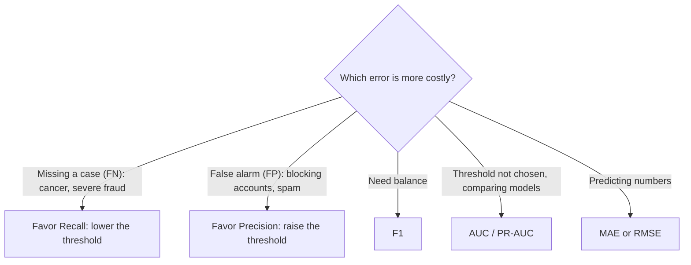

## 1. Core Concept

**Choosing an evaluation metric is choosing which kind of error you accept**: a model that is "99% correct" can be useless if the other 99% is the majority class. The same model can be excellent by one metric and terrible by another, so the first question is always **which error is more costly**: missing a case (false negative) or a false alarm (false positive)?

**Mental model:** like **a fishing net**: a wide-mesh net (high threshold) only catches fish it is sure about, so **few false alarms (high precision)** but **many missed fish (low recall)**; a tight-mesh net (low threshold) catches every fish but **drags in junk too (low precision)**. The metric is how you decide what the net is woven for.

## 2. How It Works

**Confusion matrix → The foundation**
- Four cells: **TP** (true positive, correct alarm), **FP** (false alarm), **FN** (missed case), **TN**. **Precision = TP/(TP+FP)** (of what the model flagged positive, how much was right); **Recall = TP/(TP+FN)** (of the real positives, how many were caught); **F1 = 2·P·R/(P+R)** (a harmonic mean, penalizing when either is low); **Accuracy = (TP+TN)/total**.
- **Worked example:** TP = 40, FP = 10, FN = 20 → Precision = 40/50 = **0.80**, Recall = 40/60 ≈ **0.67**, F1 ≈ **0.73**.

**Accuracy paradox → Imbalanced data**
- 1,000 patients, 10 sick; a model that always guesses "healthy" scores **99% accuracy but recall = 0**. With fraud (0.5–1% positive) accuracy is nearly meaningless; use **Precision/Recall/F1/PR-AUC**.

**Threshold → The precision–recall trade-off**
- A model outputs probabilities; **lowering the threshold** raises recall and lowers precision; **raising it** does the opposite. Pick the threshold by **error cost**: cancer detection → favor **recall**; spam filtering, blocking accounts → favor **precision**.

**ROC and AUC → Threshold-independent comparison**
- **ROC** plots TPR (recall) against FPR at every threshold; **AUC** of 0.5 is random, 1.0 is perfect. With very imbalanced data, **PR-AUC** usually reflects reality better than ROC-AUC.

**Regression → Error**
- **MAE** (mean absolute error, easy to interpret, robust to outliers), **MSE/RMSE** (**heavily penalizes large errors**, RMSE has the same unit as the target), **R²** (the fraction of variance explained). Choose **RMSE** when large errors are very harmful; **MAE** when outliers are noise.

**Evaluating generated text**
- **BLEU** (machine translation, n-gram precision), **ROUGE** (summarization, n-gram coverage against a reference), **BERTScore** (semantic similarity via embeddings), **perplexity**; today they are commonly supplemented by **human evaluation** and **LLM-as-judge** because n-gram metrics do not capture meaning.

```python
from sklearn.metrics import precision_score, recall_score, f1_score
p, r, f = precision_score(y, pred), recall_score(y, pred), f1_score(y, pred)
```

## 3. Visual Diagram



## 4. Rules of Thumb & Trade-offs

| Situation / Need | What to choose |
| --- | --- |
| Missing a case is very dangerous (cancer) | Recall |
| False alarms are costly (wrongly locking accounts) | Precision |
| Need to balance both error types | F1 |
| Very imbalanced data | Precision/Recall/PR-AUC, not accuracy |
| Compare models independent of threshold | AUC |
| Regression, large errors very harmful | RMSE |
| Regression, outliers are noise | MAE |
| Summarization / translation | ROUGE / BLEU (+ human evaluation) |

- **What you gain:** measuring what matters to the business. **What you lose:** no metric is perfect; optimizing one metric usually worsens another (precision ↔ recall).

## 5. Must Remember / Production Pitfalls

- **Reporting "99% accurate" on a rare-event problem → accuracy paradox → report precision/recall/F1/PR-AUC and the confusion matrix**.
- **Choosing a metric without regard to business cost → optimizing the wrong goal → decide first which error is more expensive, then choose the metric/threshold**.
- **A model good by AUC but poor in operation → the threshold was not chosen by cost → pick the threshold on validation using target precision/recall**.
- **RMSE rises because of a few outliers → RMSE penalizes large errors → also compare MAE and inspect outliers**.
- **High ROUGE/BLEU but unhappy users → n-grams do not capture meaning → add human/LLM-judge evaluation**.
- Exam trap: "cancer, missing a case is very dangerous" → **Recall**; "always guesses the majority class, 99% accuracy" → **accuracy paradox, use F1/AUC/Recall**; "summarization" → **ROUGE**, "machine translation" → **BLEU**.

## 6. Search Hooks

- `confusion matrix precision recall F1` — the four error cells and the metrics derived from them.
- `ROC curve AUC` — threshold-independent evaluation.
- `accuracy paradox imbalanced data` — why accuracy misleads.
- `MAE vs RMSE` — regression error and sensitivity to outliers.
- `ROUGE BLEU BERTScore` — metrics for generated text.
