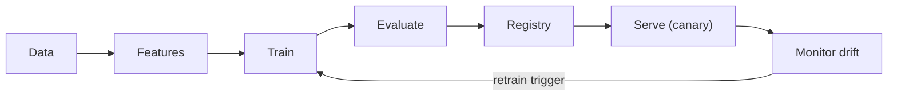

## 1. Core Concept

**MLOps** applies DevOps discipline to machine learning: reproducing experiments, deploying models, monitoring and retraining. A model "rots" over time because the world's data changes. Mental model: *ML = code + data + model; a change in any part needs to be versioned, tested and monitored.*

## 2. How It Works

- **Lifecycle**: data → features → training → evaluation → registration → deployment → monitoring → retraining.
- **Experiment tracking** (MLflow, W&B, SageMaker Experiments): parameters, metrics, artifacts, data versions.
- **Model registry**: versions, stages (staging/production), approval.
- **Feature store**: define a feature once for both **training (offline)** and **serving (online)**, avoiding **training-serving skew**.
- **Deployment**: **batch**, **online (real-time endpoint)**, **streaming**; **shadow, canary, A/B** strategies.
- **Monitoring**: prediction quality (when labels exist), **data drift** (the input distribution changes), **concept drift** (the input–output relationship changes), latency, cost.
- **CI/CD for ML**: an automated pipeline that tests data, trains, compares against a baseline and promotes only if it exceeds a threshold.
- **Reproducibility**: fixed seeds, environment (containers), data versions.

## 3. Visual Diagram

## 4. Rules of Thumb & Trade-offs

- Start with a **simple baseline** and a reproducible pipeline before optimizing the model.
- Automate retraining on **drift** or on a schedule, but keep an evaluation gate.
- Trade-off: **retraining frequency (freshness)** vs **cost and regression risk**.

## 5. Must Remember / Production Pitfalls

- **Training-serving skew**: features are computed differently in train and serve.
- **Data leakage**: using future information during training → great offline metrics, poor reality.
- No monitoring → the model silently degrades.
- No data versioning → cannot reproduce.
- Labels arrive late so real-time quality is hard to measure; use proxy metrics.
- Interview trap: "Good offline metric but bad online?" → skew, leakage, drift or a different distribution.

## 6. Search Hooks

- `MLOps model registry MLflow` — managing model versions.
- `data drift vs concept drift` — the two kinds of drift.
- `feature store training serving skew` — consistent offline and online features.
- `shadow deployment canary ML` — deploying models safely.
- `data leakage machine learning` — data leaking during training.
