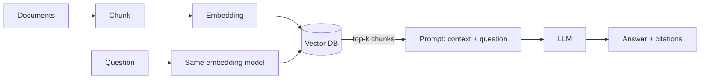

## 1. Core Concept

**RAG (Retrieval-Augmented Generation)** solves three LLM pains **without retraining**: **stale knowledge** (knowledge cutoff), an organization's **private data** and **hallucination**. The idea: before answering, the system **retrieves** relevant document passages and **puts them in the prompt** so the LLM answers based on them and **cites its sources**.

**Mental model:** RAG is **an open-book exam**: the LLM is a student good at expressing ideas, the document store is the book; before each question a **librarian** (the retriever) flips to the right few pages and places them in front of the student. If the librarian opens the wrong pages, even a great student answers wrongly.

## 2. How It Works

**Ingestion pipeline (offline)**
- **Split documents into chunks** → create **embeddings** → store them in a **vector database** together with metadata (source, permissions). **Chunking** is a big quality decision: **small** chunks are precise but lack context; **large** chunks have enough context but add noise and cost tokens; typically 200–800 tokens, with slight overlap, guided by document structure.

**Query pipeline (online)**
- **Embed the question with the same embedding model** → find the **top-k nearest chunks** (cosine similarity) → **assemble them into the prompt** with the instruction "answer only from the context, cite sources, say you don't know if it isn't there" → the LLM generates the answer.

**Consistent embedding model**
- Vectors from two embedding models **do not share a space**: changing the model means **re-indexing everything**, and queries and documents must use the same model.

**Vector database**
- Stores and finds nearest vectors: **OpenSearch**, **Aurora PostgreSQL + pgvector**, **Azure AI Search**, or a dedicated vector DB.

**Managed services**
- **Knowledge Bases for Amazon Bedrock**: a data source (for example S3) → **automatically chunks, embeds, stores in a vector store, retrieves and generates answers with citations** (through the retrieve / retrieve-and-generate APIs).
- **Azure AI Search**: **indexer + skillset (AI enrichment)**, **hybrid** (keyword + vector) search and a **semantic ranker**, commonly the RAG store for **Azure OpenAI**.

**RAG and fine-tuning**
- **RAG** suits **private data that changes often** (it can be updated, cited, and have permissions revoked); **fine-tuning** suits a **stable specialized style/task**. The two complement each other and are not mutually exclusive.

**Evaluation**
- Measure **retrieval** (recall of the right passages within the top-k) and **generation** (groundedness/faithfulness) separately. Most RAG errors lie in **retrieval**, not in the LLM.

```python
def answer(question):
    qv = embed(question)                                  # same embedding model
    chunks = vector_db.search(qv, top_k=5, filter={"tenant": user.tenant})
    ctx = "\n\n".join(f"[{c.id}] {c.text}" for c in chunks)
    prompt = f"Use only the context, cite [id]. If it is missing, say you don't know.\n{ctx}\n\nQuestion: {question}"
    return llm(prompt)
```

## 3. Visual Diagram



## 4. Rules of Thumb & Trade-offs

| Situation / Need | What to choose |
| --- | --- |
| A chatbot over the latest internal documents, no retraining | RAG |
| A fixed style/format for a narrow task | Fine-tuning |
| A managed RAG service on AWS | Knowledge Bases for Amazon Bedrock |
| A managed RAG store on Azure | Azure AI Search + Azure OpenAI |
| Exact keywords + semantics | Hybrid search |
| Sensitive per-user data | Filter by permissions at the retrieval step |

- **What you gain:** data updates without retraining, citations, less hallucination. **What you lose:** extra infrastructure and latency, quality depends on retrieval and chunking, tokens spent on context.

## 5. Must Remember / Production Pitfalls

- **RAG answers wrongly although the right document exists → retrieval does not put the right passage in the top-k → check chunking, embeddings and retrieval recall first, then change the LLM**.
- **The embedding model is changed but the old index is kept → two different vector spaces → re-index everything**.
- **Chunks too small/large → missing context or noise and token cost → chunk by structure, with overlap, measured with evals**.
- **The LLM fabricates when there are no documents → no refusal policy → require "insufficient information" answers and citations**.
- **Data leaks between users → permissions are not filtered at retrieval → metadata filters by permission/tenant**.
- Exam trap: "a chatbot over the latest internal documents, no retraining" → **RAG**; "changed the embedding model, kept the old index" → **must re-index**; "RAG is wrong because retrieval misses the right passage" → **check chunking, embeddings, recall first**.

## 6. Search Hooks

- `retrieval augmented generation RAG` — an LLM answering from retrieved documents.
- `vector database similarity search` — finding the top-k nearest vectors.
- `RAG chunking strategies` — small versus large chunks.
- `Knowledge Bases for Amazon Bedrock` — managed RAG on AWS.
- `Azure AI Search RAG hybrid semantic` — a managed RAG store on Azure.
- `RAG vs fine-tuning` — when to use which.
