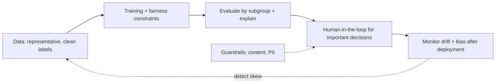

## 1. Core Concept

**Responsible AI** is a set of principles and practices that make AI systems **fair, safe, transparent, privacy-protecting and accountable to someone**. It is not something to "do last" but a design requirement: models that automatically make decisions affecting people (credit, hiring, healthcare) learn from historical data that **contains bias**, so without control they will **replicate and hide** that bias at scale.

**Mental model:** AI is **a student learning from old textbooks**: if the books contain prejudice the student repeats it confidently. Responsible AI is **the process of auditing the textbooks, checking each group of students, explaining how grades are assigned and having a teacher who is ultimately accountable**.

## 2. How It Works

**Principles → The standard frameworks**
- **Microsoft** states **six principles**: **Fairness**, **Reliability & Safety**, **Privacy & Security**, **Inclusiveness**, **Transparency**, **Accountability**. **AWS** emphasizes dimensions such as fairness, **explainability**, privacy & security, safety, controllability, veracity & robustness, governance, transparency.

**Sources of bias → Data, algorithms, people**
- **Historical data bias** (unfair past decisions), **sampling bias** (under-represented groups), **wrong/subjective labels**, and **proxy attributes**: **dropping sensitive columns (gender, race) is not enough** because other features (postal code, school) may be **correlated** and act as substitutes.

**Reducing bias → Three stages**
- **Before training**: representative data, rebalancing, cleaning labels. **During training**: fairness constraints. **After training**: adjust thresholds per group. Always **evaluate by subgroup**, not just overall accuracy; measures such as **demographic parity** and **equalized odds** can **conflict** with each other and with accuracy.

**Cloud tooling**
- **AWS**: **SageMaker Clarify** (detects bias before/after training and **explains predictions** with SHAP-style feature importance), **Bedrock Guardrails** (blocks harmful topics/content, **masks or blocks PII**, checks grounding), **SageMaker Model Cards**, **Model Monitor**, **Amazon A2I** (human review of results).
- **Azure**: the **Responsible AI dashboard** (Fairlearn, InterpretML), **Azure AI Content Safety** (severity-based content classification, Prompt Shields, groundedness detection), the Azure OpenAI **content filter**, **Transparency Notes**.

**Transparency and accountability**
- A **model card/documentation** of purpose, data and limits; **explainable** decisions for the people affected; **human-in-the-loop** for important decisions; **post-deployment monitoring** because drift can bring bias back; compliance by risk level (for example the EU AI Act's risk classification framework).

**Privacy and safety**
- **Data minimization**, masking/hiding **PII**, access control, **red-teaming** (trying to break the system) for generative systems.

## 3. Visual Diagram

## 4. Rules of Thumb & Trade-offs

| Situation / Need | What to choose |
| --- | --- |
| Detect bias and explain predictions on AWS | SageMaker Clarify |
| Block harmful content and mask PII for an LLM on AWS | Bedrock Guardrails |
| Fairness evaluation/explanation on Azure | Responsible AI dashboard (Fairlearn, InterpretML) |
| Filter harmful content on Azure | Azure AI Content Safety |
| High-consequence decisions | Human-in-the-loop |
| Sensitive data | Data minimization, PII masking |

- **What you gain:** lower legal, reputational and harm risk. **What you lose:** you may **reduce overall accuracy** in exchange for fairness, measurement and documentation take effort, and fairness definitions can conflict.

## 5. Must Remember / Production Pitfalls

- **Sensitive columns dropped but the model is still biased → correlated proxy attributes → evaluate by subgroup, check correlations, use Clarify/Fairlearn**.
- **Looking only at overall accuracy → hides harm to small groups → report metrics per group**.
- **A model fair at launch but drifting skewed → drift → monitor bias and quality continuously**.
- **A black-box model for important decisions → cannot be explained to those affected → use explanation techniques, documentation, human oversight**.
- **An LLM leaks PII or generates harmful content → no guardrails → Guardrails/Content Safety, red-teaming, grounding checks**.
- Exam trap: "detect bias and explain predictions on AWS" → **SageMaker Clarify**; "Microsoft's six Responsible AI principles" → **Fairness, Reliability & Safety, Privacy & Security, Inclusiveness, Transparency, Accountability**; "is dropping sensitive columns enough" → **no, proxies remain**.

## 6. Search Hooks

- `Microsoft Responsible AI six principles` — Microsoft's six principles.
- `Amazon SageMaker Clarify bias explainability` — measuring bias and explaining.
- `Guardrails for Amazon Bedrock` — content and PII filtering for LLMs.
- `Azure AI Content Safety` — content moderation and Prompt Shields.
- `Fairlearn fairness metrics` — fairness measures.
- `model card documentation` — documenting a model for transparency.
