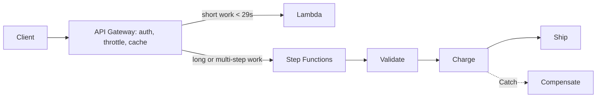

## 1. Core Concept

**API Gateway** is a managed front door for APIs (authentication, throttling, caching, transformation) usually placed in front of Lambda; **Step Functions** is a multi-step workflow orchestrator in the form of a state machine with built-in retries and error handling. They solve two pains: **building the API layer yourself** and **writing orchestration logic yourself** (chains of Lambda calling Lambda are hard to retry and hard to roll back).

**Mental model:** API Gateway is **the reception desk** (checking tickets, limiting how many people enter, forwarding requests); Step Functions is **a stateful process map** (which step to do, where to go back on error), and Lambda is each **employee** doing one job.

## 2. How It Works

**API Gateway → API types and integrations**
- **REST API**: full-featured (API keys, usage plans, request validation, mapping templates, caching, **WAF**); **HTTP API**: cheaper and faster, supports a **JWT authorizer**, with fewer features; **WebSocket API** for two-way communication. REST endpoints come in three kinds: **Edge-optimized**, **Regional**, **Private**.
- Integrations: **Lambda proxy**, HTTP, AWS services, mock, **VPC Link** (to a private ALB/NLB).

**Authentication → Who may call**
- **IAM (SigV4)**, **Cognito authorizer**, **Lambda authorizer** (token or request, custom logic, results can be cached), **JWT** (HTTP API).

**Protection and performance**
- **Throttling** by rate and burst (the default account-level quota is about **10,000 rps with a 5,000 burst** per Region); **usage plans + API keys** to limit per customer; a **stage cache** (default TTL **300 seconds**) reduces backend load. **The default integration timeout is 29 seconds**, with a maximum payload of **10 MB**.

**Step Functions → State machines**
- Defined in **Amazon States Language (JSON)**: `Task`, `Choice`, `Parallel`, `Map`, `Wait`, `Succeed/Fail`, with **`Retry`** (backoff) and **`Catch`** (switch to a compensation branch).
- **Standard**: runs up to **1 year**, **exactly-once** workflow execution, 90-day history, billed per **state transition**. **Express**: up to **5 minutes**, **at-least-once** (asynchronous), very high throughput, billed by the number of runs and duration.
- The **callback pattern** (`.waitForTaskToken`) waits for a human approver/an external system; direct integrations with over 200 AWS services mean no "glue" Lambdas are needed.

```json
{ "StartAt": "Charge", "States": {
  "Charge": { "Type": "Task", "Resource": "arn:aws:lambda:...:charge",
    "Retry": [{"ErrorEquals": ["States.TaskFailed"], "MaxAttempts": 3, "BackoffRate": 2}],
    "Catch": [{"ErrorEquals": ["States.ALL"], "Next": "Refund"}], "Next": "Ship" },
  "Refund": { "Type": "Task", "Resource": "arn:aws:lambda:...:refund", "End": true },
  "Ship": { "Type": "Task", "Resource": "arn:aws:lambda:...:ship", "End": true } } }
```

## 3. Visual Diagram



## 4. Rules of Thumb & Trade-offs

| Situation / Need | What to choose |
| --- | --- |
| A public API needing API keys, usage plans, WAF | REST API |
| A cheap proxy, JWT, low latency | HTTP API |
| Two-way real time | WebSocket API |
| A multi-step process with retries and compensation | Step Functions Standard |
| High-volume, short event processing | Step Functions Express |
| Custom authentication logic | Lambda authorizer |

- **What you gain:** less infrastructure code, declarative retries/errors. **What you lose:** per-transition cost (Standard), API Gateway's 29-second limit, learning ASL.

## 5. Must Remember / Production Pitfalls

- **A request that runs 40 seconds returns 504 → it exceeds the 29-second timeout → return 202 and process asynchronously via SQS/Step Functions**.
- **Lambda calling Lambda synchronously → you pay while waiting, hard to retry and roll back → Step Functions or a queue**.
- **Express runs twice → at-least-once → an idempotent function**.
- **Stale data is returned to customers → a long stage cache TTL → choose the TTL or drop caching for fast-changing data**.
- **One customer being throttled with 429 affects others → a shared quota → usage plans per customer**.
- Exam trap: "a multi-step ordering workflow with rollback" → **Step Functions**; "API Gateway's maximum timeout" → **29 seconds**; "Express needs attention" → **at-least-once so be idempotent**.

## 6. Search Hooks

- `API Gateway REST vs HTTP API` — comparing the two API types.
- `API Gateway Lambda authorizer` — custom authentication.
- `Step Functions Standard vs Express` — two workflow types.
- `Step Functions saga pattern` — compensation for distributed transactions.
- `API Gateway throttling usage plans` — limits and per-customer quotas.
