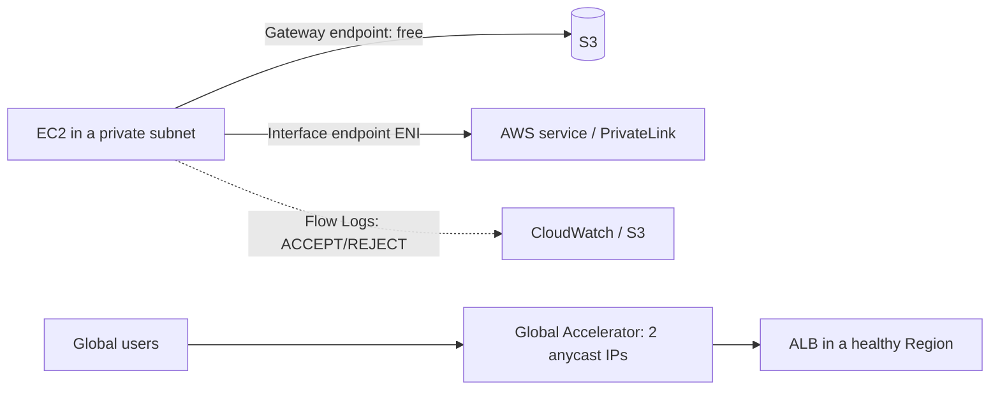

## 1. Core Concept

Beyond basic VPCs, AWS's advanced networking problems revolve around three jobs: **accessing services privately** (VPC Endpoint, PrivateLink), **global acceleration and fault tolerance** (Global Accelerator) and **observing/controlling traffic** (Flow Logs, NACL, Network Firewall). They solve the pain of traffic going around through the Internet, paying NAT fees and being unable to tell why packets are dropped.

**Mental model:** keep traffic **inside AWS's internal network** instead of the public road; each filtering layer has its own job — an SG is a guard for each room, a NACL is a gate for each floor, Network Firewall is a checkpoint for the whole campus.

## 2. How It Works

**VPC Endpoint → Without the Internet**
- **Gateway endpoint**: only **S3 and DynamoDB**, **free**, adds a route (prefix list) to the route table. **Interface endpoint (PrivateLink)**: an **ENI with a private IP** in the subnet to an AWS/partner/your own service, billed per hour and per GB, with **private DNS**, controlled by **security groups** and an **endpoint policy**.
- Example: S3 through NAT incurs per-GB processing; through a Gateway endpoint it is **free**.

**PrivateLink → Publishing a service**
- Publish a service behind an **NLB** as an **endpoint service**; consumers create an interface endpoint from their VPC **without peering and without worrying about overlapping CIDRs**, exposing only the service, not the whole network.

**Global Accelerator → Static anycast IPs**
- Provides **2 static anycast IPs**, brings traffic onto the **AWS backbone** at the nearest edge, with **health checks** and fast failover to a healthy endpoint; supports **TCP/UDP**; **does not cache** (unlike CloudFront's HTTP caching).

**Traffic filtering → SG and NACL**
- **Security Group**: stateful, Allow-only, instance level. **NACL**: stateless, has Allow/Deny, subnet level, evaluated by number, and you must open **ephemeral ports 1024–65535** in the return direction.

**Observation and protection**
- **VPC Flow Logs** record metadata (IP, port, `ACCEPT/REJECT`, bytes) to CloudWatch/S3/Firehose, **with no payload**. **AWS Network Firewall** does stateful/stateless filtering for a whole VPC; **Route 53 Resolver endpoints** for hybrid DNS; **Reachability Analyzer** checks paths.
- A **NAT Gateway** is tied to one AZ (you need one per AZ); an **Egress-only IGW** for IPv6.

## 3. Visual Diagram

## 4. Rules of Thumb & Trade-offs

| Situation / Need | What to choose |
| --- | --- |
| Privately access S3/DynamoDB, cheapest | Gateway endpoint |
| Privately access other AWS services | Interface endpoint |
| Publish a service to other VPCs, no peering | PrivateLink |
| Global static IPs, TCP/UDP, fast failover | Global Accelerator |
| Cache HTTP content | CloudFront |
| Block an IP | NACL |
| Investigate why packets are dropped | VPC Flow Logs |

- **What you gain:** privacy, lower NAT fees, fast failover. **What you lose:** interface endpoints are billed per hour/GB; extra components to manage.

## 5. Must Remember / Production Pitfalls

- **Connections come in but responses are dropped → a stateless NACL lacks the return direction → open ephemeral ports 1024–65535**.
- **Internet access is lost when one AZ fails → only one NAT Gateway → one NAT per AZ**.
- **A high NAT bill → S3 goes through NAT → a Gateway endpoint**.
- **It is hard to find the cause of REJECT → Flow Logs not enabled → enable Flow Logs at the VPC/subnet/ENI level**; remember Flow Logs have no payload.
- **An endpoint does not resolve correctly → private DNS is off or the VPC lacks DNS support → enable private DNS and `enableDnsSupport`**.
- Exam trap: "S3 from a private subnet without the Internet, cheapest" → **Gateway endpoint**; "global static IPs, TCP/UDP" → **Global Accelerator**; "NACL or SG" → **a NACL is stateless, has Deny, subnet level**.

## 6. Search Hooks

- `VPC gateway endpoint vs interface endpoint` — the two kinds of endpoints.
- `AWS PrivateLink` — publishing private services between VPCs.
- `Global Accelerator vs CloudFront` — TCP/UDP acceleration vs HTTP caching.
- `security group vs NACL` — stateful vs stateless.
- `VPC Flow Logs` — observing network traffic.
