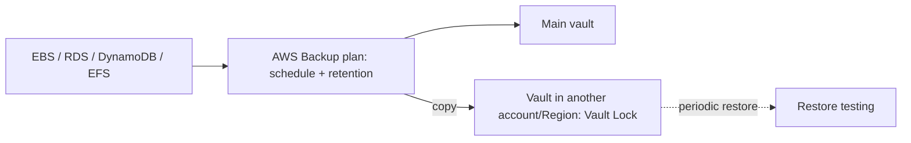

## 1. Core Concept

Data protection on AWS has three layers: **backup** (recovering after deletion/corruption), **immutability** (against ransomware and accidental deletion) and **recovery by RPO/RTO**. They address the pain of "we have replication so we are safe", when accidental deletes and malware are copied to the standby too.

**Mental model:** replication is **an automatic photocopier** — if the original is wrong, the copy is wrong too; a backup is **a dated storage box** to return to a good point in time; **Vault Lock/Object Lock** is **a cabinet with a time lock** that even the cabinet's owner cannot open early.

## 2. How It Works

**AWS Backup → A centralized policy**
- A **backup plan** has rules (schedule, window, **lifecycle moving to cold storage**, **retention**), with resources assigned by **tag**; it supports EBS, EC2, RDS/Aurora, DynamoDB, EFS, FSx, S3… It offers **cross-Region and cross-account copies**, and continuous **PITR** for RDS/S3/DynamoDB.
- **Backup Vault Lock** (WORM): **governance** or **compliance** mode (with a cooling-off period after which nobody can remove it), preventing deletion/modification of backups during the retention period.

**Snapshots and PITR**
- **EBS/RDS snapshots** are incremental; **PITR** restores to any second within the retention window (RDS 1–35 days).

**S3**
- **Versioning** (+ MFA Delete), **Object Lock** (governance/compliance, **legal hold**, requires versioning), **Replication CRR/SRR**.

**Elastic Disaster Recovery (DRS)**
- Continuous **block-level replication** from source servers to a low-cost staging area; on a disaster it launches full instances: **an RPO in seconds, an RTO in minutes**.

**4 DR strategies and the 3-2-1 rule**
- **Backup & Restore, Pilot Light, Warm Standby, Multi-site active-active** (RTO/RPO fall, cost rises). The **3-2-1** rule: 3 copies, 2 kinds of storage, 1 copy elsewhere (a different account/Region).

**Backup encryption**
- Backups are encrypted with **KMS**; sharing a snapshot cross-account requires sharing the **key** too (the default AWS managed key cannot be shared).

## 3. Visual Diagram

## 4. Rules of Thumb & Trade-offs

| Situation / Need | What to choose |
| --- | --- |
| Centralized backup of many services | AWS Backup |
| Protect against ransomware/backup deletion | Vault Lock + cross-account copy |
| S3 data that must not be modified/deleted | Object Lock |
| Rebuild servers quickly after a disaster | Elastic Disaster Recovery |
| RTO/RPO near 0 | Multi-site active-active |
| RTO in hours, low budget | Backup & Restore |

- **What you gain:** recoverability even after accidental deletion or an attack. **What you lose:** the storage cost of a second backup/vault, and periodic rehearsals.

## 5. Must Remember / Production Pitfalls

- **You have replication but still lose data after `DROP TABLE` → the mistake was copied → add point-in-time backups and versioning**.
- **Backups in the same account as the source data → a compromised account loses both → cross-account copy + Vault Lock**.
- **You have never tested a restore → you do not know if it works → rehearse restores periodically and measure the real RTO**.
- **A snapshot encrypted with the default key cannot be shared → use a customer managed key and share the key**.
- **Object Lock compliance cannot be removed even by root → a wrong retention setting is a cost you bear → try governance mode first**.
- Exam trap: "protect against ransomware deleting backups" → **Vault Lock/Object Lock + cross-account backups**; "only run the minimal core and expand on disaster" → **Pilot Light**; "does replication replace backup" → **no**.

## 6. Search Hooks

- `AWS Backup Vault Lock` — immutable backups.
- `S3 Object Lock compliance governance` — WORM for S3.
- `Pilot Light vs Warm Standby` — DR strategies.
- `RPO RTO` — recovery objectives.
- `AWS Elastic Disaster Recovery` — continuous replication and rebuilding servers.
