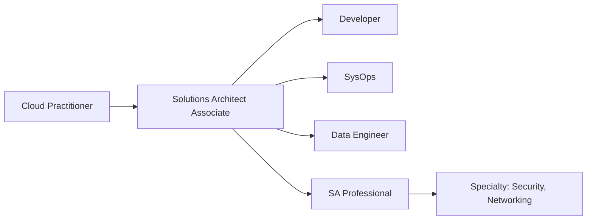

## 1. Core Concept

AWS certifications are split by **tier and role**: **Foundational** (for example Cloud Practitioner, AI Practitioner), **Associate** (Solutions Architect, Developer, SysOps Administrator, Data Engineer, Machine Learning Engineer), **Professional** (Solutions Architect, DevOps Engineer) and **Specialty** (Security, Advanced Networking…). The list and exam codes change over time, so **always cross-check AWS's official certification pages** before planning your study.

**Mental model:** choose a certification by **the job role you want**, then study by **domain and weighting** in the exam guide — the exam asks your ability to **choose the right service under constraints**, not to memorize service names.

## 2. How It Works

**Exam structure**
- Single- or multiple-answer multiple choice, mostly **scenarios**. For example Solutions Architect Associate (SAA-C03): about 65 questions in 130 minutes, a 100–1000 scale with a passing score of 720; the domains are **Secure** (~30%), **Resilient** (~26%), **High-performing** (~24%), **Cost-optimized** (~20%). Re-check the numbers in the current exam guide.

**Suggested path**
- Foundations (Cloud Practitioner if you are new) → **Solutions Architect Associate** → a role branch: **Developer** (Lambda, DynamoDB, CI/CD), **SysOps** (operations, monitoring), **Data Engineer** (Glue, Kinesis, Redshift), **ML Engineer** → Professional/Specialty.

**Mapping to lessons in this Playbook**
- **Security:** IAM, S3 security, Security services. **Resilient:** ELB/Auto Scaling, RDS/Aurora, Route 53, DR, Backup. **Performance:** S3 performance, CloudFront, ElastiCache, DynamoDB. **Cost:** EC2 pricing, S3 storage classes, FinOps. **Foundations:** VPC, EC2, SQS/SNS, Lambda, CloudFormation, Organizations, Well-Architected.

**Exam technique**
- **Underline constraint keywords**: *cheapest, least operational overhead, lowest latency, compliant, minimal code changes*. **Eliminate answers that violate constraints** first, then choose by the principles of **managed/serverless, loosely coupled, multi-AZ, least privilege**.
- When two answers are both technically right, choose the one that **meets all constraints with the least operational effort**.

## 3. Visual Diagram

## 4. Rules of Thumb & Trade-offs

| Situation / Need | What to choose |
| --- | --- |
| Completely new to cloud | Cloud Practitioner |
| Designing architectures | Solutions Architect Associate |
| Writing serverless applications | Developer Associate |
| Operations, monitoring, automation | SysOps Administrator |
| Data pipelines | Data Engineer Associate |
| A deep specialty area | Specialty |

- **What you gain:** a clear path, focused study. **What you lose:** studying broadly across many services versus understanding deeply the high-weight domains — you must balance.

## 5. Must Remember / Production Pitfalls

- **Memorizing service names → you cannot reason when the question changes constraints → learn why A is chosen over B and each service's limits**.
- **Ignoring constraint keywords → picking a technically correct answer that misses the requirement → underline keywords before reading the answers**.
- **Confusing HA with DR → choosing multi-AZ for a problem that needs multi-Region → distinguish by RPO/RTO**.
- **Using outdated material → services and syllabi change → cross-check the current exam guide**.
- **Reading without taking practice exams → you are not used to how questions are asked → take practice exams and read the explanations of wrong answers**.
- Exam trap: when two answers are both right, pick the one that **meets all constraints with the least operational effort**; "prevent creating resources outside the allowed Regions" is an **SCP** problem, not per-user IAM.

## 6. Search Hooks

- `AWS Certified Solutions Architect Associate exam guide` — domains and weightings.
- `AWS certification paths` — the certification map by role.
- `AWS Well-Architected exam questions` — reasoning by pillar.
- `AWS Skill Builder practice exam` — official practice exams.
- `AWS exam tips keywords` — how to read an exam's constraints.
