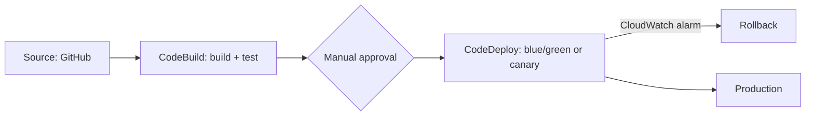

## 1. Core Concept

AWS's **Code\*** suite builds CI/CD pipelines from source to production: **CodeBuild** (build, test), **CodeDeploy** (deployment), **CodePipeline** (orchestrating the stages), along with **Systems Manager (SSM)** to operate fleets of machines without SSH. They solve the pain of releases that are manual, not repeatable and hard to roll back.

**Mental model:** a pipeline is **a factory assembly line**: each station (stage) receives an artifact from the previous one, checks quality and passes it on; an **approval gate** is the final checkpoint, and **automatic rollback** is the emergency brake when the product is faulty.

## 2. How It Works

**CodePipeline → Orchestrating stages**
- Typical stages: **Source → Build → Test → Approval → Deploy**. Each action reads/writes **artifacts** stored in S3; you can insert a **manual approval**. The source is usually GitHub/GitLab through **CodeConnections** (CodeCommit no longer accepts new customers).

**CodeBuild → Build and test**
- Runs in a container according to **`buildspec.yml`** (`install`, `pre_build`, `build`, `post_build`, `artifacts`), billed by **build minute**, supports caching and running inside a VPC to reach internal resources.

**CodeDeploy → Deployment and rollback**
- Targets **EC2/on-prem** (needs the **agent**, configured with **`appspec.yml`** and the hooks `ApplicationStop → BeforeInstall → AfterInstall → ApplicationStart → ValidateService`), **Lambda** (canary/linear/all-at-once through aliases) and **ECS** (blue/green with an ALB, shifting traffic gradually).
- Strategies: **in-place** (rolling, possibly partial downtime) vs **blue/green** (a new environment, shift traffic, roll back by shifting back). **Automatic rollback when a CloudWatch alarm fires**.

**Elastic Beanstalk and CodeArtifact**
- **Elastic Beanstalk** (PaaS) has deployment policies: All at once, Rolling, Rolling with additional batch, **Immutable**, Traffic splitting. **CodeArtifact** is a package repository; **ECR** is for images.

**Systems Manager → Operations**
- **Session Manager**: a shell/CLI through IAM, **no port 22, no keys or bastion**, with auditing to S3/CloudWatch (needs the SSM agent and an instance profile). **Run Command**, **Patch Manager** (patch baselines + maintenance windows), **State Manager**, **Automation** runbooks, **Parameter Store**.

```yaml
version: 0.2
phases:
  build:
    commands:
      - npm ci && npm test
artifacts:
  files: ["**/*"]
```

## 3. Visual Diagram



## 4. Rules of Thumb & Trade-offs

| Situation / Need | What to choose |
| --- | --- |
| A managed pipeline integrated with IAM/CloudWatch | CodePipeline + CodeBuild + CodeDeploy |
| Low-risk production releases | Blue/green or canary |
| Access EC2 without opening port 22 | SSM Session Manager |
| Patch the OS in bulk | SSM Patch Manager |
| A simple PaaS for a web app | Elastic Beanstalk |
| An ecosystem outside AWS (Actions, Jenkins) | External tools, more flexible |

- **What you gain:** deep integration with IAM, VPC, CloudWatch; less self-operated infrastructure. **What you lose:** less flexibility and a smaller ecosystem than GitHub Actions/Jenkins.

## 5. Must Remember / Production Pitfalls

- **A secret in `buildspec`/plain-text environment variables → leaks through logs → Secrets Manager/Parameter Store with IAM**.
- **A CodeBuild/CodePipeline role that is too broad (AdministratorAccess) → a compromised pipeline means a compromised account → least privilege for each role**.
- **A bad release that cannot be reverted → no automatic rollback or alarm → attach CloudWatch alarms to CodeDeploy**.
- **A DB migration that is not backward compatible → blue/green breaks when traffic shifts → a two-step migration (expand/contract)**.
- **An artifact bucket that is unencrypted or public → leaks code/artifacts → encrypt and block public access**.
- Exam trap: "access EC2 without opening port 22" → **SSM Session Manager**; "low-risk production deployment" → **blue/green or canary**; "automatic rollback on alarm" → **CodeDeploy**.

## 6. Search Hooks

- `AWS CodePipeline CodeBuild buildspec` — building CI/CD pipelines on AWS.
- `CodeDeploy blue green appspec` — zero-downtime deployment.
- `Systems Manager Session Manager` — a shell without SSH.
- `canary vs blue green deployment` — deployment strategies.
- `AWS Elastic Beanstalk` — a PaaS for quick deployment on AWS.
