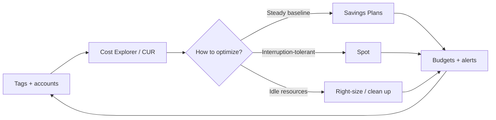

## 1. Core Concept

AWS cost optimization is a loop of **see → assign accountability → optimize → control** (FinOps: Inform, Optimize, Operate). You cannot reduce what you cannot measure or assign to a team, so **tags and reporting** come first, and only then **right-sizing, commitments (Savings Plans) and architecture**.

**Mental model:** an AWS bill is like **your home electricity bill**: know which appliances draw power (tags, Cost Explorer), turn off idle ones (remove waste), switch to a cheaper plan when usage is steady (Savings Plans), and have a breaker that warns when you cross a threshold (Budgets).

## 2. How It Works

**See the cost → Cost Explorer, Budgets, CUR**
- **Cost Explorer** analyzes by service/account/tag and forecasts; **Budgets** sets thresholds (including forecasts) with alerts and actions; the **Cost and Usage Report (CUR)** is the most detailed data, delivered to S3 for analysis with Athena/QuickSight; **Cost Anomaly Detection** spots unusual spend.
- **Cost allocation tags** (user tags) must be **activated in Billing** before they appear in reports.

**Commitment purchasing → Savings Plans, RI, Spot**
- **Compute Savings Plans** cut up to ~66% and apply to **EC2, Fargate, Lambda** in any family/Region; **EC2 Instance Savings Plans** are tied to one family+Region, up to ~72%; **Reserved Instances** are for specific instances; **Spot** cuts up to ~90% but can be reclaimed. Example: a 24/7 baseline uses Savings Plans, interruption-tolerant batch uses Spot.

**Right-sizing → Removing waste**
- **Compute Optimizer** suggests sizes based on real metrics; **Trusted Advisor** points out idle resources. Clean up **unattached EBS volumes**, old snapshots, unused Elastic IPs, instances with long-term low CPU; turn off dev environments after hours (**Instance Scheduler**).

**Cost-saving architecture**
- **Graviton** (ARM) has a better price/performance ratio, **serverless** for sparse load, S3 **Intelligent-Tiering** and lifecycle, a **Gateway endpoint** instead of NAT for S3/DynamoDB.
- **Data transfer fees** are often overlooked: out to the Internet, **cross-AZ/cross-Region**, and the **NAT Gateway** per-GB processing fee.

**Organization**
- **Organizations** consolidates billing and shares commitment discounts across accounts; **cost categories** group costs by business context.

```bash
aws ce get-cost-and-usage --time-period Start=2026-11-01,End=2026-11-21 \
  --granularity DAILY --metrics UnblendedCost --group-by Type=TAG,Key=team
```

## 3. Visual Diagram



## 4. Rules of Thumb & Trade-offs

| Situation / Need | What to choose |
| --- | --- |
| Steady 24/7 load | Savings Plans (or RI) |
| Using EC2 + Fargate + Lambda, wanting flexibility | Compute Savings Plans |
| Interruption-tolerant batch | Spot |
| Unpredictable load | On-Demand + auto scaling |
| Finding idle, oversized resources | Compute Optimizer / Trusted Advisor |
| Cost per team | Cost allocation tags |
| Alerting when over budget | AWS Budgets |

- **What you gain:** a significantly lower bill (commitments, Spot, right-sizing). **What you lose:** commitments reduce flexibility; continuous optimization costs effort and discipline.

## 5. Must Remember / Production Pitfalls

- **Tags do not appear in reports → cost allocation tags not activated → enable them in Billing and standardize tags**.
- **You bought a Savings Plan/RI and then changed architecture → an unused commitment → prefer Compute Savings Plans, review coverage**.
- **Unexpected NAT/data transfer bills → S3 through NAT, cross-AZ → a Gateway endpoint, place services in the same AZ sensibly**.
- **Running interruption-intolerant load on Spot → work lost when reclaimed → checkpoint or use On-Demand for that part**.
- **CloudWatch logs bloat over time → default retention is unlimited → set retention**.
- Exam trap: "steady 24/7 load" → **Savings Plans/RI**; "nightly batch, interruption-tolerant, cheapest" → **Spot (+ Graviton)**; "easily overlooked costs" → **NAT Gateway and data transfer**.

## 6. Search Hooks

- `AWS Savings Plans vs Reserved Instances` — two commitment forms.
- `AWS Cost and Usage Report CUR` — detailed cost data.
- `AWS Compute Optimizer right sizing` — size recommendations.
- `FinOps cost allocation tags` — allocating cost by tag.
- `EC2 Spot Instances interruption` — reclamation and how to handle it.
