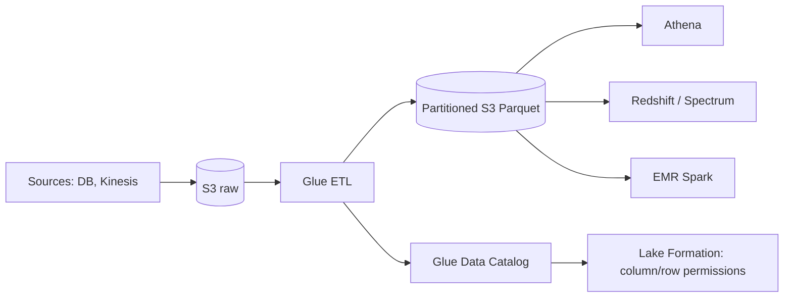

## 1. Core Concept

AWS's analytics stack revolves around the **S3 data lake**: **Glue** (Data Catalog + ETL), **Athena** (serverless SQL on S3), **Redshift** (an MPP data warehouse), **EMR** (managed Spark/Hadoop), **Lake Formation** (permissions) and **QuickSight** (BI). They solve storing data cheaply in one place and then querying it with the engine that fits.

**Mental model:** S3 is **a huge, cheap warehouse**; the Glue Catalog is **the index** for every engine; Athena is **borrowing a magnifying glass for a one-off lookup** (you pay by the amount of paper turned); Redshift is **a dedicated analysis room** with many desks ready; EMR is **a customizable Spark workshop**.

## 2. How It Works

**Glue → Catalog and ETL**
- A **crawler** infers schemas and writes them to the **Data Catalog** (a Hive metastore shared by Athena, EMR and Redshift Spectrum). **Glue ETL** is serverless Spark, with **job bookmarks** to process only new data.

**Athena → SQL on S3, pay by data scanned**
- Billed at about **5 USD per TB scanned**. To cut cost and speed up: **Parquet/ORC** (columnar, compressed), **partitions** on frequently filtered columns (for example `dt`), and select only needed columns. Example: scanning 1 TB of CSV in full = 5 USD; the same data as partitioned Parquet scans only a few tens of GB.

**Redshift → An MPP warehouse**
- Columnar, **leader node + compute nodes**. The **distribution style** (KEY, ALL, EVEN, AUTO) decides which node holds the data; a **sort key** optimizes range filters. **RA3** separates compute and storage; **Spectrum** queries S3; **Serverless** scales automatically; the fastest load is **`COPY` from S3**.

**EMR → Custom Spark/Hadoop**
- Runs on EC2/EKS/Serverless; **core nodes** hold HDFS, **task nodes** use **Spot** to cut cost.

**Lake Formation → Centralized permissions**
- **Column/row/cell-level** and **tag-based** permissions on the catalog, replacing scattered IAM/bucket policies.

```sql
-- Athena: partition pruning scans only the needed days
SELECT country, SUM(amount)
FROM sales_parquet
WHERE dt BETWEEN '2026-11-01' AND '2026-11-07'
GROUP BY country;
```

## 3. Visual Diagram



## 4. Rules of Thumb & Trade-offs

| Situation / Need | What to choose |
| --- | --- |
| Ad-hoc, infrequent queries, no cluster to manage | Athena |
| BI for many users, complex joins, steady performance | Redshift |
| Custom Spark, large ML | EMR |
| ETL without managing a cluster | Glue |
| Column/row permissions across the whole data lake | Lake Formation |

- **What you gain:** cheap storage, choosing the engine by need. **What you lose:** serverless pay-per-scan can be expensive if data is not optimized; clusters carry fixed cost.

## 5. Must Remember / Production Pitfalls

- **The Athena bill spikes → queries on unpartitioned CSV scan everything → Parquet + partitions + select only needed columns**.
- **Queries get slower over time → too many small files in S3 → compact files**.
- **Redshift joins are slow with heavy shuffling → a wrong distribution key → choose KEY on the join column or ALL for small tables**.
- **A crawler is expensive on large tables → repeated scanning → a reasonable schedule or partition projection**.
- **Permissions are tangled in many places → using separate bucket policies + IAM → centralized Lake Formation**.
- Exam trap: "reduce Athena cost" → **Parquet + partitions + select only needed columns**; "BI for many users, complex joins" → **Redshift**; "column-level permissions for a data lake" → **Lake Formation**.

## 6. Search Hooks

- `Athena partitioning Parquet cost` — reducing data scanned.
- `Glue Data Catalog crawler` — schema inference and a shared catalog.
- `Redshift distribution key sort key` — designing tables for MPP.
- `Redshift Spectrum` — query S3 from Redshift.
- `Lake Formation permissions` — column/row-level data lake permissions.
