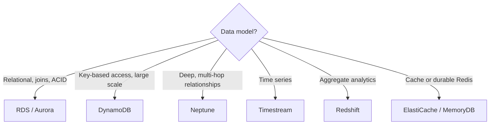

## 1. Core Concept

AWS has many purpose-built databases; choose by **data model and access pattern**, not by habit. A real application usually uses **polyglot persistence**: each kind of data gets a suitable engine instead of forcing everything into one DB.

**Mental model:** like a toolkit: **SQL (RDS/Aurora)** is the universal wrench set for relational data and transactions; **DynamoDB** is an extremely fast stamping press for key-based access at large scale; **Neptune** is a relationship map; **Timestream** is a time log; **a cache** is the shelf within arm's reach.

## 2. How It Works

**Relational → RDS and Aurora**
- **RDS** (MySQL, PostgreSQL, MariaDB, SQL Server, Oracle) and **Aurora** (MySQL/PostgreSQL compatible, 6 copies across 3 AZs). Suits ACID transactions, joins and reports. **Multi-AZ** (HA, a synchronous standby) differs from a **Read Replica** (read scaling, asynchronous).

**Key-value and document → DynamoDB, DocumentDB**
- **DynamoDB**: single-digit millisecond latency, near-unlimited scale, key-based access; **Global Tables** for multi-Region active-active. **DocumentDB** is MongoDB-compatible for document workloads.

**Wide-column → Keyspaces**
- A Cassandra-compatible, serverless service suited to heavy writes by partition.

**Graph → Neptune**
- Supports Gremlin, SPARQL, openCypher; suits social networks, fraud detection and recommendations that need **multi-hop relationship traversal** where SQL joins would be very expensive.

**In-memory → ElastiCache, MemoryDB**
- **ElastiCache** is a cache; **MemoryDB** is **durable** Redis used as a primary database.

**Time-series, ledger, search, warehouse**
- **Timestream** for IoT/metric time series; **QLDB** is an immutable ledger (AWS is winding it down, so consider Aurora + an audit table); **OpenSearch** for search/logs; **Redshift** for the warehouse.

**Multi-Region**
- **Aurora Global Database** (~1-second replication), **DynamoDB Global Tables** (multi-active, last writer wins).

## 3. Visual Diagram

## 4. Rules of Thumb & Trade-offs

| Situation / Need | What to choose |
| --- | --- |
| Transactions, relationships, ordinary reports | RDS / Aurora |
| Key-based access, predictable scale and latency | DynamoDB |
| Multi-hop friends of friends | Neptune |
| IoT, time-series metrics | Timestream |
| MongoDB compatibility | DocumentDB |
| Durable Redis as the primary DB | MemoryDB |
| Requirements unclear | Start with PostgreSQL/Aurora |

- **What you gain:** the optimal tool for each access pattern. **What you lose:** more engines mean more operations, data synchronization and learning cost.

## 5. Must Remember / Production Pitfalls

- **Using DynamoDB for ad-hoc queries and joins → the wrong tool, Scans are expensive → SQL/a warehouse or design GSIs by access pattern**.
- **Thinking Multi-AZ scales reads → the standby does not serve reads → a Read Replica**.
- **Reading stale data after a write → a replica has lag → read-after-write uses the writer**.
- **Aurora Serverless for high continuous load can cost more than fixed instances → compute cost against the real load pattern**.
- **Using Redis cache as the primary data source → lost when the node dies → use MemoryDB or keep the DB as the source of truth**.
- Exam trap: "multi-hop friends of friends" → **Neptune**; "RDS Multi-AZ is for" → **HA, not read scaling**; "IoT time series" → **Timestream**.

## 6. Search Hooks

- `Aurora Global Database` — a low-latency multi-Region DB.
- `DynamoDB Global Tables` — multi-Region active-active.
- `Amazon Neptune graph database` — a managed graph.
- `Amazon Timestream` — a time-series database.
- `RDS Multi-AZ vs read replica` — HA vs read scaling.
