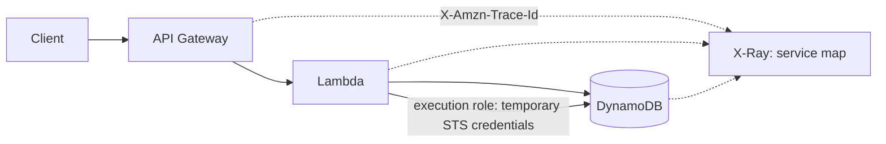

## 1. Core Concept

AWS knowledge for developers (the focus of the **Developer Associate** certification) covers: how applications **authenticate with AWS** (roles and temporary credentials), how to **call APIs correctly** (retries, pagination, idempotency) and how to **observe** (X-Ray). It addresses the pain of leaked access keys, throttling errors and not knowing where a request is slow in a distributed system.

**Mental model:** your application is **an employee wearing a temporary badge** (role/STS) calling dozens of services over a network; the network can fail at any time so **every call must tolerate retries**, and X-Ray is **a trace sticker** attached to a request to follow where it goes.

## 2. How It Works

**Credentials → Never hard-code keys**
- The SDK/CLI **credential provider chain** tries in order: environment variables → the shared credentials/config file (profile) → **a role attached to the compute** (ECS task role, EC2 instance profile through the metadata service, Lambda execution role). Prefer **roles**; when running locally use a profile/SSO.
- **STS**: `AssumeRole` (temporary credentials for 1–12 hours, cross-account, use **ExternalId** for third parties to prevent the confused deputy), `AssumeRoleWithWebIdentity` (OIDC/IRSA).

**Calling APIs correctly → Retries, pagination, idempotency**
- Throttling errors (`ThrottlingException`, `ProvisionedThroughputExceededException`, `429`) need **retry with exponential backoff + jitter** (the SDK already does this; do not retry densely without jitter).
- **Pagination**: APIs return pages (`NextToken`, `ContinuationToken`, DynamoDB `LastEvaluatedKey`); use a **paginator**, otherwise you silently miss data.
- Write operations need **idempotency** because retries can run twice (idempotency keys, conditional writes).

**S3 Presigned URL → Temporary sharing**
- A pre-signed URL carries **the signer's permissions** and has an expiry (up to 7 days with IAM user credentials, shorter if signed with temporary credentials); it allows upload/download without exposing credentials.

**X-Ray → Distributed tracing**
- A **trace** consists of **segments/subsegments**; the **trace ID** travels in the **`X-Amzn-Trace-Id`** header; there is a **service map**; **annotations** (indexed, searchable) and **metadata** (not indexed). Enable through the SDK/daemon/ADOT or **active tracing** on Lambda/API Gateway; **sampling** limits cost.

**Other**
- **AppSync**: managed GraphQL, resolvers to DynamoDB/Lambda/HTTP, real-time **subscriptions**. **Lambda**: versions and **aliases** (weighted traffic shifting), **layers**, environment variables encrypted with KMS.

```python
import boto3
s3 = boto3.client("s3")
url = s3.generate_presigned_url("get_object",
    Params={"Bucket": "b", "Key": "k"}, ExpiresIn=300)  # 5 minutes
paginator = s3.get_paginator("list_objects_v2")
for page in paginator.paginate(Bucket="b"):   # iterate through every page
    ...
```

## 3. Visual Diagram



## 4. Rules of Thumb & Trade-offs

| Situation / Need | What to choose |
| --- | --- |
| Lambda/EC2/ECS calling AWS | A role attached to the compute, never embed keys |
| Letting outsiders upload/download temporarily | S3 Presigned URL |
| Granting cross-account permissions | STS AssumeRole (+ ExternalId) |
| Find which service a request is slow in | X-Ray |
| Retrying on throttling | Exponential backoff + jitter |

- **What you gain:** better security, fault tolerance, visibility into the request flow. **What you lose:** X-Ray adds overhead/cost (controlled with sampling); retries and idempotency make code more complex.

## 5. Must Remember / Production Pitfalls

- **Access keys in code/Git → scanned and taken over by bots → roles or temporary credentials, Secrets Manager**.
- **Throttling and then a retry storm (thundering herd) → simultaneous retries without jitter → exponential backoff + jitter**.
- **Data silently missing → only the first page was read → use a paginator and iterate to the end**.
- **A retry writes twice → a non-idempotent operation → idempotency keys or conditional writes**.
- **A presigned URL expires early → signed with temporary credentials that expire first → sign with longer-lived credentials or shorten the usage window**.
- Exam trap: "a Lambda needs permission to write S3" → **the execution role**; "share a file temporarily without exposing credentials" → **a presigned URL**; "retry without jitter" → **thundering herd**.

## 6. Search Hooks

- `AWS X-Ray tracing` — distributed tracing.
- `AWS SDK retry exponential backoff` — retrying correctly.
- `S3 presigned URL` — temporary sharing without exposing credentials.
- `AWS STS AssumeRole` — temporary credentials.
- `AWS AppSync GraphQL` — managed GraphQL.
