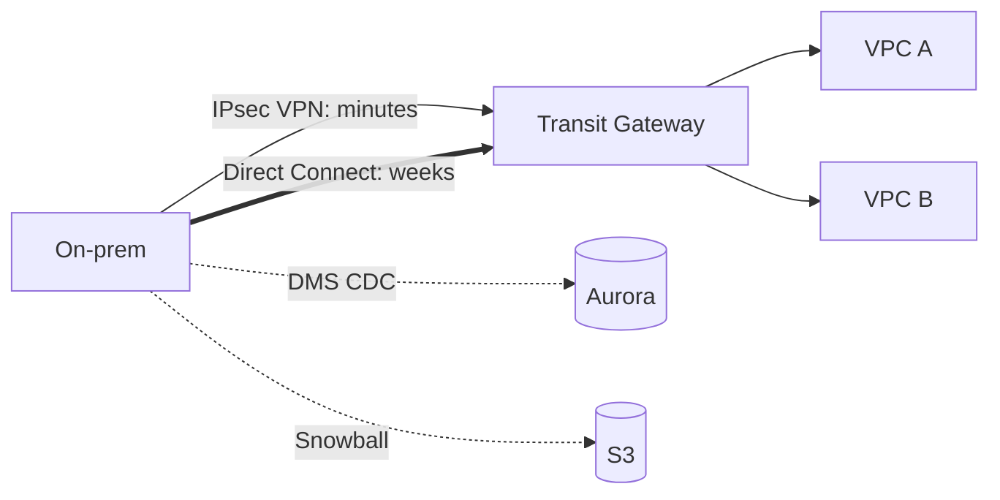

## 1. Core Concept

Connecting on-premises to AWS and migrating data uses four groups of tools: **Site-to-Site VPN** and **Direct Connect** (network connectivity), **Transit Gateway** (a hub for many VPCs), **DMS/DataSync/the Snow family** (data migration). They answer two questions: **which path to take** and **how to bring the data across** within limited bandwidth and time.

**Mental model:** a VPN is **an encrypted public road** — set up in minutes but its quality depends on the Internet; Direct Connect is **a private highway** — stable, but it takes weeks to build; Snowball is **a truck carrying hard drives** when the link is too small for the load.

## 2. How It Works

**Site-to-Site VPN → Fast, cheap, over the Internet**
- **IPsec**, each connection has **2 tunnels** for redundancy, up to about **1.25 Gbps per tunnel**; terminates on a **Virtual Private Gateway** or **Transit Gateway**; supports **BGP** or static routes. Set up in **minutes**.

**Direct Connect (DX) → Private, stable**
- A **dedicated** line to AWS (dedicated **1/10/100 Gbps**, or hosted through a partner), stable latency, **not encrypted by default** (add VPN over DX or MACsec). A **private VIF** to a VPC, a **public VIF** to public services, a **transit VIF** to Transit Gateway; a **DX Gateway** connects many VPCs/Regions. Installation takes **a few weeks**.
- **Redundancy:** two DX links at two locations, or **DX + a VPN backup**.

**Transit Gateway → Hub-and-spoke**
- One hub connecting **many VPCs and on-prem**, with **transitive routing**, replacing a mesh of **VPC Peering** (non-transitive). Supports route tables and inter-Region peering.

**Data migration**
- **DataSync**: automated online file transfer (NFS/SMB/HDFS → S3/EFS/FSx) with integrity checks. **Snowcone/Snowball Edge**: physical devices for large data or low bandwidth. **Storage Gateway**: hybrid storage (File/Volume/Tape).
- **DMS**: database migration with **full load + CDC** with near-zero downtime; **same engine** (homogeneous) needs only DMS, **different engines** (for example Oracle → Aurora PostgreSQL) need the **Schema Conversion Tool (SCT)** first. **AWS MGN** rehosts servers with block-level replication.
- **The 6R strategies** (now with Relocate): Rehost, Replatform, Refactor, Repurchase, Retire, Retain.

**A calculation example:** 200 TB over a 1 Gbps link (~100 MB/s theoretical) takes over **23 days** continuously; Snowball is usually faster.

## 3. Visual Diagram

## 4. Rules of Thumb & Trade-offs

| Situation / Need | What to choose |
| --- | --- |
| You need connectivity now, cheaply | Site-to-Site VPN |
| Large bandwidth, stable latency, private | Direct Connect (+ VPN backup) |
| Many VPCs needing transitive connectivity | Transit Gateway |
| Tens of TB, low bandwidth | Snowball |
| Low-downtime DB migration | DMS with CDC (+ SCT if engines differ) |
| Periodic online file sync | DataSync |

- **What you gain:** the right tool for the right bandwidth/time. **What you lose:** VPN depends on the Internet; DX costs time and money; Snowball has shipping delay.

## 5. Must Remember / Production Pitfalls

- **If Direct Connect dies you lose connectivity → a single link is a single point of failure → add a second DX or a VPN backup**.
- **You cannot route between on-prem and a VPC → overlapping CIDRs → plan non-overlapping CIDRs from the start**.
- **Data on DX is unencrypted → DX is private but not encrypted by default → VPN over DX or MACsec if encryption is needed**.
- **A DMS migration between different engines fails on schema → not all schema/code is converted → use SCT**.
- **Uploading hundreds of TB over the Internet takes too long → compute bandwidth first → Snowball**.
- Exam trap: "DX takes weeks but you need connectivity now" → **VPN first**; "VPC peering that is transitive" → **no, use Transit Gateway**; "migrate 200 TB with low bandwidth" → **Snowball**.

## 6. Search Hooks

- `AWS Direct Connect vs Site-to-Site VPN` — comparing two hybrid connectivity types.
- `AWS Transit Gateway` — a hub connecting many VPCs and on-prem.
- `AWS DMS CDC schema conversion tool` — near-zero-downtime DB migration.
- `AWS Snowball data transfer` — moving large data with physical devices.
- `6 Rs of cloud migration` — migration strategies.
