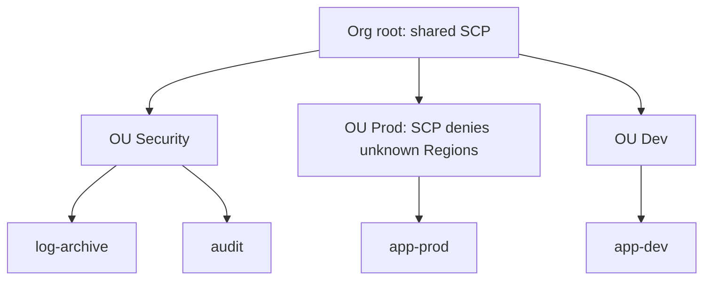

## 1. Core Concept

When you have many accounts, **AWS Organizations** groups them into a tree of **OUs**, consolidates billing and applies **SCPs** as guardrails; **Control Tower** sets up a best-practice **landing zone** for you. They solve governing tens to hundreds of accounts while still **isolating the blast radius** and controlling permissions.

**Mental model:** each account is **a separate locked apartment**: a fault or violation in one does not spread to another. An SCP is **the building rules** that set out what must never be done, but **it is not a key** — you still need IAM to actually get in.

## 2. How It Works

**Organization → A tree of accounts and billing**
- The **management account** (pays and administers the organization) and **member accounts**, divided into **OUs**. **Consolidated billing** merges bills and shares **Savings Plans/RI** discounts across accounts.

**SCP (Service Control Policy) → A maximum limit**
- An SCP sets a **permission ceiling** for every principal in an account/OU; **effective permissions = the intersection of the SCP and IAM policies**. An SCP **does not grant permissions**, **does not apply to the management account** and does not affect **service-linked roles**. Two styles: a **deny list** (block specific things, easier to manage) and an allow list (stricter but harder).

```json
{ "Effect": "Deny", "Action": "*", "Resource": "*",
  "Condition": { "StringNotEquals": { "aws:RequestedRegion": ["ap-southeast-1"] } } }
```

**Control Tower → The landing zone**
- Quickly builds a **landing zone** containing **log archive** and **audit** accounts, **guardrails** (preventive via SCPs, detective via AWS Config, proactive via CloudFormation hooks) and an **Account Factory** that creates standardized accounts.

**IAM Identity Center → SSO**
- Sign in once to many accounts through **permission sets**, connecting the company IdP.

**Multi-account shared services**
- A CloudTrail **organization trail**, a **delegated administrator** (GuardDuty/Security Hub from the security account), **AWS RAM** sharing subnets/Transit Gateway, **tag policies**, **backup policies**; the `aws:PrincipalOrgID` condition in a resource policy to allow only accounts in the organization.

## 3. Visual Diagram



## 4. Rules of Thumb & Trade-offs

| Situation / Need | What to choose |
| --- | --- |
| Prevent any account from turning off CloudTrail or using unknown Regions | SCP deny |
| Quickly stand up a standard multi-account environment | Control Tower |
| SSO across many accounts | IAM Identity Center |
| Share subnets/Transit Gateway across accounts | AWS RAM |
| Consolidate bills, share discounts | Consolidated billing |

- **What you gain:** strong isolation, centralized guardrails, clear cost per account. **What you lose:** multi-account operational cost (networking, cross-account access, tooling) and the need for tag/naming discipline.

## 5. Must Remember / Production Pitfalls

- **An SCP has Allow yet you still get AccessDenied → an SCP does not grant permissions → add the matching IAM policy**.
- **You need to restrict the management account too but the SCP has no effect → the management account is exempt from SCPs → do not run workloads there**.
- **Using the management account for workloads → permissions too broad, high risk → use it only for billing/organization**.
- **Blocking a foundational service with an SCP by mistake → breaks integrations (IAM, STS, global services) → try the SCP in a test OU and use conditional denies**.
- **Accounts overlap in permissions because there is no standard → not using Control Tower/permission sets → standardize with a landing zone**.
- Exam trap: "prevent every account from using Regions other than ap-southeast-1" → **an SCP deny on aws:RequestedRegion**; "does an SCP grant permissions" → **no**; "SCPs do not apply to" → **the management account**.

## 6. Search Hooks

- `AWS Organizations SCP service control policies` — a maximum-permission guardrail.
- `AWS Control Tower landing zone` — standing up a standard multi-account environment.
- `IAM Identity Center permission sets` — SSO into many accounts.
- `AWS RAM resource access manager` — sharing resources across accounts.
- `multi-account strategy AWS` — the account separation strategy.
