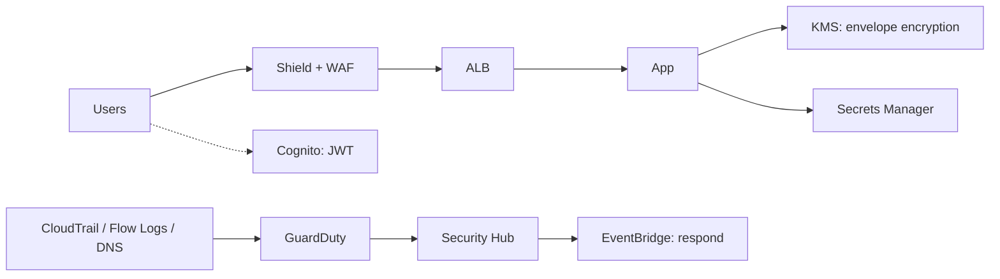

## 1. Core Concept

Beyond IAM, AWS has a set of dedicated security services across the lifecycle: **KMS** (encryption keys), **Secrets Manager/Parameter Store** (secrets), **WAF/Shield** (blocking web attacks and DDoS), **GuardDuty/Inspector/Macie/Security Hub** (detection), **Cognito** (authenticating application users). They solve protecting at several layers instead of relying on a single fence.

**Mental model:** like protecting a building: **WAF/Shield** are the gate and barriers, **KMS/Secrets** are the safe and keys, **GuardDuty** is cameras + staff monitoring for suspicious people, **Cognito** is the desk issuing entry cards to the application's guests.

## 2. How It Works

**KMS → Key management and envelope encryption**
- Key types: **AWS owned**, **AWS managed** (`aws/s3`, rotated yearly automatically) and **customer managed keys (CMK)** (you control the key policy, rotation and deletion). Keys are **tied to a Region**; use a **multi-Region key** if you need replication.
- KMS directly encrypts at most **4 KB**, so large data uses **envelope encryption**: call `GenerateDataKey` to get a **data key**, use the data key to encrypt the data locally, then store the **encrypted data key** beside the data. Impact: you do not send the whole file to KMS, saving requests and latency.
- Using a key needs a **key policy** (the source of truth) plus IAM/grants; key deletion has a **7–30 day** waiting period. **CloudHSM** when you need your own HSM.

**Secrets Manager vs Parameter Store → Secrets**
- **Secrets Manager** stores and **automatically rotates** secrets (RDS via Lambda), charged per secret. **SSM Parameter Store** is cheap/free for configuration and simple secrets, without built-in automatic rotation like Secrets Manager.

**Detection and protection**
- **GuardDuty** analyzes **CloudTrail, VPC Flow Logs, DNS logs** (no agent needed) to detect anomalous behavior; it only **detects**, it does not block automatically (combine with EventBridge/Lambda to respond).
- **WAF** sits on an **ALB, API Gateway REST, CloudFront**: managed rule groups (SQLi, XSS), **rate-based rules**, geo, IP sets. **Shield Standard** is free L3/L4 DDoS protection; **Shield Advanced** is paid with a support team and cost protection.
- **Inspector** scans EC2/ECR/Lambda for vulnerabilities; **Macie** finds sensitive data (PII) in S3; **Security Hub** aggregates findings; **ACM** issues free TLS certificates with automatic renewal for ELB/CloudFront.

**Cognito → Authenticating application users**
- **User Pool**: a user directory, sign-up/sign-in, MFA, social login, issuing **JWTs**. **Identity Pool**: exchanges an identity (from a User Pool or another IdP) for **temporary AWS credentials** to access AWS services directly.

```python
import boto3
kms = boto3.client("kms")
dk = kms.generate_data_key(KeyId="alias/app", KeySpec="AES_256")
# dk["Plaintext"] encrypts the data locally, dk["CiphertextBlob"] is stored alongside
```

## 3. Visual Diagram



## 4. Rules of Thumb & Trade-offs

| Situation / Need | What to choose |
| --- | --- |
| Block SQL injection, XSS, rate limit | AWS WAF |
| Detect compromised accounts, unusual behavior | GuardDuty |
| Auto-rotating secrets (RDS) | Secrets Manager |
| Simple, cheap configuration/secrets | Parameter Store |
| Sign-in for web/mobile apps | Cognito User Pool |
| Issue AWS credentials to app users | Cognito Identity Pool |
| Encrypt large files | KMS envelope encryption |

- **What you gain:** layered protection, managed services. **What you lose:** cost by request/quantity, a wrong key policy can lock you out, many services must be coordinated.

## 5. Must Remember / Production Pitfalls

- **Encrypting a large file by sending all of it to KMS → exceeds the 4 KB limit and costs requests → envelope encryption**.
- **KMS throttling under high traffic → request quota exceeded → cache data keys, S3 Bucket Key, or raise the quota**.
- **A wrong key policy locks out even the admin → nobody can use the key → always keep permissions for root/an admin role and test first**.
- **A secret sits in an environment variable/code → leaks via logs or Git → Secrets Manager/Parameter Store with IAM**.
- **Expecting GuardDuty to block automatically → it only detects → connect EventBridge → Lambda/SSM to automate the response**.
- Exam trap: "encrypt a large file with KMS" → **envelope encryption**; "block SQLi at the ALB" → **WAF**; "User Pool or Identity Pool" → **the User Pool issues JWTs, the Identity Pool issues AWS credentials**.

## 6. Search Hooks

- `AWS KMS envelope encryption` — encrypt data with a data key.
- `Secrets Manager rotation` — automatically rotating secrets.
- `Amazon GuardDuty findings` — threat detection.
- `AWS WAF rate based rules` — abuse protection at the web layer.
- `Cognito user pool vs identity pool` — authentication vs issuing AWS credentials.
