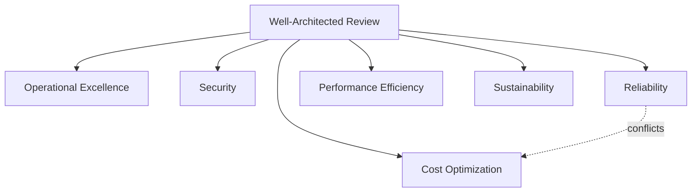

## 1. Core Concept

The **AWS Well-Architected Framework** is a set of principles for assessing and improving architectures across **6 pillars**: **Operational Excellence, Security, Reliability, Performance Efficiency, Cost Optimization, Sustainability**. It addresses the pain of "the architecture works but we do not know where the risks are", and is also **a reasoning frame** for the SAA/SAP exams.

**Mental model:** like **six gauges on a dashboard**: you cannot turn one gauge to the maximum while ignoring the other five; every architectural decision is a **trade-off** among them.

## 2. How It Works

**Six pillars → What to do and typical services**
- **Operational Excellence**: operate with code (IaC), make small, reversible changes, runbooks, learn from incidents. Examples: CloudFormation, CloudWatch.
- **Security**: strong identity, **least privilege**, protect data at rest/in transit, traceability, automated response. Examples: IAM, KMS, GuardDuty, CloudTrail.
- **Reliability**: **multi-AZ**, self-healing, quota management, failover testing, backup/DR by **RPO/RTO**. Examples: ELB, Auto Scaling, Route 53, Backup.
- **Performance Efficiency**: pick the right resource types, serverless, measurement, edge/multi-Region for latency. Examples: CloudFront, ElastiCache.
- **Cost Optimization**: **right-sizing**, suitable pricing models (Savings Plans, Spot), removing waste, attributing cost with tags. Examples: Cost Explorer, Compute Optimizer.
- **Sustainability**: use resources efficiently, reduce waste (Graviton, serverless, right-sizing).

**Tools**
- The **Well-Architected Tool** (question-based reviews that produce a list of risks), **Lenses** (Serverless, SaaS, ML…), **Trusted Advisor** (checks for cost, performance, security, fault tolerance and service limits; full checks with Business/Enterprise Support).

**Shared Responsibility Model**
- AWS is responsible for **security of the cloud** (physical infrastructure, managed services); the customer is responsible for **security in the cloud** (data, IAM, configuration, the OS for EC2).

**How to reason when choosing a solution**
- By default prefer **managed/serverless, loosely coupled (queues, events), multi-AZ, least privilege, encryption, automation**, unless the question/requirements say otherwise.

## 3. Visual Diagram

## 4. Rules of Thumb & Trade-offs

| Situation / Need | What to choose |
| --- | --- |
| Tolerate a single AZ failure | Multi-AZ (Reliability) |
| Cut cost while keeping availability | Right-sizing, Savings Plans, Spot for interruption-tolerant load |
| Minimum permissions, encryption, traceability | Security |
| Assess an architecture against the official checklist | Well-Architected Tool |
| Automatic suggestions on cost, security, quotas | Trusted Advisor |

- **What you gain:** you see the risks fully, a common language between teams. **What you lose:** the pillars conflict — Reliability (multi-AZ/Region) raises Cost; Security raises operational complexity; Performance (more resources) raises Cost.

## 5. Must Remember / Production Pitfalls

- **Confusing HA with DR → only multi-AZ and assuming DR exists → still goes down when the Region fails → DR needs cross-Region by RPO/RTO**.
- **Cost optimization cuts redundancy too → availability drops → optimize by requirements, do not cut fault-tolerant infrastructure**.
- **Treating review as a one-off → the architecture drifts → review periodically before launch, after incidents and on major changes**.
- **Broad permissions "for convenience" → a Security risk → least privilege and Access Analyzer**.
- **No cost tags → you do not know who spends → standardize tags and cost allocation**.
- Exam trap: "cut cost without affecting availability" → **right-sizing, Savings Plans, Spot for interruption-tolerant load**; "which pillar is multi-AZ" → **Reliability**; "what is AWS responsible for" → **security of the cloud**.

## 6. Search Hooks

- `AWS Well-Architected Framework six pillars` — the six architectural pillars.
- `AWS Well-Architected Tool lenses` — an assessment tool with lenses.
- `AWS Trusted Advisor checks` — cost, security and performance recommendations.
- `shared responsibility model AWS` — the split of security responsibility.
- `RPO RTO disaster recovery` — recovery objectives after a disaster.
