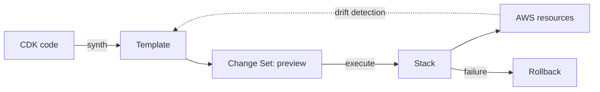

## 1. Core Concept

**CloudFormation** describes AWS infrastructure with declarative templates (YAML/JSON) and deploys them as a **stack**; **CDK** lets you write infrastructure in a programming language (TypeScript, Python…) and generates CloudFormation templates. They solve the pain of hand-building that is not repeatable, reviewable or reversible.

**Mental model:** a template is **the architectural blueprint**, CloudFormation is **the construction crew** that compares the blueprint with the existing building and only changes the differences; a **Change Set** is **a preview of changes** before the crew knocks down any walls.

## 2. How It Works

**Template → Structure and functions**
- Sections: `Parameters`, `Mappings`, `Conditions`, `Resources` (required), `Outputs`. Intrinsic functions: `!Ref`, `!GetAtt`, `!Sub`, `!Join`, `!ImportValue`. Practical limits: **500 resources per stack**, an inline template of at most 51,200 bytes (through S3 up to 1 MB).

**Stack lifecycle → Create, update, rollback**
- A failed create **rolls back** everything. On update, each change falls into one of three kinds: **no interruption**, **some interruption**, or **replacement** (delete and recreate, **possibly losing data**). A dangerous state: `UPDATE_ROLLBACK_FAILED` needs manual handling.

**Change Set → Preview**
- Create a change set to see which resources are `Add/Modify/Remove` and whether there is a `Replacement`, then execute. This is the safe way before changing production.

**Data protection and safety**
- **DeletionPolicy**: `Delete` (default), `Retain` or `Snapshot` (for RDS/EBS) when the stack is deleted; **UpdateReplacePolicy** is similar for replacements. A **Stack Policy** blocks updates to sensitive resources. **Drift detection** compares real state with the template to find manual edits outside CloudFormation.

**Extensions**
- **Nested stacks** split things up; **cross-stack references** through `Export/ImportValue` (an export being imported cannot be deleted/changed); **StackSets** deploy one template to **many accounts/Regions** (Organizations integration); **custom resources** (Lambda) for things CloudFormation does not yet support.

**CDK and SAM**
- **CDK**: **L1** constructs (1-to-1 with CloudFormation), **L2** (sensible defaults), **L3** (patterns); `cdk synth` → a template, `cdk diff`, `cdk deploy`. **SAM** is a CloudFormation extension for serverless.

```yaml
Resources:
  Db:
    Type: AWS::RDS::DBInstance
    DeletionPolicy: Snapshot
    UpdateReplacePolicy: Snapshot
    Properties: { DBInstanceClass: db.t3.micro, Engine: postgres, AllocatedStorage: 20 }
```

## 3. Visual Diagram



## 4. Rules of Thumb & Trade-offs

| Situation / Need | What to choose |
| --- | --- |
| Preview the impact before updating production | Change Set |
| Keep the database when deleting a stack | DeletionPolicy Retain/Snapshot |
| Deploy one template to 30 accounts | StackSets |
| Detect hand-edited configuration | Drift detection |
| Infrastructure in a programming language, complex loops/conditions | CDK |
| Multi-cloud | Terraform |

- **What you gain:** infrastructure that is versioned, reviewable, reversible and repeatable. **What you lose:** tight coupling to AWS, learning templates, the risk of a replacement losing data if uncontrolled.

## 5. Must Remember / Production Pitfalls

- **An update wipes the database → a property that causes replacement → read the change set and set DeletionPolicy/UpdateReplacePolicy Snapshot**.
- **The configuration differs from the template after an incident → someone edited by hand → drift detection and restrict direct edit permissions**.
- **You cannot delete a stack/export → the export is imported by another stack → remove the import first**.
- **A stack is stuck in `UPDATE_ROLLBACK_FAILED` → a resource was edited by hand or deleted → continue update rollback, skipping the failed resource**.
- **A stack that is too large, hitting 500 resources → split by lifecycle** (network, data, app).
- Exam trap: "keep the DB when deleting the stack" → **DeletionPolicy Retain/Snapshot**; "preview changes" → **Change Set**; "the same template across many accounts" → **StackSets**.

## 6. Search Hooks

- `CloudFormation change sets` — previewing changes.
- `CloudFormation drift detection` — detecting hand-edited configuration.
- `CloudFormation StackSets` — deploying across accounts and Regions.
- `AWS CDK constructs L1 L2 L3` — CDK's levels of abstraction.
- `AWS SAM serverless` — a framework for serverless applications.
