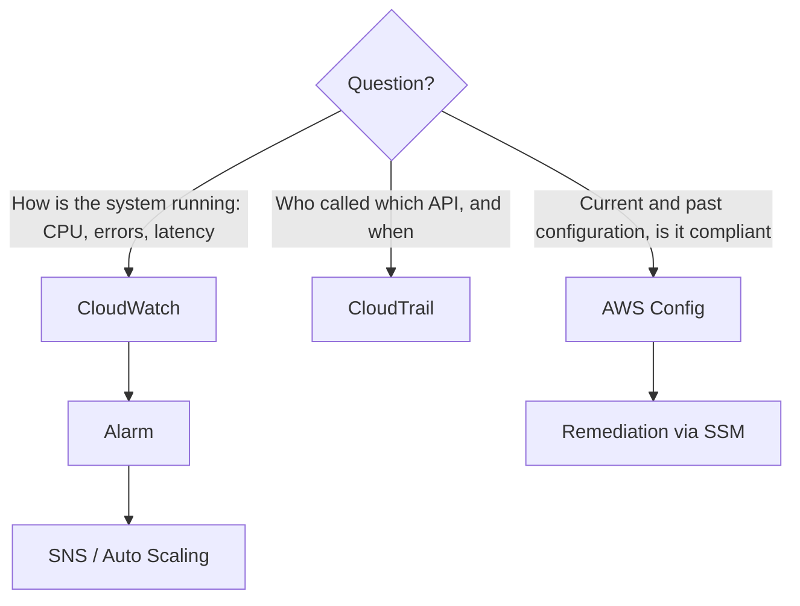

## 1. Core Concept

AWS's three observability services answer three different questions: **CloudWatch** tells you **how the system is running** (metrics, logs, alarms), **CloudTrail** tells you **who called which API** (audit), and **AWS Config** tells you **how resources were configured over time** and whether they comply. Confusing these three is the most common mistake in incident investigation and in exams.

**Mental model:** CloudWatch is **the gauges on the dashboard** (speed, temperature), CloudTrail is **the camera recording who comes and goes**, Config is **a notebook of snapshots of the state** at each moment together with a checklist of house rules.

## 2. How It Works

**CloudWatch Metrics and Alarms → Performance**
- Metrics belong to a **namespace** and **dimensions**; EC2 sends every **5 minutes** by default (**detailed monitoring** 1 minute); **custom metrics** are standard 1 minute, **high-resolution** down to **1 second**. **RAM and disk usage are not available**: you must install the **CloudWatch Agent** or send custom metrics.
- An **alarm** has states `OK/ALARM/INSUFFICIENT_DATA`; actions include sending to SNS, Auto Scaling, EC2 recover; a **composite alarm** combines conditions to reduce noise; you must choose how to handle **missing data**.

**CloudWatch Logs → Centralized logs**
- **Log groups/streams**, **retention** (by default **never expires**, so set it), **Logs Insights** for queries, **metric filters** turning logs into metrics, **subscription filters** pushing to Lambda/Kinesis/OpenSearch, export to S3.
- **EventBridge** reacts to events or runs on a schedule.

**CloudTrail → API audit**
- Records **management events** (create/delete/modify resources) by default, viewable in **Event history** for **90 days**; to keep them longer you must create a **trail** that stores to S3 (multi-Region, **organization trail**, **log file validation**).
- **Data events** (S3 object-level, Lambda invoke) are **not enabled by default** and are billed. CloudTrail records **who/when/from where**, not the content of the data.

**AWS Config → Configuration and compliance**
- Records **configuration items** over time (a timeline), evaluates with **Config Rules** (managed or custom Lambda), **conformance packs**, and **auto-remediation** through **SSM Automation**; an **aggregator** collects across accounts/Regions.

```bash
aws cloudtrail lookup-events --lookup-attributes AttributeKey=EventName,AttributeValue=TerminateInstances
```

## 3. Visual Diagram



## 4. Rules of Thumb & Trade-offs

| Situation / Need | What to choose |
| --- | --- |
| Who terminated the EC2 / deleted the bucket | CloudTrail |
| High CPU, rising latency, application errors | CloudWatch |
| Was a bucket switched to public, over time | AWS Config |
| Investigate "who changed the security group" | CloudTrail + Config |
| Track RAM/disk | CloudWatch Agent |
| Automatically fix configuration violations | Config rule + remediation |

- **What you gain:** full visibility of performance, actions and configuration. **What you lose:** log ingest cost, data events and Config charges by the number of recorded configurations.

## 5. Must Remember / Production Pitfalls

- **You cannot see RAM/disk in CloudWatch → EC2 does not send them by default → install the CloudWatch Agent**.
- **You want to know who deleted an S3 object but there is no trace → data events not enabled → enable data events for buckets that need auditing**.
- **You need more than 90 days of history → only Event history was used → create a trail that stores to S3 or CloudTrail Lake**.
- **The CloudWatch Logs bill balloons → the default retention is unlimited → set retention and filter logs at the source**.
- **An alarm keeps flipping between ALARM/INSUFFICIENT_DATA → missing data handling is not suitable → configure treat missing data**.
- Exam trap: "who terminated the EC2" → **CloudTrail**; "track RAM" → **CloudWatch Agent/custom metric**; "a bucket became public over time, fix it automatically" → **Config rule + remediation**.

## 6. Search Hooks

- `CloudWatch Logs Insights` — query logs directly in CloudWatch.
- `CloudWatch Agent custom metrics memory` — collecting RAM and disk.
- `CloudTrail management events data events` — distinguishing the two event types.
- `AWS Config rules remediation` — automatic configuration compliance evaluation.
- `CloudWatch composite alarms` — combining alarms to reduce noise.
