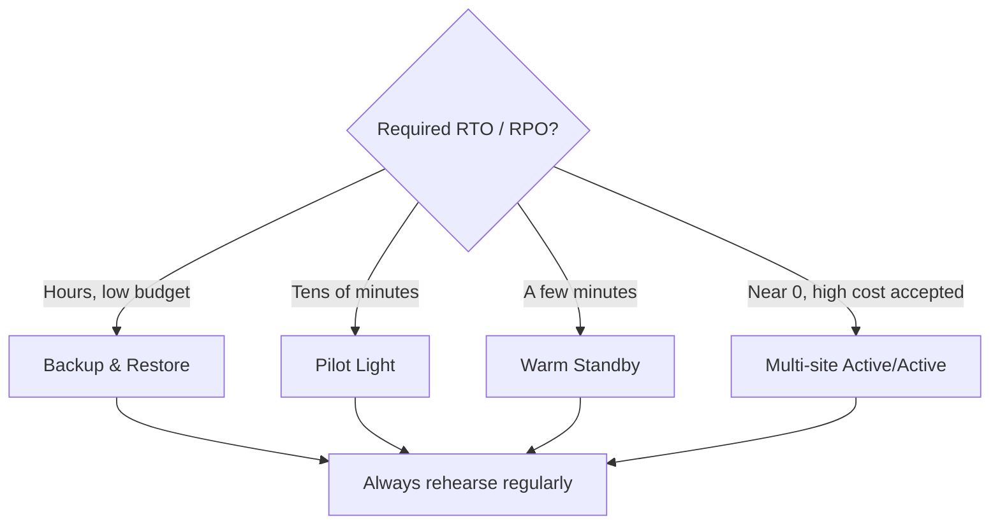

## 1. Core Concept

**Disaster Recovery (DR)** is the plan for restoring a system when a whole datacenter or Region is lost. Every DR decision revolves around two numbers: **RTO** (the maximum acceptable downtime) and **RPO** (the maximum acceptable data loss). The smaller the RTO and RPO, the **higher the cost**.

**Mental model:** DR is like **insurance**: you pay a regular premium in exchange for recovery speed; choose the plan by the damage the business can tolerate, not the most expensive plan.

## 2. How It Works

**RTO vs RPO → Two measures**
- **RTO**: how long until the system must run again. **RPO**: the maximum data loss measured in time (an RPO of 1 hour means backup/replication at least every hour).

**Four strategies → From cheap to expensive**
- **Backup & Restore**: periodic backups (S3, **AWS Backup**), rebuilt only when a disaster occurs; **RTO in hours**, the cheapest.
- **Pilot Light**: keep **the core** always running (for example a database replica), with the application tier off, turned on and scaled during a disaster; RTO in tens of minutes.
- **Warm Standby**: run **a fully scaled-down copy** in another Region, scaled up during a disaster; **RTO of minutes**.
- **Multi-site Active/Active**: run full environments in several Regions at once; RTO/RPO near 0 but **the most expensive** and complex (data synchronization, write conflicts).

**Tools**
- **AWS Backup**: one policy for schedules, retention and **cross-Region/cross-account copies**. **AWS Elastic Disaster Recovery (DRS)**: **continuous block-level replication** from source machines (on-prem or cloud) to AWS and launching instances during a disaster.
- Data: **Aurora Global Database** (~1 second), **S3 CRR**, **DynamoDB Global Tables**. Routing: **Route 53 failover** with health checks.

**Multi-AZ vs Multi-Region**
- Multi-AZ protects when **one datacenter** fails (**HA**); only a **cross-Region** deployment survives when **the whole Region** has a problem (**DR**).

## 3. Visual Diagram

## 4. Rules of Thumb & Trade-offs

| Situation / Need | What to choose |
| --- | --- |
| RTO in hours, low budget | Backup & Restore |
| RTO of tens of minutes | Pilot Light |
| RTO of a few minutes, medium budget | Warm Standby |
| RPO/RTO near 0, expensive accepted | Multi-site Active/Active |
| Protect against a single AZ failure | Multi-AZ (HA, not DR) |
| Centralized backup of many services | AWS Backup |

- **What you gain:** the system survives a disaster. **What you lose:** parallel infrastructure cost, data synchronization complexity and rehearsals.

## 5. Must Remember / Production Pitfalls

- **Confusing HA with DR → deploying only Multi-AZ and assuming DR exists → when a whole Region fails it still goes down; you need cross-Region**.
- **Choosing Active/Active for a system that does not need it → surplus cost and complexity → pick the strategy by real RTO/RPO**.
- **Backups exist but cannot be restored → never tested → rehearse restores and failovers regularly**.
- **Backups in the same account/Region as the source data → both are lost if compromised → copy cross-Region/cross-account**.
- **RPO does not match backup frequency → nightly backups but a 5-minute RPO requirement → use continuous replication**.
- Exam trap: "RTO of minutes, medium budget" → **Warm Standby**; "RTO in hours, low budget" → **Backup & Restore**; "RPO near 0, RTO of minutes, high cost accepted" → **Active/Active**.

## 6. Search Hooks

- `RTO vs RPO` — recovery time objective and acceptable data loss.
- `AWS disaster recovery strategies pilot light warm standby` — the four DR strategies.
- `AWS Elastic Disaster Recovery` — continuous replication and rebuilding servers.
- `AWS Backup cross-region cross-account` — centralized backup.
- `Multi-AZ vs Multi-Region` — HA versus DR.
