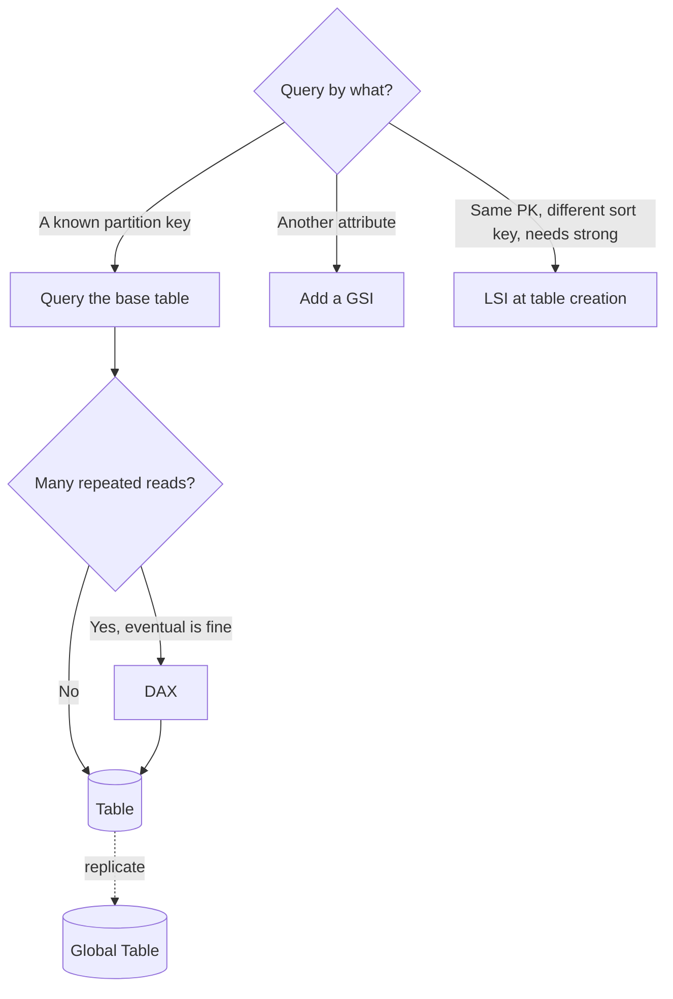

## 1. Core Concept

**Amazon DynamoDB** was built to solve near-unlimited horizontal scaling without patching, sharding or operating servers: every read/write by key keeps **single-digit millisecond** latency whether the table is a few GB or hundreds of TB. The price is that you only get fast access by **key** — everything else must be designed in advance.

**Mental model:** DynamoDB is like **a row of numbered filing cabinets**: you pull a file extremely fast if you know the cabinet number (the partition key), but if you must search every cabinet that is a `Scan` — expensive and slow. So table design starts from **access patterns**, not from entities.

## 2. How It Works

**Primary key → Distributing data**
- **Mechanism:** DynamoDB hashes the **partition key** to pick a physical partition; the **sort key** (if present) orders items within the same partition, enabling `begins_with` and `between`.
- **Real numbers:** each partition handles up to about **3,000 RCU and 1,000 WCU** and stores up to **10 GB**; an item is at most **400 KB**.
- **Impact:** keys with **high cardinality** (`customerId`, `orderId`) spread load evenly; skewed keys (`status = ACTIVE`, the current date) pile load onto one partition → a **hot partition** and throttling even when the table's total capacity is spare.

**Capacity (RCU/WCU) → Cost and throttling**
- **1 RCU** = one **strongly consistent** read of ≤ **4 KB**/second; **eventually consistent** reads get twice as many; a **transaction** costs double. **1 WCU** = one write of ≤ **1 KB**/second.
- **Example:** a 6 KB item read strongly consistently costs `ceil(6/4) = 2` RCU, read eventually consistently only `1` RCU; writing a 2.5 KB item costs `3` WCU.
- **Two modes:** **on-demand** (pay per request, no forecasting, suits unpredictable load but **is not always cheaper**) and **provisioned** (declare RCU/WCU, with auto scaling, cheaper for steady load).
- **Impact:** exceeding capacity → `ProvisionedThroughputExceededException`; the SDK **retries with exponential backoff** by itself.

**Query vs Scan → Latency and cost**
- `Query` touches only one partition key (and a sort key range), costing RCU by the amount of data **returned**; `Scan` reads the **whole table**, costing RCU by table size.

```python
table.query(
    KeyConditionExpression=Key("customerId").eq("c-42") & Key("orderDate").begins_with("2026-11")
)
```

**Secondary index → Querying by other attributes**
- **GSI:** an entirely different partition/sort key, **can be created at any time**, has **its own capacity**, and reads are **eventually consistent** only. Writes to a table whose GSI is throttled can **slow writes to the base table too**.
- **LSI:** the **same partition key**, a different sort key, **created only when the table is created**, at most **5**, supports strongly consistent reads, but limits each partition key value to **10 GB**.
- **Impact:** if you need to query by an attribute that is not the partition key → add a **GSI** instead of using `Scan` or raising RCU.

**DAX → A read cache**
- **DAX** is a **write-through** in-memory cache in front of the table, giving read latency around **microseconds**. It only serves **eventually consistent reads**; strongly consistent reads pass straight to the table.

**Global Tables → Multi-Region**
- Each Region has a **writable** replica (multi-active); conflicts are resolved by **last writer wins**. Used for **DR** and bringing data close to users; often paired with **Streams** (kept 24 hours) to trigger Lambda, **TTL** to expire items automatically and **PITR** to restore within 35 days.

## 3. Visual Diagram



## 4. Rules of Thumb & Trade-offs

| Situation / Need | What to choose |
| --- | --- |
| Key-based access at large scale (carts, sessions, IoT) | DynamoDB |
| Joins, ad-hoc reports, integrity constraints | RDS / Aurora |
| A new launch or spiky load | On-demand |
| Stable, predictable load | Provisioned + auto scaling |
| Querying by another attribute | GSI |
| Same partition key, needs strongly consistent | LSI (must be decided at table creation) |
| Repeated reads, microseconds needed | DAX |
| Writing in multiple Regions, DR | Global Tables |

- **What you gain:** scale and predictable latency, almost no operations.
- **What you lose:** **query flexibility** — changing access patterns later is costly (adding a GSI, backfilling, sometimes redesigning keys).

## 5. Must Remember / Production Pitfalls

- **Throttling although capacity remains → a hot partition → choose a high-cardinality key** (combined with a random suffix/shard if needed), avoid keys based on status or the current date.
- **RCU cost spikes → using `Scan` on a large table → use `Query` and GSIs**, limit results with projections and key-level filters.
- **You need an LSI but the table already exists → an LSI cannot be added later → decide at design time**; remember the 10 GB limit per partition key value.
- **Writes to the base table slow down → the GSI runs out of capacity and applies back-pressure → provision enough WCU for the GSI or use on-demand**.
- **Updates from two Regions get lost → last writer wins → design writes per Region or use conditional writes/versioning**.
- Exam trap: "a cache for DynamoDB" → **DAX** (ElastiCache is for complex query results); "writes in multiple Regions" → **Global Tables**; "query by a non-key attribute" → **a GSI**, not a Scan or more RCU.

## 6. Search Hooks

- `DynamoDB partition key design hot partition` — design keys that avoid overloading one partition.
- `DynamoDB RCU WCU calculation` — how to compute read and write capacity units.
- `DynamoDB GSI vs LSI` — the differences between the two secondary index types.
- `DynamoDB Accelerator DAX` — an in-memory write-through cache for DynamoDB.
- `DynamoDB Streams Lambda trigger` — react to data changes in near real time.
- `DynamoDB Global Tables` — multi-Region, multi-writer replication, last writer wins.
