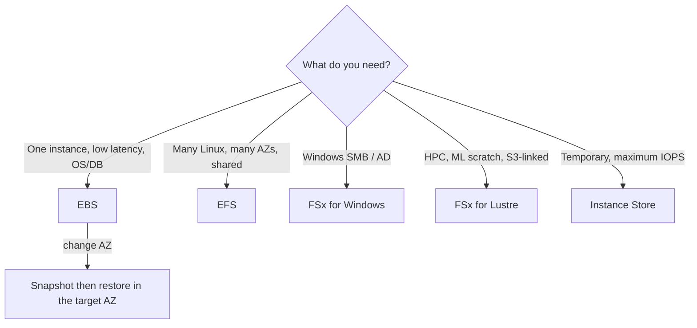

## 1. Core Concept

Besides S3 (object), EC2 uses three other storage families: **EBS** (block storage, like a disk attached to one machine), **EFS** (an NFS file system shared across many Linux machines) and **FSx** (managed file systems for Windows, HPC, NetApp and OpenZFS). Choosing the wrong family is often the cause of **AZ, performance or data-loss** errors.

**Mental model:** EBS is **a hard drive plugged into one machine in one room (AZ)**; EFS is **a network drive shared across the whole building**; Instance Store is **a scratch desk attached to the machine**, lost when the machine is removed; S3 is **a storage warehouse accessed through an API**, not a disk.

## 2. How It Works

**EBS → Block storage per AZ**
- A volume lives in **one AZ** and attaches to **one instance** (except **io1/io2 Multi-Attach**: up to 16 instances in the same AZ, where the application must handle concurrent writes itself).
- **gp3**: the default SSD, baseline **3,000 IOPS and 125 MiB/s**, with IOPS/throughput adjustable **independently** of size (up to 16,000 IOPS). **gp2** uses 3 IOPS/GB with **burst credits**: when credits run out, IOPS drop.
- **io2**: high, consistent IOPS for databases (up to 64,000, **io2 Block Express** up to 256,000). **st1/sc1**: throughput/cold HDDs, **not used as boot volumes**.
- **Snapshots**: incremental, stored in S3 (managed by AWS), copyable to another Region/AZ, can create an **AMI**; encrypted with KMS and the key is shared along with the snapshot. **Elastic Volumes** changes size/type while running.

**EFS → A shared file system**
- **NFSv4.1**, Linux only, **multi-AZ**, scales automatically, mounted by thousands of instances at once through **mount targets** (one per AZ, controlled with SGs).
- **Performance mode**: **General Purpose** (default, low latency) vs **Max I/O**. **Throughput mode**: **Bursting**, **Provisioned**, **Elastic**. **Lifecycle** moves infrequently used files to **EFS-IA/Archive**; there are cheaper **One Zone** classes.

**FSx → Purpose-built file systems**
- **FSx for Windows** (SMB, Active Directory integration), **FSx for Lustre** (HPC/ML, very high throughput, loads and writes data back from **S3**), **FSx for NetApp ONTAP** (NFS/SMB/iSCSI) and **FSx for OpenZFS**.

**Instance Store → Physically attached temporary disk**
- NVMe attached directly to the host, **very high IOPS**, but **data is lost on stop/terminate or hardware failure** (it survives a reboot). Use it for cache/buffers.

```bash
aws ec2 create-snapshot --volume-id vol-0abc --description "pre-upgrade"
aws ec2 create-volume --snapshot-id snap-0abc --availability-zone ap-southeast-1b
```

## 3. Visual Diagram



## 4. Rules of Thumb & Trade-offs

| Situation / Need | What to choose |
| --- | --- |
| Boot volume, ordinary database | EBS gp3 |
| A DB needing high, steady IOPS | EBS io2 |
| Shared Linux files across many AZs | EFS |
| A Windows/AD file server | FSx for Windows |
| High-speed HPC/ML | FSx for Lustre |
| Temporary cache/buffer, maximum IOPS | Instance Store |

- **What you gain:** the right type for the right workload. **What you lose:** EFS costs more than EBS per GB; EBS is tied to an AZ; Instance Store is not durable.

## 5. Must Remember / Production Pitfalls

- **You need to move EBS to another AZ → a volume is tied to an AZ → create a snapshot and restore in the target AZ**.
- **Data is lost after stopping an instance → it was stored on Instance Store → data you must keep belongs on EBS/EFS/S3**.
- **IOPS gradually drop on a gp2 volume → burst credits ran out → move to gp3 or io2**.
- **A multi-AZ app needs shared files → it used EBS so nothing is shared → EFS**.
- **Deleting an instance also deletes the data → Delete on Termination → on by default for the root volume, off by default for extra volumes**; check the setting.
- **EFS is slow with many small files → NFS latency per operation → bundle files or tune the throughput mode**.
- Exam trap: "a shared file system for multi-AZ EC2 Linux" → **EFS**; "a DB needing very high, steady IOPS" → **io2**; "Instance Store data on stop" → **lost**.

## 6. Search Hooks

- `EBS volume types gp3 io2` — the volume types and when to use them.
- `EBS Multi-Attach` — attaching io2 to several instances in the same AZ.
- `EFS performance modes throughput modes` — EFS performance modes.
- `FSx for Lustre S3 integration` — an HPC file system linked to S3.
- `EC2 Instance Store ephemeral` — a physically attached temporary disk, lost on stop.
