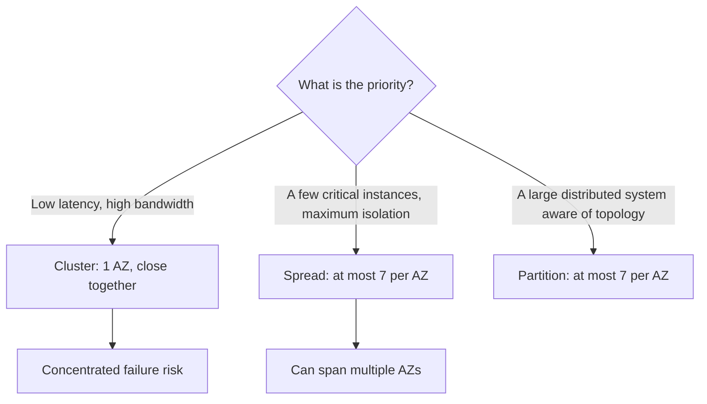

## 1. Core Concept

A **Placement Group** gives you control over the **physical location** of instances in the datacenter: close together for fast networking, or far apart so a hardware failure does not take the whole group down. It is the only way to trade **network performance** against **fault tolerance** at the hardware level.

**Mental model:** like arranging cars in a lot: **Cluster** is parking side by side in one row for fast relay running, but one fire ruins the whole row; **Spread** is one car per separate, distant slot; **Partition** is dividing into a few independent rows.

## 2. How It Works

**Cluster → Close together, fastest**
- Packs instances close together in **one AZ** (the same or neighboring racks), giving very low latency and high bandwidth (**single-flow up to 10 Gbps**, more with ENA/EFA). Suits HPC and tightly coupled computing.
- Trade-off: the risk of **concentrated hardware failure**. Use the same instance type and **launch everything at once**; on `InsufficientInstanceCapacity`, stop/start the group to retry.

**Spread → Maximum isolation**
- Each instance sits on **separate hardware** (its own rack, power and network). Limited to **7 running instances per AZ per group**, but a group can **span multiple AZs**. Suits a few extremely critical instances (master nodes, a primary DB).

**Partition → Groups of racks**
- Splits into at most **7 partitions per AZ**; each partition is its own set of racks that **shares no hardware** with other partitions, yet can hold **hundreds of instances**. The topology is visible through metadata so applications can place replicas in the right partition. Suits **HDFS, HBase, Cassandra, Kafka**.

**Changing placement**
- To move an instance into or out of a group, the instance must be **stopped**, and you must use the **AWS CLI/SDK** (`modify-instance-placement`); it **cannot be done in the console**. Two groups cannot be merged.

```bash
aws ec2 create-placement-group --group-name hpc --strategy cluster
aws ec2 run-instances --placement GroupName=hpc --count 8 ...
```

## 3. Visual Diagram



## 4. Rules of Thumb & Trade-offs

| Situation / Need | What to choose |
| --- | --- |
| HPC, MPI, low node-to-node latency | Cluster (+ EFA) |
| 3–5 critical instances that must not fail together | Spread |
| Large-scale Cassandra, Kafka, HDFS | Partition |
| No special requirement | No placement group needed |

- **What you gain:** control over performance or failure isolation. **What you lose:** Cluster sacrifices fault tolerance; Spread limits the count; Partition requires the application to understand topology.

## 5. Must Remember / Production Pitfalls

- **A Cluster group fails with `InsufficientInstanceCapacity` when growing gradually → nearby capacity is insufficient → launch the whole group at once, with the same instance type, or stop/start to retry**.
- **Using Spread for 100 instances → exceeds the 7-per-AZ limit → switch to Partition**.
- **Running a whole critical system in one Cluster → one rack failure loses everything → use Spread or Partition and span AZs**.
- **Trying to change placement in the console for a running instance → not possible → stop the instance and use the CLI/SDK**.
- **Cassandra/Kafka replicas in the same partition → the same rack fails together → place replicas in different partitions**.
- Exam trap: "HPC needs the lowest network latency" → **Cluster**; "a few extremely critical instances avoiding shared hardware failure" → **Spread**; "large Cassandra/Kafka/HDFS" → **Partition**.

## 6. Search Hooks

- `EC2 cluster placement group` — pack instances for low latency.
- `EC2 spread placement group limits` — hardware isolation, at most 7 per AZ.
- `EC2 partition placement group` — rack groups for distributed systems.
- `modify-instance-placement` — change placement when the instance is stopped.
- `InsufficientInstanceCapacity cluster placement` — the capacity error in a cluster.
