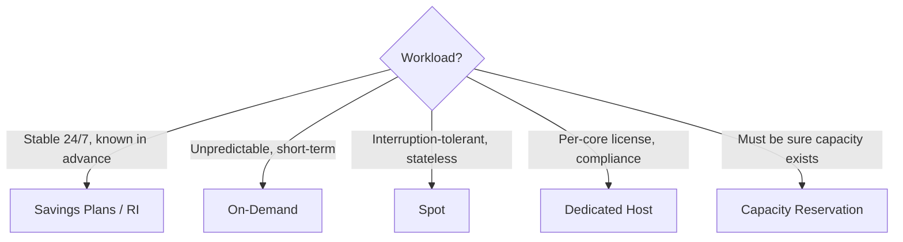

## 1. Core Concept

EC2 sells the same machine under several pricing models; choosing correctly can cut compute cost by **50–90%**. What you trade for the lower price is **a time commitment** or **the possibility of being reclaimed**.

**Mental model:** like **booking hotel rooms**: On-Demand is walk in and stay at list price; Reserved/Savings Plans are a cheap long-term contract; Spot is a last-minute empty room that is super cheap but you can be evicted; a Dedicated Host is renting a whole floor.

## 2. How It Works

**On-Demand → The most flexible**
- Billed **per second** (60-second minimum) for Linux/Windows, no commitment. The most expensive in shared tenancy but suits short-term, unpredictable load.

**Reserved Instances (RI) → A 1- or 3-year commitment**
- Discount **up to 72%**; choose All/Partial/No Upfront. **Standard RI** gives a bigger discount, **Convertible RI** can change the instance family (a smaller discount, up to ~66%).

**Savings Plans → A commitment in $/hour**
- Commit to spend **$/hour** for 1 or 3 years, discount **up to 72%**. **Compute Savings Plans** apply to EC2 (any family/Region), **Fargate** and **Lambda**; **EC2 Instance Savings Plans** are tied to one family in one Region, with a bigger discount.
- Impact: more flexible than RI when you change architecture.

**Spot → Cheapest, can be reclaimed**
- Discount **up to ~90%**; AWS can reclaim with a **2-minute warning**. Suitable only for **stateless, interruption-tolerant** workloads (batch, CI, image processing). Use diverse instance types/AZs to reduce the chance of reclamation.

**Dedicated Host / Instances → Hardware isolation**
- A **Dedicated Host** is a dedicated physical server where you see the **sockets/cores** to use **BYOL licenses** per core and satisfy compliance; the highest cost. A **Dedicated Instance** runs on dedicated hardware but you do not control the host.

**Capacity Reservation → Guarantee machines exist**
- Reserves capacity in an AZ by the hour, **with no automatic discount**; combine with Savings Plans/RI to lower the price.

**A combined example:** a web app with a stable baseline uses **Savings Plans**, the spikes use **On-Demand**, and background processing jobs use **Spot**, all in one **Auto Scaling Group** with a **mixed instances policy**.

## 3. Visual Diagram

## 4. Rules of Thumb & Trade-offs

| Situation / Need | What to choose |
| --- | --- |
| A stable, predictable baseline load | Savings Plans (or Reserved) |
| A new launch, unpredictable load | On-Demand |
| Nightly batch, interruption-tolerant | Spot |
| BYOL per socket/core | Dedicated Host |
| Using EC2, Fargate, Lambda and may change family | Compute Savings Plans |

- **What you gain:** up to 72% off (commitments) or ~90% (Spot). **What you lose:** flexibility when you commit wrongly, or having to accept reclamation with Spot.

## 5. Must Remember / Production Pitfalls

- **You bought RI/Savings Plans and then changed architecture → an unused commitment you still pay for → prefer Compute Savings Plans and review utilization**.
- **Running stateful or interruption-intolerant load on Spot → progress is lost when reclaimed → checkpointing, an ASG with several instance types, or move to On-Demand**.
- **Confusing Dedicated Instance with Dedicated Host → no per-core BYOL → choose Dedicated Host when you need to see sockets/cores**.
- **Thinking a Capacity Reservation gives a discount → it is still billed at On-Demand rates → combine with Savings Plans**.
- **Forgetting to stop dev environments after hours → wasted money → automatic stop schedules**.
- Exam trap: "interruption-tolerant batch, cheapest" → **Spot**; "per-socket/core license (BYOL) and compliance" → **Dedicated Host**; "flexible across EC2, Fargate, Lambda" → **Compute Savings Plans**.

## 6. Search Hooks

- `EC2 On-Demand vs Reserved vs Spot` — comparing the main pricing models.
- `AWS Savings Plans vs Reserved Instances` — two commitment forms.
- `EC2 Spot interruption notice` — the 2-minute warning and how to handle it.
- `EC2 Dedicated Host BYOL` — per-socket/core licensing.
- `EC2 Capacity Reservations` — reserving capacity per AZ.
