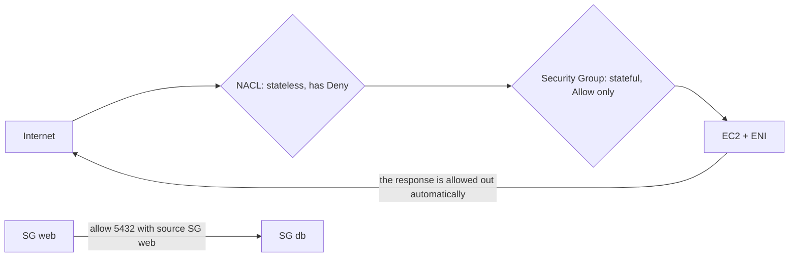

## 1. Core Concept

EC2 networking has two layers of traffic filtering — the **Security Group (SG)** at the instance level and the **Network ACL (NACL)** at the subnet level — plus interface components such as **ENI**, **ENA** and **EFA** that determine bandwidth and latency. They solve two problems: who may talk to the instance, and how fast they can talk.

**Mental model:** an SG is **a guard standing right at each room's door** (it remembers the people it let in, so they are not blocked on the way out), a NACL is **a checkpoint for a whole floor** (it remembers nothing, every entry and exit needs a rule).

## 2. How It Works

**Security Group → A stateful firewall at the ENI level**
- **Only Allow rules**, no Deny. A newly created SG: **inbound blocks everything, outbound allows everything**.
- **Stateful**: traffic allowed in has its response allowed out automatically, with no reverse-direction rule needed. Rule changes take effect immediately.
- A rule's source can be a CIDR, a prefix list or **another SG**. Example: the DB tier only allows port 5432 from the web tier's SG, so scaling the web tier to 50 instances needs no rule changes.

**Network ACL → A stateless firewall at the subnet level**
- It has both **Allow and Deny**, evaluated in **ascending rule number order**, stopping at the first matching rule. **Stateless**: you must open rules for the return direction too, including **ephemeral ports 1024–65535**.
- A VPC's default NACL allows everything; a NACL you create blocks everything by default. Use it when you need to **block a specific IP**, because an SG has no Deny.

**ENI → A virtual network card**
- An ENI has a **private IP**, a MAC address and its own SGs, and can have an **Elastic IP** attached. Attach extra ENIs to separate management/log networks, or **move the ENI to another instance** (in the same AZ) on failover while keeping the IP and MAC.

**ENA and EFA → Network performance**
- **ENA (Elastic Network Adapter)** gives bandwidth up to **100 Gbps**, high PPS and low latency, at no extra cost.
- **EFA (Elastic Fabric Adapter)** is ENA plus **OS-bypass** (libfabric/MPI/NCCL) for ultra-low-latency node-to-node communication, used for HPC and distributed ML training.

```bash
aws ec2 authorize-security-group-ingress --group-id sg-db \
  --protocol tcp --port 5432 --source-group sg-web
```

## 3. Visual Diagram



## 4. Rules of Thumb & Trade-offs

| Situation / Need | What to choose |
| --- | --- |
| Open ports for an application, referencing between tiers | Security Group (source is another SG) |
| Block an IP or a range of IPs | Network ACL (has Deny) |
| Failover keeping IP/MAC | Move the ENI to a standby instance |
| High bandwidth, low latency in general | ENA |
| HPC/ML across nodes, MPI | EFA (+ a Cluster placement group) |

- **What you gain:** SGs are compact and scale easily; NACLs add Deny and a second layer of blocking. **What you lose:** a stateless NACL easily misses the return direction, so use it only when really needed.

## 5. Must Remember / Production Pitfalls

- **You need to block a malicious IP but an SG has no Deny → add a Deny rule to the NACL** with a lower number than the Allow rules.
- **Connections come in but responses are dropped → the NACL lacks return-direction/ephemeral port rules → open 1024–65535 for the return direction**.
- **A 0.0.0.0/0 rule for SSH or a DB → exposed to the Internet → restrict by source SG, a bastion/SSM Session Manager**.
- **You need to keep an IP on failover → the IP is bound to the instance instead of an ENI → attach an Elastic IP/ENI and move the ENI**; remember an ENI can only move within the same AZ.
- **Confusing EFA with ENA → no OS-bypass so MPI is still slow → use EFA in a cluster placement group**.
- Exam trap: "block a specific IP" → **NACL**; "SG is stateful means" → **the response to allowed traffic passes automatically**; "referencing between tiers" → **the previous tier's SG as the source**.

## 6. Search Hooks

- `security group vs network ACL` — stateful or stateless, instance or subnet level.
- `security group referencing another security group` — reference an SG instead of IPs.
- `Elastic Network Interface ENI failover` — move the network card to keep the IP.
- `EC2 Enhanced Networking ENA` — high bandwidth, high PPS, low latency.
- `Elastic Fabric Adapter EFA HPC` — OS-bypass for node-to-node communication.
