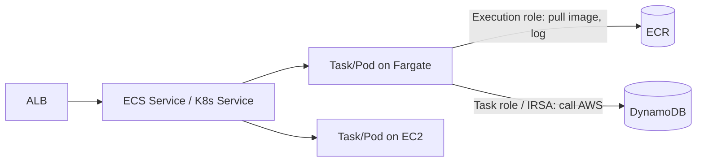

## 1. Core Concept

AWS has two container orchestrators: **ECS** (simple, deeply integrated with AWS) and **EKS** (managed Kubernetes), and two ways to provide compute: **EC2** (you manage the nodes) or **Fargate** (serverless, no nodes to manage). They solve running, scaling and updating containers without building a cluster from scratch.

**Mental model:** choose along **two independent axes**: (1) the orchestrator — ECS or EKS; (2) the compute — EC2 or Fargate. Also always distinguish **who is calling AWS**: the ECS agent (execution role) or the application in the container (task role).

## 2. How It Works

**ECS → Task Definition, Task, Service**
- A **Task Definition** describes the image, CPU/RAM, ports, environment variables and roles. A **Task** runs once; a **Service** keeps **N tasks** running continuously, replaces failed tasks, registers with an **ALB** and supports rolling or blue/green deployments (CodeDeploy).
- **Two easily confused roles:** the **Task Role** grants permissions to the **application** to call AWS (write DynamoDB, read S3); the **Execution Role** lets the **ECS agent** pull images from **ECR** and write CloudWatch logs.

**Fargate → No nodes to manage**
- You specify **vCPU/RAM** per task, **one ENI per task** in the VPC (`awsvpc`), billed per second; impact: no OS/AMI patching but a higher price per GB-hour than EC2 under steady load.
- Tasks in a **private subnet** need **NAT or VPC endpoints** to pull images from ECR.

**EKS → Managed Kubernetes**
- The **control plane** is operated by AWS (with an hourly fee). Workers: **managed node groups**, **Fargate profiles** or self-managed. Pods get IPs from the VPC through the VPC CNI.
- **Permissions for pods:** **IRSA** (IAM Roles for Service Accounts, using OIDC) or **EKS Pod Identity**, granting **a separate role per service account** with least privilege instead of using the node's role.
- **Scaling:** **HPA** (pods), **Cluster Autoscaler** or **Karpenter** (nodes, creating just the instance types needed, faster).

**ECR and others**
- **ECR** stores images, with **image scanning** and **lifecycle policies** to clean up old images. **App Runner** runs web apps from source/image with minimal configuration.

```json
{ "family": "orders",
  "taskRoleArn": "arn:aws:iam::123:role/orders-task",
  "executionRoleArn": "arn:aws:iam::123:role/ecsTaskExecution",
  "networkMode": "awsvpc" }
```

## 3. Visual Diagram



## 4. Rules of Thumb & Trade-offs

| Situation / Need | What to choose |
| --- | --- |
| Simple, no Kubernetes needed | ECS + Fargate |
| Already using K8s, need multi-cloud/ecosystem | EKS |
| GPU, daemons, steady load needing cost optimization | EC2 launch type |
| A small web app, minimal configuration | App Runner |
| Per-pod permissions on EKS | IRSA / Pod Identity |
| Fast, right-sized node scaling | Karpenter |

- **What you gain:** Fargate means less operations; EKS is flexible and portable. **What you lose:** Fargate costs more than EC2 for steady load; EKS is complex and has a control plane fee.

## 5. Must Remember / Production Pitfalls

- **A container reports AccessDenied calling DynamoDB/S3 → the Execution role was edited by mistake → edit the Task role**.
- **A task cannot pull the image in a private subnet → no outbound path → NAT or VPC endpoints for ECR/S3**.
- **Every pod shares the node's broad permissions → one pod's vulnerability exposes everything → IRSA/Pod Identity with least privilege**.
- **A task is OOM-killed → the memory limit is below real needs → raise memory/the container limit**.
- **A high Fargate bill with steady load → paying for vCPU/RAM all the time → consider EC2 + Savings Plans**.
- Exam trap: "don't want to manage servers for containers" → **Fargate**; "a container writes to DynamoDB" → **Task role**; "per-pod permissions on EKS" → **IRSA**.

## 6. Search Hooks

- `ECS task definition task role execution role` — distinguishing the two kinds of roles.
- `AWS Fargate vs EC2 launch type` — choosing compute for containers.
- `EKS IRSA IAM roles for service accounts` — per-pod permissions.
- `Karpenter vs Cluster Autoscaler` — node scaling for EKS.
- `Amazon ECR image scanning lifecycle policy` — managing and scanning images.
